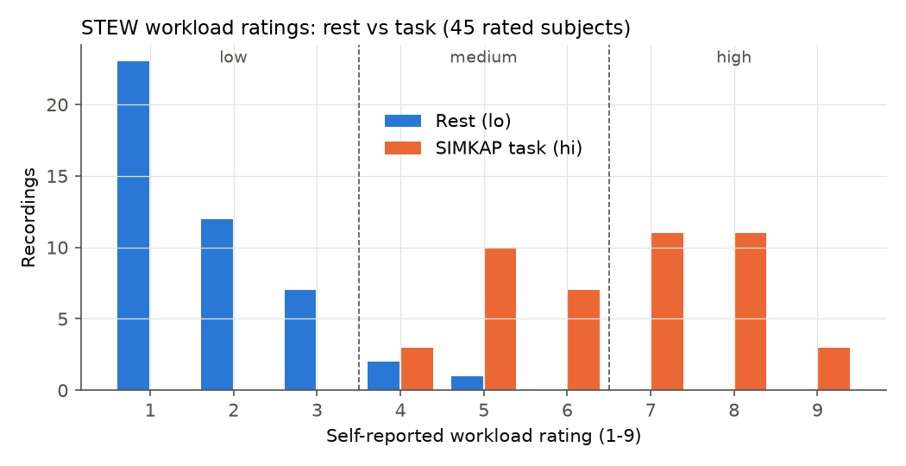
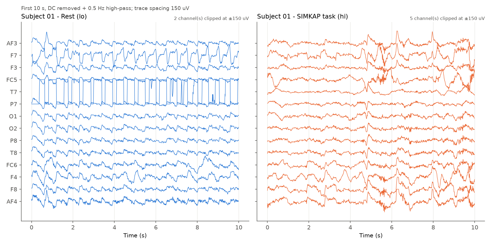
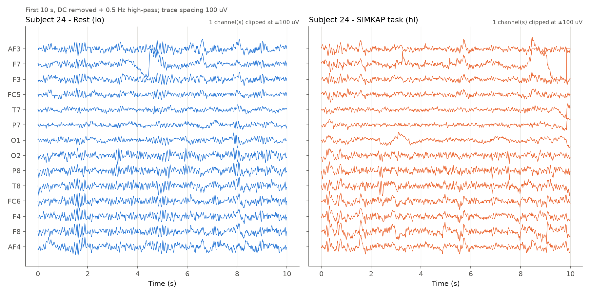
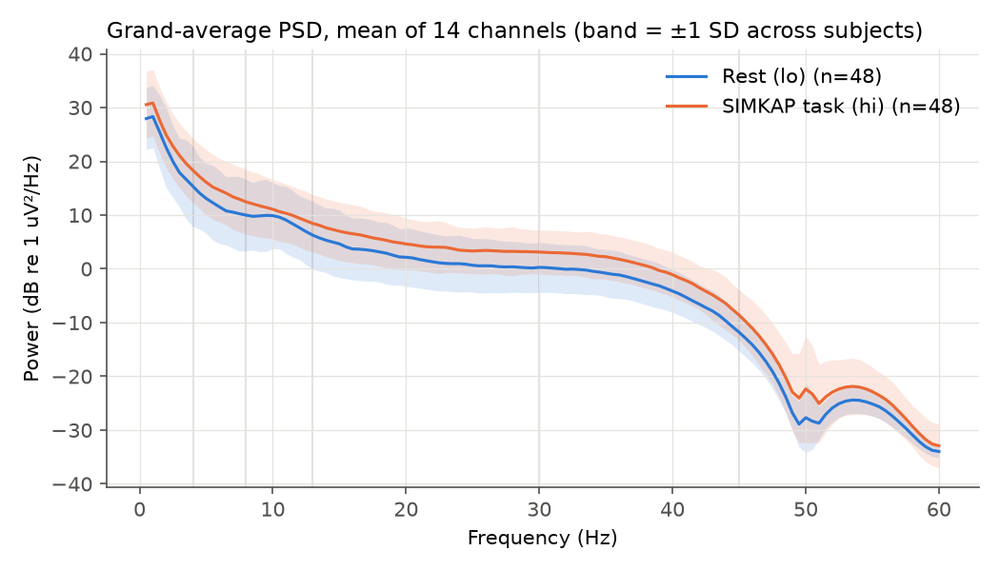
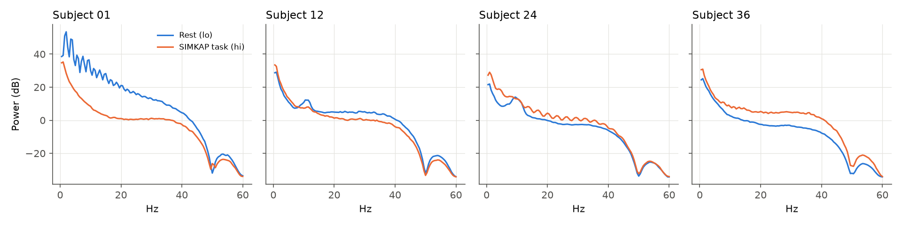

# 2. Dataset — STEW

## 2.1 What STEW is
**STEW (Simultaneous Task EEG Workload)** is a public mental-workload EEG dataset. The code cites it as
"Lim et al., 2018" (`src/eegengine/io/stew.py`, module docstring). Full reference (to verify against the
publisher before submission): W. L. Lim, O. Sourina and L. P. Wang, "STEW: Simultaneous Task EEG
Workload Data Set", *IEEE Transactions on Neural Systems and Rehabilitation Engineering*, 26(11), 2018;
distributed through IEEE DataPort. The local copy used here was downloaded as `STEW Dataset.zip`.

| Property | Value | Source |
|---|---|---|
| Subjects | 48 [`results/eda/dataset_summary.json` → `n_subjects`] | EDA summary |
| Recordings | 96 [`results/eda/dataset_summary.json` → `n_recordings`] (2 per subject) | EDA summary |
| Headset | Emotiv EPOC, 14 channels (saline electrodes) | `src/eegengine/io/stew.py` |
| Channels (file column order) | AF3, F7, F3, FC5, T7, P7, O1, O2, P8, T8, FC6, F4, F8, AF4 | `src/eegengine/io/stew.py:CHANNELS` |
| Sampling rate | 128 [`results/eda/dataset_summary.json` → `fs`] Hz | EDA summary |
| Samples per recording | 19200 [`results/eda/dataset_summary.json` → `shape.1`] = 150 s = 2.5 min | EDA summary |
| Conditions | `subXX_lo.txt` = rest (eyes open, no task); `subXX_hi.txt` = SIMKAP multitasking test | `stew.py` docstring |
| Rating | self-reported workload after each recording, 1–9 scale | `ratings.txt` |
| Subjects without a rating | 5, 24, 42 | `results/eda/dataset_summary.json` → `subjects_missing_rating` |
| File format | plain text, whitespace separated, no header, 19 200 rows × 14 columns (samples × channels) | `stew.py:read_signal_file` |
| Units / DC offset | µV with a large Emotiv DC offset: mean 4333.0 [`results/eda/dataset_summary.json` → `raw_dc_offset_uv.mean`] µV (range 3611.0 [`results/eda/dataset_summary.json` → `raw_dc_offset_uv.min`]–4945.6 [`results/eda/dataset_summary.json` → `raw_dc_offset_uv.max`] µV) | EDA summary |
| Typical EEG amplitude after DC removal + 0.5 Hz HP | median channel std 22.9 [`results/eda/dataset_summary.json` → `clean_channel_std_uv_median`] µV | EDA summary |

**SIMKAP** ("Simultaneous Capacity", from the Vienna Test System) is a multitasking test: the subject
works on a visual comparison/cancellation task while simultaneously answering questions that interrupt
it. In STEW it is the high-workload condition. (Task description summarised from the STEW publication;
the repository only states "SIMKAP multitasking test".)

**Electrode positions.** The 14 channels are standard 10-20/10-10 positions. MNE's montages
`colin27_1020`, `standard_1020` and `standard_1005` give identical coordinates for these 14 electrodes
(max difference 0.0 mm, checked in Phase 2; `docs/decisions.md` D5). The 2-D head-map positions used by
the dashboard were projected from that montage (`frontend/src/lib/eeg.ts:POS`). Coverage: frontal
(AF3, AF4, F3, F4, F7, F8, FC5, FC6), temporal (T7, T8), parietal (P7, P8), occipital (O1, O2). There
are **no midline (Fz, Cz, Pz) and no EOG electrodes**, which matters for eye-artefact handling (§3.5).

### Loader
`src/eegengine/io/stew.py:load_stew` reads all 96 files with pandas' C whitespace parser
(`read_signal_file`), transposes samples × channels → `(14, 19200)` `float64`, validates the shape and
finiteness, attaches the rating from `load_ratings`, and returns `Recording` dataclasses
(`subject_id, condition, rating, data, fs, ch_names`). A `.npz` cache (`data/processed/stew_raw_cache.npz`)
makes later loads fast. `to_mne_raw` converts a recording to an `mne.io.RawArray` (µV → V) with the 10-20 montage.

## 2.2 Why STEW
* **Same headset as the planned system.** STEW was recorded with the Emotiv EPOC — the 14-channel,
  128-Hz consumer headset the project intends to use — so channel layout, sampling rate, noise
  characteristics (saline electrodes, on-board filtering at ~43 Hz, DC offset) and file format match
  what the team will collect.
* **Public workload labels.** It provides a condition label (rest vs multitasking) and a self-rated
  workload score per recording, which allows supervised training and evaluation now.
* **Pilot / validation role.** The proposal (§2.14 according to the brief; the document is NOT AVAILABLE)
  positions STEW as a pilot dataset to build and validate the pipeline before the team-collected
  Emotiv data with attention/fatigue/readiness labels exists. Everything is config-driven so the same
  pipeline runs on the team data later (README "Plugging in the team-collected Emotiv data").

## 2.3 Label tasks
Built by `src/eegengine/labels.py:add_labels`; masked labels are stored as `-1` and **no subject is ever
dropped** — each task selects its rows with `labels.py:task_view` (mask = label ≥ 0).

| Task | Column | Definition | Why |
|---|---|---|---|
| **T1 workload_binary** | `y_binary` | lo (rest) = 0 "low", hi (SIMKAP) = 1 "high"; all 48 subjects | the dataset's primary contrast |
| **T2 workload_level** | `y_level` | each recording's own rating: 1–3 low (0), 4–6 medium (1), 7–9 high (2); unrated masked | graded workload from self-report |
| **T3 workload_within_task** | `y_within` | **task recordings only**: rating 4–6 moderate (0), 7–9 high (1); rest recordings and unrated subjects masked | confound-free workload test (see §2.4) |

`labels.py:within_task_label` returns −1 for `lo` recordings, for missing ratings and (defensively) for
task ratings ≤ 3 (none exist in STEW). `io/stew.py:rating_to_level` maps 1–3/4–6/7–9 → 0/1/2 and NaN → −1.

### Class counts
<!-- BEGIN TABLE:labels -->
| Task | Unit | N labelled | Subjects | Class counts | By condition (lo / hi) |
|---|---|---|---|---|---|
| workload_binary | recordings | 96 | 48 | low 48, high 48 | lo: 48/0; hi: 0/48 |
| workload_level | recordings | 90 | 45 | low 42, medium 23, high 25 | lo: 42/3/0; hi: 0/20/25 |
| workload_within_task | recordings | 45 | 45 | moderate 20, high 25 | lo: 0/0; hi: 20/25 |
| workload_binary | epochs | 7104 | 48 | low 3552, high 3552 | lo: 3552/0; hi: 0/3552 |
| workload_level | epochs | 6660 | 45 | low 3108, medium 1702, high 1850 | lo: 3108/222/0; hi: 0/1480/1850 |
| workload_within_task | epochs | 3330 | 45 | moderate 1480, high 1850 | lo: 0/0; hi: 1480/1850 |

Source: `results/preprocessing/label_counts.json`
<!-- END TABLE:labels -->

Note on a fixed bug: `scripts/run_preprocess.py` writes `docs/labels.md`. Until this report was written,
running the 2-s epoch variant (`configs/preprocess_2s.yaml`) overwrote it with 2-s epoch counts
(149 epochs per recording). The recording-level counts were never affected. The script now writes
`docs/labels.md` only for the default 4-s configuration and the 2-s run writes its own copy to
`results/preprocessing_2s/labels.md`.

## 2.4 The confound analysis — why T2 ≈ T1 and why T3 matters
Self-reported ratings by condition:
<!-- BEGIN TABLE:ratings -->
| Rating (1–9) | Rest (lo) recordings | Task (hi) recordings |
|---|---|---|
| 1 | 23 | 0 |
| 2 | 12 | 0 |
| 3 | 7 | 0 |
| 4 | 2 | 3 |
| 5 | 1 | 10 |
| 6 | 0 | 7 |
| 7 | 0 | 11 |
| 8 | 0 | 11 |
| 9 | 0 | 3 |

Source: `results/eda/dataset_summary.json` → `rating_distribution`
<!-- END TABLE:ratings -->

* Rest is rated 1.80 [`results/eda/dataset_summary.json` → `lo_vs_hi_ratings.rest_mean`] ± 1.01 on average (median
  1.0 [`results/eda/dataset_summary.json` → `lo_vs_hi_ratings.rest_median`]); the task 6.58 [`results/eda/dataset_summary.json` → `lo_vs_hi_ratings.task_mean`]
  ± 1.42 (median 7.0 [`results/eda/dataset_summary.json` → `lo_vs_hi_ratings.task_median`]).
* The task was rated higher than rest by **every** rated subject: 45 [`results/eda/dataset_summary.json` → `lo_vs_hi_ratings.n_task_gt_rest`]
  of 45; mean difference 4.78 [`results/eda/dataset_summary.json` → `lo_vs_hi_ratings.diff_mean`]. Wilcoxon signed-rank
  on the paired ratings: W = 0.0 [`results/eda/dataset_summary.json` → `lo_vs_hi_ratings.wilcoxon_stat`],
  p = 4.3e-09 [`results/eda/dataset_summary.json` → `lo_vs_hi_ratings.wilcoxon_p`] (`scripts/explore_dataset.py`).
* Mapped to T2 levels, rest recordings are low/medium/high = 42/3/0 and task recordings 0/20/25
  (`results/eda/dataset_summary.json` → `level_by_condition`). **No rest recording is "high" and no task
  recording is "low".** A T2 classifier can therefore score well simply by recognising rest vs task: T2
  mostly re-measures T1.
* T1 itself is confounded: rest vs SIMKAP differs not only in mental workload but also in eye movements
  (reading a screen), hand/arm movement (responding), visual input and arousal. EEG differences between
  the two recordings are therefore not purely "workload".
* **T3 removes the condition confound**: both classes come from the same SIMKAP condition, same setup
  and same session; only the self-reported workload differs (moderate 4–6 vs high 7–9). It is the
  honest test of whether EEG tracks *how hard the task felt*. Its weakness: only 45 labelled recordings,
  one per subject (20 moderate, 25 high), so every subject carries a single class — per-subject
  macro-F1 is undefined and LOSO fold metrics cannot be computed (§5.2).

## 2.5 Exploratory data analysis
Produced by `scripts/explore_dataset.py` → `results/eda/`.

*Figure 2.1 — Self-rated workload for rest vs task; dashed lines = T2 level boundaries.*

*Figure 2.2 — First 10 s of subject 01, DC removed + 0.5 Hz high-pass, ±spacing clipped for display.
In the rest recording channel T7 swings rail to rail (a broken/saturated electrode) — later detected
in 100 % of its windows and interpolated (§3.6).*

*Figure 2.3 — Subject 24 (one of the three unrated subjects).*

*Figure 2.4 — Grand-average PSD (mean of 14 channels) for rest vs task, band = ±1 SD across subjects.
The task recordings have higher power at almost all frequencies, consistent with more muscle/eye
activity and arousal during the task; the dip at 50 Hz and the steep fall above ~43 Hz are the Emotiv's
on-board notch and low-pass filters.*

*Figure 2.5 — Rest vs task PSD for subjects 01, 12, 24, 36: the direction of the difference is
consistent but its size varies strongly between people — one reason subject-wise evaluation matters.*

Other EDA facts: the signals are finite everywhere (`tests/test_stew_loader.py:test_shapes_and_metadata`)
and every recording has exactly 19 200 samples.
