# Technical source report — EEG Neuro-Cognitive Understanding Engine (Component 1)

**SLIIT IT4010 · Project J26-DS-333 · "EEG Neuro-Cognitive Understanding Engine for Cognitive State Detection"**
Component 1 of the group project *Neuroadaptive Learning System Using EEG, Computer Vision, and Agentic AI*.

This is the complete, factual source report of what is implemented in `component1/` of the
repository, written so that it can be turned into a polished progress report and viva guide.

## How to read this report
* **Everything here describes code that exists.** Code is referenced as `path/to/file.py:function_name`.
* **Every results number comes from a file.** In prose it is written as
  `value [`results/…/file.json` → `key.path`]`; tables are generated by `scripts/build_report.py`
  directly from the files in `results/` and carry a *Source* column or line. `scripts/build_report.py`
  re-checks every citation and every table against the files (result: `docs/report/verification.json`).
* **NOT AVAILABLE** marks information that does not exist in the repository.
* **DEVIATION FROM PROPOSAL** marks a difference from the planned method, with the reason.
* **The proposal document itself (`docs/proposal.docx`) is NOT AVAILABLE in the repository.** Wherever the
  report refers to the proposal it uses the requirements as written in the author's phase brief
  (which summarises proposal sections §1.4, §3 and §4.6–4.15). Section numbers of the proposal could
  therefore not be verified against the document — see `docs/decisions.md` D1.

## Contents
| File | Content |
|---|---|
| `01_overview.md` | Problem, role in the 4-component system, objectives + status, key findings, pipeline diagram, timeline |
| `02_dataset.md` | STEW dataset, labels T1/T2/T3, confound analysis, EDA |
| `03_preprocessing.md` | DC removal, filtering, notch, ICA, bad channels, epoching, normalisation, signal quality |
| `04_features.md` | Spectral, entropy/Hjorth, wavelet, PLV, coherence, graph features (formulas, counts) |
| `05_classical_models.md` | LR, SVM, RF, XGBoost, cross-validation design, feature ablation, statistics |
| `06_deep_models.md` | EEGNet, CNN-LSTM, hybrid CNN-LSTM-Transformer-GAT, training, ablation, calibration, latency |
| `07_evaluation_and_results.md` | Metrics, master results table, rest-baseline inflation, confusion matrices, leakage audit, interpretation |
| `08_system_architecture.md` | Repository, inference engine, output contract, FastAPI, React dashboard, how to run, tests |
| `09_proposal_alignment.md` | Requirement-by-requirement implementation status and deviations |
| `10_limitations_future.md` | Limitations and prioritised future work |
| `11_viva_guide.md` | Spoken summaries, demo script, 60+ examiner questions with answers, glossary, cheat sheet |
| `12_appendix.md` | Full configs, decisions log, figures list, code index, dependencies, references |
| `FULL_REPORT.md` | All of the above, concatenated |
| `figures/` | Every figure referenced in the report (PNG) |
| `verification.json` | Output of the number cross-check |

Repository state described: branch `dev`, `component1/` (see the commit timeline in `01_overview.md`).


---

# 1. Overview

## 1.1 The problem
A neuroadaptive learning system has to know, moment by moment, how the learner's brain is coping —
is the material overloading them, are they disengaged, tired, ready to learn? Self-reports interrupt
learning and are delayed; behaviour (clicks, answers) is indirect. EEG measures brain activity
directly and continuously at low cost with consumer headsets such as the Emotiv EPOC (14 channels,
128 Hz). The problem Component 1 solves is: **turn a raw, noisy 14-channel consumer EEG stream into
calibrated, timestamped estimates of the learner's cognitive state every 2 seconds, with an honest
signal-quality flag, in a format the other components can consume.**

## 1.2 Role of Component 1 in the 4-component system
The group project *Neuroadaptive Learning System Using EEG, Computer Vision, and Agentic AI* has four
components. Component 1 (this report) is the EEG engine. The repository also contains a folder
`Component 4/` (another member's work: `api.py`, `policy_service.py`, `algorithms/`, `llm/` …); its
content is outside this report. The roles of the other components are taken from the author's brief
(the proposal itself is NOT AVAILABLE in the repository):

| Consumer | What it receives from Component 1 | Contract field(s) |
|---|---|---|
| Multimodal fusion (EEG + computer vision) | per-window workload probabilities + confidence + signal quality, timestamped | `states.workload.*`, `signal_quality.*`, `timestamp_start/end` |
| Explainable AI (XAI) | the evidence behind a state: per-channel band power and the connectivity matrix | `band_power`, `connectivity` |
| Cueing / adaptive pedagogy agent | the current state label and whether it is trustworthy | `states.*.label/value`, `signal_quality.flag`, `source` |
| Dashboard (this component) | everything above + the raw display signal | WebSocket `raw` + `state` messages |

**Inputs:** raw EEG, 14 channels in Emotiv order (AF3 F7 F3 FC5 T7 P7 O1 O2 P8 T8 FC6 F4 F8 AF4),
µV, 128 Hz, either streamed in chunks (`src/eegengine/inference/engine.py:CognitiveEngine.push`) or uploaded
(`POST /predict`). **Outputs:** one `CognitiveStateOutput` JSON object per 4-s window every 2 s
(`src/eegengine/inference/schema.py`, documented in `docs/output_contract.md`, schema
`docs/output_contract.schema.json`).

## 1.3 Objectives and status
The proposal's objective list (§3) is NOT AVAILABLE as a document; the objectives below are those of
the author's brief, which states the component goal. Status uses the evidence in the repository.

| # | Objective | Status | Evidence |
|---|---|---|---|
| O1 | Reproducible EEG acquisition/loading pipeline for the Emotiv EPOC format | **Done** (offline files); live headset acquisition **Not done** | `src/eegengine/io/stew.py`; no LSL/Emotiv SDK code exists |
| O2 | Signal-quality assessment (flat, amplitude, variance, EMG, line noise), windows marked not deleted | **Done** | `src/eegengine/quality/checks.py`, `results/quality/`, `results/preprocessing/` |
| O3 | Preprocessing: DC removal, 0.5–45 Hz zero-phase band-pass, 50 Hz notch, optional ICA, bad-channel interpolation | **Done** (ICA implemented but OFF by default) | `src/eegengine/preprocess/*`, `configs/preprocess.yaml` |
| O4 | Epoching 4 s / 50 % overlap (2 s variant) + normalisation options | **Done**; 2-s variant preprocessed but **not evaluated** | `results/preprocessing_2s/preprocess_summary.json` |
| O5 | Feature extraction: spectral, entropy, wavelet, PLV, coherence, graph | **Done** (1,499 features) | `src/eegengine/features/*`, `results/features/feature_summary.json` |
| O6 | Classical baselines (LR, SVM, RF, XGBoost) with LOSO | **Done** | `results/cls_*_loso/` |
| O7 | Feature-family ablation A1–A5 + statistics | **Done** (T1, T3; T2 only "all") | `results/cls_*_xgb_A*`, `results/stats_classical.json` |
| O8 | Deep models: EEGNet, CNN-LSTM, hybrid CNN-LSTM-Transformer-GAT (multi-task) | **Done** | `src/eegengine/models/deep/*`, `results/deep_*` |
| O9 | Architecture ablation A6–A10 | **Done** (T1, T3) | `results/deep_*`, `results/stats_deep.json` |
| O10 | Calibrated probabilities (temperature scaling) + ECE + reliability diagram | **Done**; calibration does not improve every model | `results/deep_*/reliability.png` |
| O11 | Cognitive states: workload | **Done** (trained) | T1/T3 models in `models/` |
| O12 | Cognitive states: attention, fatigue, learning readiness | **Partial** — heads exist and are masked; outputs are **heuristic indices, not trained predictions** (no labels in STEW) | `src/eegengine/models/deep/hybrid.py`, `src/eegengine/inference/heuristics.py` |
| O13 | Real-time inference engine + JSON output contract for teammates | **Done** | `src/eegengine/inference/engine.py`, `docs/output_contract.md` |
| O14 | FastAPI backend (REST + WebSocket) | **Done** | `api/main.py`, `tests/test_engine_api.py` |
| O15 | React dashboard (6 pages, offline demo mode) | **Done** | `frontend/` |
| O16 | Leakage audit, reproducibility, tests, documentation | **Done** | `docs/leakage_audit.md`, `scripts/run_all.py`, 105 test cases |
| O17 | Training on team-collected Emotiv data | **Not done** (data not yet collected) | README "Plugging in the team-collected Emotiv data" |

## 1.4 Key findings (one paragraph)
On STEW, rest vs SIMKAP multitasking (T1) is detected well across unseen subjects: the best classical
model, XGBoost on all 1,499 features, reaches a leave-one-subject-out pooled macro-F1 of
0.865 [`results/cls_T1_xgb_all_none_loso/metrics.json` → `pooled.macro_f1`] (AUROC
0.941 [`results/cls_T1_xgb_all_none_loso/metrics.json` → `pooled.auroc`]) and, scored on 18-s windows over
5 subject folds, a fold macro-F1 of 0.915 [`results/cls_T1_xgb_all_none_kfold5/metrics.json` → `sequence_level.per_fold.macro_f1.mean`].
Connectivity features (PLV/coherence) are the family that adds most (spectral only
0.810 [`results/cls_T1_xgb_A1_spectral_none_loso/metrics.json` → `pooled.macro_f1`] → spectral + connectivity
0.866 [`results/cls_T1_xgb_A4_spectral_connectivity_none_loso/metrics.json` → `pooled.macro_f1`],
Wilcoxon p = 5.4e-05 [`results/stats_classical.json` → `tests.2.p_value`]). The deep models are clearly worse on
the same folds and windows (best: A8 CNN-LSTM-Transformer 0.773 [`results/deep_T1_A8_cnn_lstm_trans_kfold5/metrics.json` → `per_fold.macro_f1.mean`];
full hybrid 0.758 [`results/deep_T1_A10_hybrid_kfold5/metrics.json` → `per_fold.macro_f1.mean`]; XGBoost better,
p = 4.0e-06 [`results/stats_deep.json` → `tests.5.p_value`]). However, when the rest/task confound is removed
— moderate vs high self-rated workload *within* the task (T3) — every model is at chance (XGBoost LOSO pooled
macro-F1 0.538 [`results/cls_T3_xgb_all_none_loso/metrics.json` → `pooled.macro_f1`], AUROC
0.544 [`results/cls_T3_xgb_all_none_loso/metrics.json` → `pooled.auroc`]). So the engine reliably detects
"doing a demanding task vs resting", but on 45 STEW recordings it does **not** detect graded workload
within a task. Normalising features with each subject's own rest recording inflates T1 (XGBoost
0.865 → 0.924 [`results/cls_T1_xgb_all_rest_baseline_loso/metrics.json` → `pooled.macro_f1`]); a label-permutation
control gives chance (0.506 [`results/leakage_audit.json` → `permutation_test.mean_balanced_accuracy`]), confirming
no cross-subject leakage.

## 1.5 End-to-end pipeline
```mermaid
flowchart LR
    A["Raw EEG<br/>14 ch · 128 Hz · µV<br/>(STEW .txt / live chunks)"] --> B["Signal quality<br/>flat · amplitude · variance z<br/>EMG 30–45 Hz · 50 Hz line"]
    B --> C["Preprocessing<br/>mean removal · FIR 0.5–45 Hz<br/>notch 50 Hz · (ICA off)<br/>bad-channel spline interpolation"]
    C --> D["Epoching<br/>4 s windows · 2 s step<br/>74 per recording"]
    D --> E["Features (1,499)<br/>spectral · entropy/Hjorth · DWT<br/>PLV · coherence · graph"]
    D --> F["Deep inputs<br/>raw epochs (14×512)<br/>sequences of 8 epochs"]
    E --> G["Classical models<br/>LR · SVM · RF · XGBoost"]
    E -- "band power (nodes)<br/>PLV (edges)" --> H
    F --> H["Deep models<br/>EEGNet · CNN-LSTM ·<br/>CNN+LSTM+Transformer+GAT"]
    G --> I["Calibrated probabilities<br/>(temperature scaling for deep)"]
    H --> I
    I --> J["EMA smoothing<br/>+ heuristic indices<br/>(attention · fatigue · readiness)"]
    J --> K["CognitiveStateOutput JSON<br/>every 2 s"]
    K --> L["FastAPI REST + WebSocket"]
    L --> M["React dashboard"]
    L --> N["Fusion · XAI · Cueing<br/>(other components)"]
```

## 1.6 Development timeline (git log of `component1/`)
<!-- BEGIN TABLE:timeline -->
| Commit | Date (+0530) | Message |
|---|---|---|
| 06f9da1 | 2026-10-03 12:44 | Data importing |
| bf0525d | 2026-10-19 12:53 | Set up eeg-engine project skeleton, environment and CLAUDE.md |
| 20cab38 | 2026-10-19 12:53 | Add STEW loader and workload label builder with tests |
| d3e0efc | 2026-10-19 12:53 | Add signal quality checks and quality report |
| d4db526 | 2026-10-19 12:53 | Add dataset exploration script and EDA outputs |
| bb7ce78 | 2026-10-19 13:28 | Phase 2: preprocessing, bad-channel repair, epoching, labels |
| 39b1cb5 | 2026-10-19 13:33 | Phase 3: spectral, entropy, wavelet, PLV/coherence and graph features |
| 81d6950 | 2026-10-19 15:25 | Phase 4-6 code: classical runner, deep models, inference engine and API |
| f31c2a6 | 2026-10-19 15:30 | Phase 7: React dashboard (6 pages, live + offline demo mode) and model/CV tests |
| 2850052 | 2026-10-19 20:04 | Phase 4-5 results: classical LOSO baselines, feature ablation, 5-fold classical and deep runs |
| daed308 | 2026-10-19 20:25 | Phase 8: verification, leakage audit, docs and packaging |
| f8f0a83 | 2026-10-19 20:47 | EEG Neuro-Cognitive Understanding Engine with STEW pipeline, models, API and dashboard |
| 59d5fb8 | 2026-10-19 21:32 | Fix dashboard 'CORS' failure: API errors on missing data, add Vite /api proxy |
| dc54076 | 2026-10-19 21:52 | summery |

Source: `git log -- component1`
<!-- END TABLE:timeline -->

All work after the initial data import was done on 19 October 2026 on branch
`EEG-Neuro-Cognitive-Understanding-Engine`, merged into `dev` via pull request #4 (merge commit
`08ad2a1` in the repository history). The test suite has 89 test functions = 105 collected test
cases (see `08_system_architecture.md` §8.9).


---

# 2. Dataset — STEW

## 2.1 What STEW is
**STEW (Simultaneous Task EEG Workload)** is a public mental-workload EEG dataset. The code cites it as
"Lim et al., 2018" (`src/eegengine/io/stew.py`, module docstring). Full reference (to verify against the
publisher before submission): W. L. Lim, O. Sourina and L. P. Wang, "STEW: Simultaneous Task EEG
Workload Data Set", *IEEE Transactions on Neural Systems and Rehabilitation Engineering*, 26(11), 2018;
distributed through IEEE DataPort. The local copy used here was downloaded as `STEW Dataset.zip`.

| Property | Value | Source |
|---|---|---|
| Subjects | 48 [`results/eda/dataset_summary.json` → `n_subjects`] | EDA summary |
| Recordings | 96 [`results/eda/dataset_summary.json` → `n_recordings`] (2 per subject) | EDA summary |
| Headset | Emotiv EPOC, 14 channels (saline electrodes) | `src/eegengine/io/stew.py` |
| Channels (file column order) | AF3, F7, F3, FC5, T7, P7, O1, O2, P8, T8, FC6, F4, F8, AF4 | `src/eegengine/io/stew.py:CHANNELS` |
| Sampling rate | 128 [`results/eda/dataset_summary.json` → `fs`] Hz | EDA summary |
| Samples per recording | 19200 [`results/eda/dataset_summary.json` → `shape.1`] = 150 s = 2.5 min | EDA summary |
| Conditions | `subXX_lo.txt` = rest (eyes open, no task); `subXX_hi.txt` = SIMKAP multitasking test | `stew.py` docstring |
| Rating | self-reported workload after each recording, 1–9 scale | `ratings.txt` |
| Subjects without a rating | 5, 24, 42 | `results/eda/dataset_summary.json` → `subjects_missing_rating` |
| File format | plain text, whitespace separated, no header, 19 200 rows × 14 columns (samples × channels) | `stew.py:read_signal_file` |
| Units / DC offset | µV with a large Emotiv DC offset: mean 4333.0 [`results/eda/dataset_summary.json` → `raw_dc_offset_uv.mean`] µV (range 3611.0 [`results/eda/dataset_summary.json` → `raw_dc_offset_uv.min`]–4945.6 [`results/eda/dataset_summary.json` → `raw_dc_offset_uv.max`] µV) | EDA summary |
| Typical EEG amplitude after DC removal + 0.5 Hz HP | median channel std 22.9 [`results/eda/dataset_summary.json` → `clean_channel_std_uv_median`] µV | EDA summary |

**SIMKAP** ("Simultaneous Capacity", from the Vienna Test System) is a multitasking test: the subject
works on a visual comparison/cancellation task while simultaneously answering questions that interrupt
it. In STEW it is the high-workload condition. (Task description summarised from the STEW publication;
the repository only states "SIMKAP multitasking test".)

**Electrode positions.** The 14 channels are standard 10-20/10-10 positions. MNE's montages
`colin27_1020`, `standard_1020` and `standard_1005` give identical coordinates for these 14 electrodes
(max difference 0.0 mm, checked in Phase 2; `docs/decisions.md` D5). The 2-D head-map positions used by
the dashboard were projected from that montage (`frontend/src/lib/eeg.ts:POS`). Coverage: frontal
(AF3, AF4, F3, F4, F7, F8, FC5, FC6), temporal (T7, T8), parietal (P7, P8), occipital (O1, O2). There
are **no midline (Fz, Cz, Pz) and no EOG electrodes**, which matters for eye-artefact handling (§3.5).

### Loader
`src/eegengine/io/stew.py:load_stew` reads all 96 files with pandas' C whitespace parser
(`read_signal_file`), transposes samples × channels → `(14, 19200)` `float64`, validates the shape and
finiteness, attaches the rating from `load_ratings`, and returns `Recording` dataclasses
(`subject_id, condition, rating, data, fs, ch_names`). A `.npz` cache (`data/processed/stew_raw_cache.npz`)
makes later loads fast. `to_mne_raw` converts a recording to an `mne.io.RawArray` (µV → V) with the 10-20 montage.

## 2.2 Why STEW
* **Same headset as the planned system.** STEW was recorded with the Emotiv EPOC — the 14-channel,
  128-Hz consumer headset the project intends to use — so channel layout, sampling rate, noise
  characteristics (saline electrodes, on-board filtering at ~43 Hz, DC offset) and file format match
  what the team will collect.
* **Public workload labels.** It provides a condition label (rest vs multitasking) and a self-rated
  workload score per recording, which allows supervised training and evaluation now.
* **Pilot / validation role.** The proposal (§2.14 according to the brief; the document is NOT AVAILABLE)
  positions STEW as a pilot dataset to build and validate the pipeline before the team-collected
  Emotiv data with attention/fatigue/readiness labels exists. Everything is config-driven so the same
  pipeline runs on the team data later (README "Plugging in the team-collected Emotiv data").

## 2.3 Label tasks
Built by `src/eegengine/labels.py:add_labels`; masked labels are stored as `-1` and **no subject is ever
dropped** — each task selects its rows with `labels.py:task_view` (mask = label ≥ 0).

| Task | Column | Definition | Why |
|---|---|---|---|
| **T1 workload_binary** | `y_binary` | lo (rest) = 0 "low", hi (SIMKAP) = 1 "high"; all 48 subjects | the dataset's primary contrast |
| **T2 workload_level** | `y_level` | each recording's own rating: 1–3 low (0), 4–6 medium (1), 7–9 high (2); unrated masked | graded workload from self-report |
| **T3 workload_within_task** | `y_within` | **task recordings only**: rating 4–6 moderate (0), 7–9 high (1); rest recordings and unrated subjects masked | confound-free workload test (see §2.4) |

`labels.py:within_task_label` returns −1 for `lo` recordings, for missing ratings and (defensively) for
task ratings ≤ 3 (none exist in STEW). `io/stew.py:rating_to_level` maps 1–3/4–6/7–9 → 0/1/2 and NaN → −1.

### Class counts
<!-- BEGIN TABLE:labels -->
| Task | Unit | N labelled | Subjects | Class counts | By condition (lo / hi) |
|---|---|---|---|---|---|
| workload_binary | recordings | 96 | 48 | low 48, high 48 | lo: 48/0; hi: 0/48 |
| workload_level | recordings | 90 | 45 | low 42, medium 23, high 25 | lo: 42/3/0; hi: 0/20/25 |
| workload_within_task | recordings | 45 | 45 | moderate 20, high 25 | lo: 0/0; hi: 20/25 |
| workload_binary | epochs | 7104 | 48 | low 3552, high 3552 | lo: 3552/0; hi: 0/3552 |
| workload_level | epochs | 6660 | 45 | low 3108, medium 1702, high 1850 | lo: 3108/222/0; hi: 0/1480/1850 |
| workload_within_task | epochs | 3330 | 45 | moderate 1480, high 1850 | lo: 0/0; hi: 1480/1850 |

Source: `results/preprocessing/label_counts.json`
<!-- END TABLE:labels -->

Note on a fixed bug: `scripts/run_preprocess.py` writes `docs/labels.md`. Until this report was written,
running the 2-s epoch variant (`configs/preprocess_2s.yaml`) overwrote it with 2-s epoch counts
(149 epochs per recording). The recording-level counts were never affected. The script now writes
`docs/labels.md` only for the default 4-s configuration and the 2-s run writes its own copy to
`results/preprocessing_2s/labels.md`.

## 2.4 The confound analysis — why T2 ≈ T1 and why T3 matters
Self-reported ratings by condition:
<!-- BEGIN TABLE:ratings -->
| Rating (1–9) | Rest (lo) recordings | Task (hi) recordings |
|---|---|---|
| 1 | 23 | 0 |
| 2 | 12 | 0 |
| 3 | 7 | 0 |
| 4 | 2 | 3 |
| 5 | 1 | 10 |
| 6 | 0 | 7 |
| 7 | 0 | 11 |
| 8 | 0 | 11 |
| 9 | 0 | 3 |

Source: `results/eda/dataset_summary.json` → `rating_distribution`
<!-- END TABLE:ratings -->

* Rest is rated 1.80 [`results/eda/dataset_summary.json` → `lo_vs_hi_ratings.rest_mean`] ± 1.01 on average (median
  1.0 [`results/eda/dataset_summary.json` → `lo_vs_hi_ratings.rest_median`]); the task 6.58 [`results/eda/dataset_summary.json` → `lo_vs_hi_ratings.task_mean`]
  ± 1.42 (median 7.0 [`results/eda/dataset_summary.json` → `lo_vs_hi_ratings.task_median`]).
* The task was rated higher than rest by **every** rated subject: 45 [`results/eda/dataset_summary.json` → `lo_vs_hi_ratings.n_task_gt_rest`]
  of 45; mean difference 4.78 [`results/eda/dataset_summary.json` → `lo_vs_hi_ratings.diff_mean`]. Wilcoxon signed-rank
  on the paired ratings: W = 0.0 [`results/eda/dataset_summary.json` → `lo_vs_hi_ratings.wilcoxon_stat`],
  p = 4.3e-09 [`results/eda/dataset_summary.json` → `lo_vs_hi_ratings.wilcoxon_p`] (`scripts/explore_dataset.py`).
* Mapped to T2 levels, rest recordings are low/medium/high = 42/3/0 and task recordings 0/20/25
  (`results/eda/dataset_summary.json` → `level_by_condition`). **No rest recording is "high" and no task
  recording is "low".** A T2 classifier can therefore score well simply by recognising rest vs task: T2
  mostly re-measures T1.
* T1 itself is confounded: rest vs SIMKAP differs not only in mental workload but also in eye movements
  (reading a screen), hand/arm movement (responding), visual input and arousal. EEG differences between
  the two recordings are therefore not purely "workload".
* **T3 removes the condition confound**: both classes come from the same SIMKAP condition, same setup
  and same session; only the self-reported workload differs (moderate 4–6 vs high 7–9). It is the
  honest test of whether EEG tracks *how hard the task felt*. Its weakness: only 45 labelled recordings,
  one per subject (20 moderate, 25 high), so every subject carries a single class — per-subject
  macro-F1 is undefined and LOSO fold metrics cannot be computed (§5.2).

## 2.5 Exploratory data analysis
Produced by `scripts/explore_dataset.py` → `results/eda/`.


*Figure 2.1 — Self-rated workload for rest vs task; dashed lines = T2 level boundaries.*


*Figure 2.2 — First 10 s of subject 01, DC removed + 0.5 Hz high-pass, ±spacing clipped for display.
In the rest recording channel T7 swings rail to rail (a broken/saturated electrode) — later detected
in 100 % of its windows and interpolated (§3.6).*


*Figure 2.3 — Subject 24 (one of the three unrated subjects).*


*Figure 2.4 — Grand-average PSD (mean of 14 channels) for rest vs task, band = ±1 SD across subjects.
The task recordings have higher power at almost all frequencies, consistent with more muscle/eye
activity and arousal during the task; the dip at 50 Hz and the steep fall above ~43 Hz are the Emotiv's
on-board notch and low-pass filters.*


*Figure 2.5 — Rest vs task PSD for subjects 01, 12, 24, 36: the direction of the difference is
consistent but its size varies strongly between people — one reason subject-wise evaluation matters.*

Other EDA facts: the signals are finite everywhere (`tests/test_stew_loader.py:test_shapes_and_metadata`)
and every recording has exactly 19 200 samples.


---

# 3. Preprocessing and signal quality

All steps are driven by `configs/preprocess.yaml` (reproduced in full in the appendix) and run by
`src/eegengine/preprocess/pipeline.py:preprocess_recording` for each recording, from
`scripts/run_preprocess.py`. Order:

```
raw (µV, DC offset) → mean removal → FIR band-pass 0.5–45 Hz → FIR notch 50 Hz
  → persistent bad-channel detection + spherical-spline interpolation → (optional ICA, OFF)
  → per-window quality flags → 4-s epochs, 2-s step (+ metadata) → normalisation option
```
Output: `data/processed/epochs_6d7dd612.npz` with `X` of shape 7104 × 14 × 512
(`results/preprocessing/preprocess_summary.json` → `X_shape`), plus a metadata table (one row per epoch:
subject, condition, rating, epoch index, t_start, t_end, quality flag, quality score, bad channels,
interpolated channels, y_binary, y_level, y_within). The file name contains a SHA-1 hash of the
configuration (`pipeline.py:config_hash`), so a changed setting can never silently reuse old epochs.

## 3.1 DC removal
* **What:** subtract each channel's mean over the recording, `x'(t) = x(t) − mean(x)`.
* **Why:** the Emotiv adds a constant offset of about 4333 µV (mean 4333.0 [`results/eda/dataset_summary.json` → `raw_dc_offset_uv.mean`])
  that has nothing to do with brain activity and would dominate every amplitude-based computation.
* **How:** `src/eegengine/preprocess/filters.py:filter_recording` (first line). For the raw quality report
  and EDA, `src/eegengine/preprocess/dc.py:remove_dc` additionally applies a 4th-order zero-phase
  Butterworth high-pass at 0.5 Hz (`scipy.signal.sosfiltfilt`).
* **Limitation:** mean removal alone leaves slow drift; that is removed by the band-pass below.

## 3.2 Band-pass 0.5–45 Hz (zero-phase FIR)
* **What:** a linear-phase finite-impulse-response filter that keeps 0.5–45 Hz. `mne.filter.filter_data`
  designs a windowed-sinc filter (`fir_design="firwin"`, Hamming window) and applies it with
  `phase="zero"`, i.e. the filter delay is compensated so peaks are not shifted in time.
* **Parameters:** l_freq 0.5 [`configs/preprocess.yaml` → `filter.l_freq`] Hz, h_freq 45.0 [`configs/preprocess.yaml` → `filter.h_freq`] Hz,
  padding `reflect_limited`. With MNE's automatic rules the transition bands are 0.5 Hz at the low edge and
  11.25 Hz at the high edge (−6 dB at ≈ 50.6 Hz) and the filter length is chosen automatically by MNE
  (≈ 3.3 / 0.5 Hz ≈ 6.6 s for a Hamming window) — derived from MNE's documented defaults, `docs/decisions.md` D11.
* **Why these edges:** 0.5 Hz removes electrode drift and sweat potentials but keeps delta; 45 Hz keeps
  the gamma band used by the features (30–45 Hz) while staying below the 50 Hz mains frequency and the
  Emotiv's own ~43 Hz low-pass. **Why FIR + zero phase:** linear phase does not distort the waveform shape
  or the phase relations between channels — essential because PLV (§4.4) measures phase differences. An
  IIR (Butterworth) filter would be shorter but has non-linear phase unless run forwards-backwards.
* **How:** `src/eegengine/preprocess/filters.py:bandpass`. Input/output `(channels, samples)` µV.
* **Produced:** see the before/after PSDs in §3.9. Tested in `tests/test_preprocess.py`
  (`test_bandpass_passes_in_band`: gain 0.97–1.03 at 10/30 Hz; `test_bandpass_attenuates_out_of_band`:
  gain < 0.1 at 0.05 and 58 Hz; `test_bandpass_is_zero_phase`: lag 0 samples).
* **Limitation:** the long (several-second) filter needs context; in real time the engine filters the
  last 20 s and keeps the newest 4 s (§8.2). Band powers agree with offline filtering within 5 %
  (`tests/test_engine_api.py:test_engine_band_power_close_to_offline`).

## 3.3 Notch 50 Hz
* **What:** a narrow FIR band-stop at the mains frequency (`mne.filter.notch_filter`, zero phase).
* **Why:** Sri Lanka's mains electricity is 50 Hz [`configs/preprocess.yaml` → `filter.notch_freq`]; power-line
  interference appears as a sharp peak there. With the 45 Hz low-pass and the Emotiv's on-board notch it is
  largely redundant for STEW, but it is cheap and protects other headsets/rooms (`configs/preprocess.yaml` comment).
* **How:** `src/eegengine/preprocess/filters.py:notch`; skipped automatically if the frequency is above Nyquist (64 Hz).
* **Tested:** `test_notch_removes_50hz` (gain < 0.1 at 50 Hz, > 0.97 at 20 Hz).

## 3.4 Signal-quality checks (per window, per channel)
* **What:** five checks on every 4-s window (2-s step) and every channel, implemented in
  `src/eegengine/quality/checks.py:channel_metrics` and `assess_window`. Each window is first linearly
  detrended (`scipy.signal.detrend`) so slow drift is not mistaken for an artefact (`docs/decisions.md` D6).

| Check | Metric | Threshold | Rationale |
|---|---|---|---|
| flat | channel std | < 0.5 [`configs/preprocess.yaml` → `quality.flat_std_uv`] µV | disconnected/saturated electrode (Emotiv LSB ≈ 0.51 µV) |
| amplitude | max abs(x) of the detrended window | > 150.0 [`configs/preprocess.yaml` → `quality.max_abs_uv`] µV | blinks, movement, electrode pops; 150 µV is a common upper bound for clean scalp EEG |
| variance | robust z-score of log-variance across the 14 channels: `z = (v − median) / (1.4826 · MAD)` | abs(z) > 3.5 [`configs/preprocess.yaml` → `quality.var_z_thresh`] | one channel far noisier/quieter than the others in the same window; median/MAD are robust to the outlier itself |
| hf (EMG) | P(30–45 Hz) / P(1–45 Hz) from Welch (1-s segments) | > 0.25 [`configs/preprocess.yaml` → `quality.hf_ratio_thresh`] | muscle (EMG) contamination is broadband high-frequency power |
| line | mean PSD within ±1 Hz of 50 Hz / mean PSD at 2–5 Hz from it | > 10.0 [`configs/preprocess.yaml` → `quality.line_ratio_thresh`] | power-line interference peak |

* **Blink tolerance** (`docs/decisions.md` D7): a failure on a frontal channel (AF3, AF4, F7, F8) that is
  *only* amplitude and/or variance with max |x| < 300.0 [`configs/preprocess.yaml` → `quality.blink_max_uv`] µV is
  counted as a blink. Blinks lower the score and make the window "warn" but never "bad": they are
  normal, frequent, and present at inference time too.
* **Window verdict:** `score = 1 − n_bad_channels / 14`; `n_hard` = bad channels that are not blink-like;
  flag = **good** (no bad channel), **bad** (n_hard > 2), otherwise **warn**. Windows are only **marked**;
  nothing is deleted. Experiments can exclude bad windows from *training* (`exclude_bad_windows`), but
  this was not used (all reported runs train on all windows).

### DEVIATION FROM PROPOSAL — EMG band 30–45 Hz instead of > 45 Hz
The first implementation measured high-frequency power above 45 Hz. On STEW that ratio was ≈ 0.001 even in
noisy recordings, because the **Emotiv EPOC low-pass filters on board at about 43 Hz**, so almost no power
exists above 45 Hz. The check was moved inside the passband (30–45 Hz) where muscle activity is visible
(`docs/decisions.md` D4).

### Quality on the raw signal (current rules)
<!-- BEGIN TABLE:phase1_quality -->
| Check | Windows with ≥ 1 channel failing it |
|---|---|
| flat | 0 |
| amplitude | 3487 |
| variance | 2740 |
| hf | 352 |
| line | 452 |

Window flags: good 0.3554, warn 0.5214, bad 0.1232 (n = 7104). Most often bad channels (mean fraction of windows): AF3 0.208, F8 0.197, T7 0.190, F7 0.186, AF4 0.177, F3 0.137.

Worst recordings (bad windows / total): sub14_lo 70/74, sub25_hi 69/74, sub40_hi 69/74, sub44_hi 54/74, sub37_lo 33/74, sub02_hi 24/74

Source: `results/quality/quality_summary.json` (raw signal: mean removal + 0.5 Hz high-pass; current quality rules)
<!-- END TABLE:phase1_quality -->

### Raw vs filtered vs final flag rates
<!-- BEGIN TABLE:quality_rates -->
| Stage (same rules, 4-s windows, 2-s step) | good | warn | bad |
|---|---|---|---|
| Raw (mean removal + 0.5 Hz Butterworth HP) | 0.3554 | 0.5214 | 0.1232 |
| After 0.5–45 Hz FIR + 50 Hz notch | 0.2972 | 0.5674 | 0.1354 |
| After interpolation of persistent bad channels (FINAL) | 0.3722 | 0.5053 | 0.1225 |

n_windows = 7104. Source: `results/preprocessing/quality_raw_vs_filtered.json`
<!-- END TABLE:quality_rates -->

Filtering *increases* the share of flagged windows before interpolation (good 0.355 [`results/preprocessing/quality_raw_vs_filtered.json` → `raw_dc_removed.good`]
→ 0.297 [`results/preprocessing/quality_raw_vs_filtered.json` → `filtered.good`]): the FIR's gentle 0.5 Hz transition
band passes slightly more 0.25–0.5 Hz drift than the Butterworth used for the raw report, and persistently
broken channels are still present. After interpolation of persistently bad channels the final rates are
good 0.372 [`results/preprocessing/quality_raw_vs_filtered.json` → `filtered_interpolated_final.good`],
warn 0.505 [`results/preprocessing/quality_raw_vs_filtered.json` → `filtered_interpolated_final.warn`],
bad 0.123 [`results/preprocessing/quality_raw_vs_filtered.json` → `filtered_interpolated_final.bad`].

### Choosing the amplitude threshold
<!-- BEGIN TABLE:sweep -->
| Amplitude threshold (filtered signal) | good | warn | bad |
|---|---|---|---|
| 100 µV | 0.1332 | 0.6029 | 0.2639 |
| 120 µV | 0.1989 | 0.6095 | 0.1916 |
| 150 µV | 0.2972 | 0.5674 | 0.1354 |
| 200 µV | 0.4041 | 0.5006 | 0.0953 |

Source: `results/preprocessing/quality_raw_vs_filtered.json` → `amplitude_threshold_sweep_filtered`
<!-- END TABLE:sweep -->

100 µV would mark 0.264 [`results/preprocessing/quality_raw_vs_filtered.json` → `amplitude_threshold_sweep_filtered.100.bad`]
of windows bad — too strict for a consumer headset; 200 µV only 0.095 [`results/preprocessing/quality_raw_vs_filtered.json` → `amplitude_threshold_sweep_filtered.200.bad`].
150 µV was chosen as the conventional upper bound for clean EEG (D7).

## 3.5 ICA (optional, default OFF)
* **What:** Independent Component Analysis unmixes the 14 channels into statistically independent
  sources; eye-blink sources can be removed and the signal rebuilt.
* **How:** `src/eegengine/preprocess/ica.py:run_ica` — MNE `ICA` with `method="fastica"`,
  n_components 13 [`configs/preprocess.yaml` → `ica.n_components`], fit on a 1-Hz high-passed copy, then
  `find_bads_eog` with **AF3 and AF4 as EOG proxies** (the Emotiv has no EOG electrode), z-threshold
  3.0 [`configs/preprocess.yaml` → `ica.eog_z_thresh`], at most 2 components removed; every decision is logged.
* **Why it is OFF by default:** (1) without a real EOG channel, AF3/AF4 contain frontal *brain* activity
  too — removing "AF3-like" components risks deleting frontal theta, which is the most workload-related
  rhythm; (2) with only 14 channels ICA has few components and separation is imperfect; (3) blinks are
  already handled by quality flags and will also be present in live use, so models should be robust to
  them; (4) a deterministic, simpler pipeline is easier to reproduce and defend.
* **Produced (demo run, `run_preprocess.py --ica-demo`):**
<!-- BEGIN TABLE:ica -->
| Recording | ICA components | Removed (EOG-like) | max |correlation score| |
|---|---|---|---|
| sub01_lo | 13 | none | — |
| sub01_hi | 13 | [0] | [0.947] |
| sub38_lo | 13 | [0] | [0.969] |
| sub38_hi | 13 | none | — |

Source: `results/preprocessing/ica_demo_log.json` (demo run only — ICA is OFF in the main pipeline)
<!-- END TABLE:ica -->

* **Limitation:** the effect of ICA on classification was not evaluated (NOT AVAILABLE).

## 3.6 Persistent bad channels + spherical-spline interpolation
* **What:** a channel that is broken for most of a recording is rebuilt from its neighbours with
  spherical-spline interpolation (Perrin et al., 1989, as implemented in MNE `interpolate_bads`).
* **Rule** (`src/eegengine/preprocess/bad_channels.py:detect_bad_channels`, D8): a channel is persistently
  bad if it is flat or *hard*-failing (amplitude / abnormally HIGH variance / EMG / line, blink-like
  failures excluded) in ≥ 0.6 [`configs/preprocess.yaml` → `bad_channels.min_bad_fraction`] of the windows,
  **or** its *median* per-window std is > 4.0 [`configs/preprocess.yaml` → `bad_channels.max_std_ratio`] × that of the
  median channel. The median is used so a few huge spikes cannot condemn a whole channel (those windows are
  flagged instead). Low variance alone is not a reason. At most 3 [`configs/preprocess.yaml` → `bad_channels.max_interpolated`]
  of 14 channels are rebuilt per recording (worst first).
* **How:** `bad_channels.py:interpolate_channels` builds an `mne.io.RawArray` with the 10-20 montage, sets
  `info["bads"]` and calls `interpolate_bads(mode="accurate")`.
* **Produced:** 30 [`results/preprocessing/preprocess_summary.json` → `n_channels_interpolated`] channels in
  26 [`results/preprocessing/preprocess_summary.json` → `n_recordings_with_interpolation`] recordings; none detected
  but left un-interpolated. Every decision:
<!-- BEGIN TABLE:interp -->
| Recording | Channel | Reason(s) | Fraction of windows hard-bad | Median-window std ratio | Interpolated |
|---|---|---|---|---|---|
| sub01_lo | T7 | noisy+huge | 1.0 | 61.58 | yes |
| sub01_lo | FC6 | noisy | 0.784 | 2.69 | yes |
| sub02_hi | T7 | noisy | 0.838 | 2.35 | yes |
| sub02_hi | FC6 | noisy | 0.635 | 1.65 | yes |
| sub04_lo | P8 | noisy | 0.676 | 2.42 | yes |
| sub04_hi | AF3 | huge | 0.459 | 4.54 | yes |
| sub06_lo | FC5 | noisy+huge | 0.946 | 4.27 | yes |
| sub07_lo | T7 | noisy | 0.77 | 0.59 | yes |
| sub13_lo | P8 | noisy+huge | 0.946 | 8.63 | yes |
| sub14_lo | F7 | noisy | 0.635 | 3.13 | yes |
| sub17_lo | FC5 | noisy+huge | 0.743 | 5.29 | yes |
| sub19_lo | FC5 | noisy+huge | 0.716 | 4.26 | yes |
| sub22_lo | F8 | huge | 0.297 | 4.68 | yes |
| sub23_hi | F3 | noisy+huge | 1.0 | 11.44 | yes |
| sub27_hi | F3 | noisy | 0.932 | 2.5 | yes |
| sub27_hi | FC6 | noisy | 0.797 | 1.26 | yes |
| sub28_hi | F7 | huge | 0.122 | 4.22 | yes |
| sub30_lo | F7 | noisy+huge | 0.973 | 17.82 | yes |
| sub30_lo | AF3 | huge | 0.392 | 8.12 | yes |
| sub30_hi | FC6 | noisy+huge | 0.986 | 8.92 | yes |
| sub33_lo | T7 | noisy+huge | 0.892 | 6.87 | yes |
| sub34_hi | T7 | noisy+huge | 0.635 | 8.22 | yes |
| sub38_lo | F3 | noisy+huge | 0.973 | 6.69 | yes |
| sub38_hi | F3 | noisy+huge | 1.0 | 36.98 | yes |
| sub40_lo | AF3 | noisy+huge | 1.0 | 8.37 | yes |
| sub40_hi | AF3 | noisy+huge | 0.932 | 6.23 | yes |
| sub41_lo | F3 | noisy+huge | 1.0 | 22.56 | yes |
| sub45_lo | F7 | huge | 0.027 | 4.08 | yes |
| sub45_hi | FC5 | noisy | 0.635 | 2.35 | yes |
| sub46_hi | AF4 | huge | 0.027 | 4.23 | yes |

30 channels in 26 recordings. Source: `results/preprocessing/interpolation_log.csv`
<!-- END TABLE:interp -->

* **Tested:** `tests/test_preprocess.py:test_bad_channel_detected_and_interpolated` (a synthetic broken T7 is
  found, rebuilt from neighbours to < 30 µV std, other channels untouched) and
  `test_pipeline_one_recording` (sub01_lo T7 is interpolated).
* **Limitation:** interpolation with only 14 sparse electrodes is approximate; frontal/temporal edge
  channels have few neighbours.

## 3.7 Epoching
* **What/how:** `src/eegengine/preprocess/epoching.py:make_epochs` cuts each cleaned recording into windows
  of 4.0 [`configs/preprocess.yaml` → `epoching.window_s`] s with a 2.0 [`configs/preprocess.yaml` → `epoching.step_s`] s
  step (50 % overlap) using a strided view: 74 [`results/preprocessing/preprocess_summary.json` → `epochs_per_recording`]
  epochs per 150-s recording, 7104 epochs in total. Quality windows use the same grid, so each epoch carries
  its own flag.
* **Why 4 s:** long enough for stable spectra (Welch with 2-s segments → 0.5 Hz resolution) and for phase
  estimates down to delta (4 cycles at 1 Hz); short enough to track changes. **Why 50 % overlap:** doubles
  the number of training windows and gives the engine an output every 2 s.
* **2-s variant:** `configs/preprocess_2s.yaml` (2-s windows, 1-s step) produces 149 epochs per recording
  (`results/preprocessing_2s/preprocess_summary.json` → `epochs_per_recording`) with a lower bad-window rate
  (0.066 [`results/preprocessing_2s/preprocess_summary.json` → `final_flag_rates.bad`]).
  **DEVIATION FROM PROPOSAL:** the brief planned to "also test 2 s"; the 2-s epochs were generated but **no
  model was trained or evaluated on them** (time budget, D14) — NOT AVAILABLE.
* **Usable epochs:** overall 0.878 [`results/preprocessing/preprocess_summary.json` → `usable_fraction_overall`]
  of epochs are not "bad". Two recordings are below 50 % usable (sub27_hi, sub37_lo); they are **kept**.
<!-- BEGIN TABLE:usable -->
| Subject | Usable rest | Usable task | Usable all |
|---|---|---|---|
| 27 | 0.77 | 0.459 | 0.615 |
| 1 | 0.608 | 0.676 | 0.642 |
| 44 | 0.689 | 0.622 | 0.655 |
| 16 | 0.676 | 0.676 | 0.676 |
| 37 | 0.459 | 0.946 | 0.703 |
| 5 | 0.73 | 0.689 | 0.709 |
| 21 | 0.797 | 0.635 | 0.716 |
| 2 | 0.77 | 0.703 | 0.736 |

(8 lowest of 48; usable = quality flag ≠ bad.) Source: `results/preprocessing/usable_epochs_per_subject.csv`
<!-- END TABLE:usable -->

## 3.8 Normalisation options and the rest-baseline leakage risk
`src/eegengine/preprocess/normalize.py`:
* `none` — epochs saved un-normalised (default; scaling happens inside each model's training fold).
* `epoch_zscore` — z-score each epoch and channel over time; uses only the epoch itself (no leakage).
* `rest_baseline` (signal level `rest_baseline_signal`, feature level `rest_baseline_features`) — z-score with the
  mean/std of **the same subject's rest (lo) epochs**. Classical experiments use the feature-level version (D9).

**Leakage risk:** for T1 (rest vs task) the test subject's rest recording *is one of the two classes*.
Normalising every feature by that recording makes the rest recording's average feature vector exactly 0 by
construction, so the classifier partly learns "is this the reference recording?". It is a realistic
calibration step (a user records a short baseline before a session) but it inflates T1, so **every T1
result is reported with and without it** and no headline number uses it (§7.3). It uses no labels of other
subjects and never the task recording, so it is not cross-subject leakage.

## 3.9 Before/after PSD
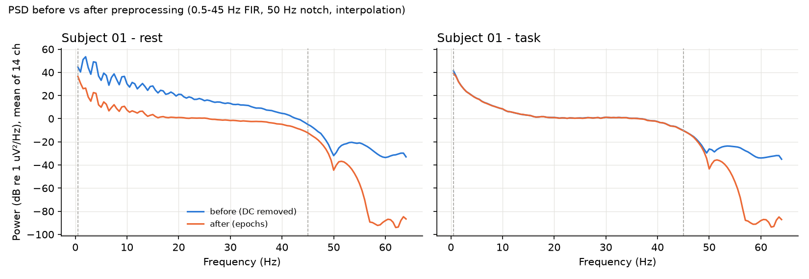

*Figure 3.1 — Subject 01: power below 0.5 Hz and above 45 Hz removed; the in-band spectrum is unchanged.*

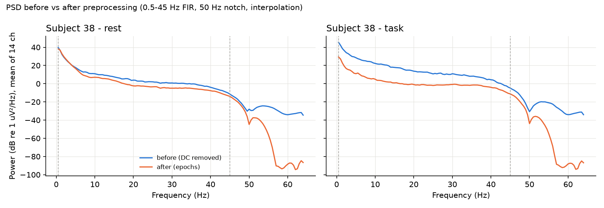

*Figure 3.2 — Subject 38: in the task recording the F3 channel (median-window std 36.98× the median channel,
`results/preprocessing/interpolation_log.csv`) was interpolated, which lowers broadband power after preprocessing.*


---

# 4. Feature engineering

Entry point: `src/eegengine/features/extract.py:extract_features(X, fs, ch_names, cfg)`; input `X` of
shape `(N, 14, 512)` µV (N epochs of 4 s at 128 Hz); output a pandas DataFrame `(N, 1499)` plus arrays
`bandpower (N, 14, 5)`, `plv (N, 4, 14, 14)`, `coh (N, 4, 14, 14)`. The **same function** is used for batch
extraction (`scripts/run_features.py`, multi-process via `extract_features_parallel`, 6 workers) and by
the real-time engine on one window at a time, so training and inference features are identical by
construction (`tests` and `scripts/audit_leakage.py:feature_locality` confirm a max difference of
0.0 [`results/leakage_audit.json` → `feature_locality.max_abs_difference`]). Configuration: `configs/features.yaml`.

<!-- BEGIN TABLE:feature_counts -->
| Family (column prefix) | Features | Composition |
|---|---|---|
| spectral | 185 | abs + rel band power (14 ch × 5 bands × 2), 3 ratios × 14 ch, 3 asymmetries |
| entropy | 84 | 6 measures × 14 ch (spectral entropy, Hjorth mobility, Hjorth complexity, log variance, skewness, kurtosis) |
| wavelet | 266 | 6 sub-bands × 14 ch × 3 (log energy, relative energy, std) + 14 wavelet entropies |
| plv | 364 | 91 channel pairs × 4 bands |
| coh | 364 | 91 channel pairs × 4 bands |
| graph | 236 | 4 bands × (4 node metrics × 14 ch + 3 global metrics) |
| **total** | 1499 |  |

Source: `results/features/feature_summary.json`
<!-- END TABLE:feature_counts -->

**Naming convention:** `<family>_<measure>_<band/level>_<channel or pair>`, e.g. `spectral_abs_theta_F3`,
`spectral_ratio_theta_beta_AF4`, `entropy_hjorth_mobility_O1`, `wavelet_relenergy_D4_P7`,
`plv_alpha_AF3-F7`, `coh_beta_O1-O2`, `graph_alpha_clustering_T8`, `graph_theta_efficiency`. Experiments select
families by prefix (`extract.py:family_columns`). The full list of 1,499 names is in
`results/features/feature_columns.txt`.

**Caching:** the feature table is saved as `data/processed/features_<hash>.parquet` and the arrays as
`features_<hash>_arrays.npz`, where the hash covers the feature configuration *and* the preprocessing hash
(`src/eegengine/data.py:feature_hash`). `scripts/run_features.py` skips extraction if the file exists.

<!-- BEGIN TABLE:feature_timing -->
| Step | CPU seconds (all 7104 epochs, summed over workers) |
|---|---|
| spectral | 4.8 |
| entropy | 7.4 |
| wavelet | 1.9 |
| connectivity | 85.4 |
| graph | 143.3 |

Wall time 51.7 s; single-window extraction latency (median of 20) 24.47 ms. Source: `results/features/feature_summary.json`
<!-- END TABLE:feature_timing -->

Frequency bands (`src/eegengine/features/spectral.py:BANDS`): delta 1–4, theta 4–8, alpha 8–13, beta 13–30,
gamma 30–45 Hz. Bins are assigned half-open [lo, hi) so adjacent bands never double count; the bands tile
1–45 Hz exactly.

## 4.1 Spectral features (prefix `spectral_`, 185 features)
**WHAT.** The Welch power spectral density averages periodograms of overlapping, windowed segments:
`P(f) = (1/K) Σ_k |FFT(w · x_k)(f)|² / (fs Σ w²)`. Band power is the integral of the PSD over the band:
`BP_b = Σ_{f∈b} P(f) Δf` (µV²). From it:
* **absolute band power** `log10(BP_b)` per channel and band (log because band power is strongly right-skewed),
* **relative band power** `BP_b / Σ_b BP_b` (fraction of 1–45 Hz power; the five values sum to 1 — tested in
  `tests/test_features.py:test_relative_band_powers_sum_to_one`),
* **ratios** `log10(BP_θ/BP_α)`, `log10(BP_θ/BP_β)`, `log10(BP_α/BP_β)` per channel,
* **frontal alpha asymmetry** `ln BP_α(right) − ln BP_α(left)` for F4−F3, AF4−AF3, F8−F7.

**Physiology.** Frontal-midline **theta** (4–8 Hz) rises with working-memory load and mental effort;
**alpha** (8–13 Hz) is high when a region is idle or actively inhibited and is suppressed by visual
attention and task engagement (posterior alpha drops when the eyes take in a task); **beta** (13–30 Hz)
accompanies active, alert processing and motor preparation; **gamma** (30–45 Hz) on a consumer headset is
heavily mixed with muscle (EMG) activity. The theta/alpha and theta/beta ratios are classic workload
markers; frontal alpha asymmetry relates to approach/withdrawal motivation.

**WHY.** Band power is the most established and interpretable EEG workload feature and the A1 baseline of
the ablation. Welch (vs a single periodogram) reduces variance; vs multitaper it is simpler and standard.

**HOW.** `spectral.py:welch_psd` (`scipy.signal.welch`, nperseg 256 [`configs/features.yaml` → `welch.nperseg`]
samples = 2 s, noverlap 128 [`configs/features.yaml` → `welch.noverlap`] = 50 %, Hann window, 0.5 Hz
resolution, 3 segments per 4-s epoch), `spectral.py:band_power`, `spectral.py:spectral_features`.
Input `(N, 14, 512)` → PSD `(N, 14, 257)` → band power `(N, 14, 5)`.

**PRODUCED.** A1 (spectral only) reaches T1 pooled macro-F1 0.810 [`results/cls_T1_xgb_A1_spectral_none_loso/metrics.json` → `pooled.macro_f1`] (§5.4).

**LIMITATIONS.** Absolute power depends on skull/electrode impedance and varies strongly between people;
gamma is contaminated by EMG; a 4-s epoch gives only 3 Welch segments (noisy estimates).

## 4.2 Complexity / time-domain features (prefix `entropy_`, 84 features)
**WHAT** (per channel; `src/eegengine/features/entropy.py`):
* **Spectral entropy** — Shannon entropy of the normalised 1–45 Hz PSD, divided by its maximum:
  `H = −Σ p_f log p_f / log N_f`, `p_f = P(f)/Σ P(f)`; 1 = flat/white spectrum, low = power concentrated in
  few frequencies (`spectral_entropy`). Tested: white noise > 0.9, pure sine < 0.3.
* **Hjorth parameters** (`hjorth`): activity `= var(x)`; mobility `= sqrt(var(x′)/var(x))` (≈ mean frequency;
  tested: for a sine ≈ 2πf/fs); complexity `= mobility(x′)/mobility(x)` (≈ bandwidth / irregularity), with x′ the
  first difference. Activity equals variance, so it is stored once as `entropy_logvar` (`log10 var`).
* **Statistical moments:** skewness and excess kurtosis (`scipy.stats`). Kurtosis is high for spiky signals
  (blinks, pops).

**WHY.** Cheap, interpretable signal-complexity descriptors complementary to band power; mental effort
tends to change the irregularity of EEG.

**PRODUCED.** Adding them to spectral (A2) gives T1 pooled macro-F1 0.826 [`results/cls_T1_xgb_A2_spectral_entropy_none_loso/metrics.json` → `pooled.macro_f1`]
— a small but significant gain over A1 (Wilcoxon p = 0.0028 [`results/stats_classical.json` → `tests.0.p_value`]).

**LIMITATIONS.** Kurtosis/skewness react strongly to artefacts; spectral entropy depends on the band limits.
No sample/permutation entropy was implemented (NOT AVAILABLE).

## 4.3 Discrete wavelet transform (prefix `wavelet_`, 266 features)
**WHAT.** A 5-level DWT with the Daubechies-4 (db4) wavelet splits each epoch into one approximation and five
detail sub-bands. At 128 Hz they correspond approximately to: D1 32–64 Hz, D2 16–32 Hz, D3 8–16 Hz,
D4 4–8 Hz, D5 2–4 Hz, A5 0–2 Hz. Per sub-band and channel: **energy** `log10 Σ c²`, **relative energy**
`E_j / Σ_j E_j`, **std** of the coefficients; per channel **wavelet entropy** `−Σ_j p_j ln p_j` with p_j the
relative energies (`src/eegengine/features/wavelet.py:wavelet_features`, `pywt.wavedec(..., "db4", level=5)`).

**WHY db4.** db4 has a compact support (8 taps) and a shape similar to EEG transients, and is the most
common choice in EEG DWT studies; 5 levels at 128 Hz map neatly onto the classical bands. The DWT gives a
time-frequency view complementary to Welch (better time localisation, octave-wide bands).

**PRODUCED.** A3 (spectral + wavelet) T1 pooled macro-F1 0.822 [`results/cls_T1_xgb_A3_spectral_wavelet_none_loso/metrics.json` → `pooled.macro_f1`],
not significantly better than A1 (p = 0.107 [`results/stats_classical.json` → `tests.1.p_value`]) — largely redundant
with band power.

**LIMITATIONS.** Octave bands do not align exactly with the clinical bands (e.g. D3 8–16 Hz mixes alpha and
low beta); D1 (32–64 Hz) is mostly above the Emotiv's 43 Hz on-board low-pass.

## 4.4 Phase-locking value (prefix `plv_`, 364 features)
**WHAT.** For each band, every epoch is band-pass filtered (4th-order zero-phase Butterworth,
`connectivity.py:band_filter`), the instantaneous phase φ(t) is taken from the analytic signal (Hilbert
transform, `scipy.signal.hilbert`), and for every channel pair
`PLV_ij = | (1/T) Σ_t exp(i (φ_i(t) − φ_j(t))) |`.
PLV = 1 means a constant phase difference (phase-locked), 0 means random phase relations.
Implementation: `connectivity.py:plv_matrix` computes all pairs at once as `|Z Zᴴ| / T` with
`Z = exp(iφ)`. Bands: theta, alpha, beta, gamma (`configs/features.yaml` → `connectivity.bands`).
Output `(N, 4, 14, 14)` symmetric matrices with 1 on the diagonal; the 91 upper-triangle values per band
are the classical features; the matrices feed the GAT and the dashboard.

**WHAT IT MEASURES.** Functional coupling — whether two regions oscillate in a consistent timing
relationship, independent of amplitude. Workload changes fronto-parietal theta/alpha synchronisation.

**Tested:** identical signals → 1; constant phase lag → > 0.99; independent noise → < 0.1; symmetric with unit diagonal.

**Volume-conduction caveat.** One brain source is picked up by several nearby electrodes at the same time
(zero phase lag), which inflates PLV between neighbours without any real interaction. Measures that ignore
zero-lag coupling (imaginary coherence, weighted phase-lag index) avoid this but were not implemented
(NOT AVAILABLE). Long-range edges are therefore more informative than neighbouring ones.

## 4.5 Magnitude-squared coherence (prefix `coh_`, 364 features)
**WHAT.** `C_ij(f) = |S_ij(f)|² / (S_ii(f) S_jj(f))`, where S are Welch cross-/auto-spectra (Hann window,
1-s segments = coh_nperseg 128 [`configs/features.yaml` → `connectivity.coh_nperseg`] samples, 50 % overlap → 7
segments per 4-s epoch), averaged over the bins of each band. Implemented vectorised for all pairs at
once in `connectivity.py:coherence_matrix` (chunks of 256 epochs to bound memory) and tested against
`scipy.signal.coherence` (difference < 1e-6).

**PLV vs coherence.** Coherence is a frequency-domain correlation that depends on **both amplitude and
phase** consistency across segments; PLV uses **phase only** within the epoch. Large-amplitude artefacts
can dominate coherence; PLV is amplitude-independent but needs band filtering. Using both gives the
models two partly independent views of coupling.

**PRODUCED.** Connectivity (PLV + coherence) is the family with the largest gain: A4 T1 pooled macro-F1
0.866 [`results/cls_T1_xgb_A4_spectral_connectivity_none_loso/metrics.json` → `pooled.macro_f1`] vs A1 0.810, Wilcoxon
p = 5.4e-05 [`results/stats_classical.json` → `tests.2.p_value`] (Holm-corrected 1.7e-04 [`results/stats_classical.json` → `tests.2.p_holm`]).

**LIMITATIONS.** Same volume-conduction issue; only 7 segments per epoch → positively biased estimates
for short data.

## 4.6 Graph features (prefix `graph_`, 236 features)
**WHAT.** Each PLV matrix (per epoch, per band) is treated as a weighted graph: 14 electrodes = nodes,
PLV = edge weight (`src/eegengine/features/graph.py`, networkx).

**Thresholding** (`graph.py:threshold_matrix`): three strategies are implemented — *proportional* (keep the
strongest fraction of edges), *absolute* (keep PLV ≥ a value) and *none* (fully weighted). Used:
**proportional, 0.3 [`configs/features.yaml` → `graph.proportion`]** (top 30 % of the 91 edges = 27 edges, weights
kept). **Why:** absolute thresholds give graphs of very different density for different people/bands
(PLV levels differ), which makes metrics incomparable; proportional thresholding fixes the density so
metrics describe the *structure* of the strongest connections.

Metrics (`graph.py:graph_metrics`), with `w_ij` the kept weights:
| Metric | Formula / definition | Meaning |
|---|---|---|
| node strength | `s_i = Σ_j w_ij` | how strongly a region is coupled overall |
| clustering coefficient (weighted, Onnela) | `C_i = (1/(k_i(k_i−1))) Σ_jk (ŵ_ij ŵ_jk ŵ_ki)^{1/3}`, ŵ = w / max w | how much a node's neighbours are also coupled (local segregation) |
| betweenness centrality | fraction of shortest paths (distance `d_ij = 1/w_ij`) passing through the node | hub / bridge role |
| eigenvector centrality | leading eigenvector of W (numpy `eigh`), normalised | connected to other well-connected nodes |
| global efficiency (weighted) | `E = (1/(n(n−1))) Σ_{i≠j} 1/d_ij*`, d* = shortest-path distance (scipy Dijkstra), 1/∞ = 0 | network integration |
| density | fraction of the 91 possible edges present (for "none": mean weight) | constant 0.3 under proportional thresholding |
| graph entropy | `−Σ_i p_i log p_i / log n`, `p_i = s_i/Σ s` | how evenly coupling is spread over nodes |

4 node metrics × 14 channels + 3 global metrics = 59 per band × 4 bands = 236 features.
Tested: complete graph → strength 13, clustering 1, betweenness 0, efficiency 1, entropy 1; a disconnected
graph with one edge → efficiency 1/91; proportional threshold keeps exactly round(0.3 × 91) edges.

**WHY.** Graph metrics summarise the whole network in a few interpretable numbers (integration,
segregation, hubs), complementing the raw 91 pairwise values.

**PRODUCED.** A5 (spectral + connectivity + graph) T1 pooled macro-F1 0.870 [`results/cls_T1_xgb_A5_spectral_connectivity_graph_none_loso/metrics.json` → `pooled.macro_f1`]
— practically the same as A4 (graph metrics are derived from PLV, so they add little new information).
Graph extraction is the slowest step (143.3 [`results/features/feature_summary.json` → `cpu_seconds_by_family.graph`] CPU-s).

**LIMITATIONS.** With 14 nodes, path-based metrics (betweenness, efficiency) are coarse; density is
constant by design under proportional thresholding (a zero-information feature); inherits PLV's
volume-conduction bias.

## 4.7 Real-time cost
Extracting all families for a single 4-s window takes a median of 24.47 [`results/features/feature_summary.json` → `single_epoch_latency_ms_median`] ms
in the latest run of `scripts/run_features.py` (earlier runs on the same machine measured about 40 ms,
the value recorded inside the classical experiments' latency fields — the machine was shared with other
applications, so latency varies between runs).


---

# 5. Classical models

## 5.1 The four models
All four are scikit-learn `Pipeline`s built by `src/eegengine/models/classical.py:make_pipeline`:
`StandardScaler → (optional SelectKBest(f_classif) or PCA) → classifier`. Selection/PCA is implemented
but **not used** in any reported run (`configs/experiments/classical.yaml` → `selection: null`).
Hyper-parameters are fixed in advance — no nested tuning (`docs/decisions.md` D12).

| Model | WHAT | WHY chosen | Exact configuration (`classical.py`) | Class imbalance |
|---|---|---|---|---|
| Logistic Regression (LR) | linear model `p(y=1|x) = σ(wᵀx + b)`, L2 penalty | simplest interpretable baseline; tests whether a linear boundary suffices | `C=0.1`, `max_iter=3000`, lbfgs | `class_weight="balanced"` |
| SVM, RBF kernel | max-margin classifier with kernel `K(x,x′) = exp(−γ‖x−x′‖²)` | strong non-linear baseline, standard in EEG workload papers | `C=1.0`, `gamma="scale"`, **no Platt scaling** (D13) | `class_weight="balanced"` |
| Random Forest (RF) | bagged ensemble of decision trees with random feature subsets | robust to many noisy/correlated features, little tuning | 200 trees, `max_features="sqrt"`, `min_samples_leaf=2`, `max_samples=0.5` | `class_weight="balanced_subsample"` |
| XGBoost | gradient-boosted trees: each tree fits the gradient of the log-loss of the current ensemble | typically the strongest model on tabular features | 200 trees, `max_depth=4`, `learning_rate=0.1`, `subsample=0.8`, `colsample_bytree=0.3`, `max_bin=64`, `tree_method="hist"` | balanced `sample_weight` (`fit_pipeline`) |

* **Why StandardScaler inside the pipeline:** LR/SVM need features on comparable scales; because the
  scaler is a pipeline step it is fit on the training subjects of each fold only (tested:
  `tests/test_models_cv.py:test_scaler_is_fit_inside_pipeline`).
* **Scores:** `classical.py:predict_scores` returns `predict_proba` for LR/RF/XGB; the SVM's decision
  value is squashed with a sigmoid/softmax — valid for ranking (AUROC, averaging) but **not calibrated
  probabilities** (D13).
* **Missing classes in a fold:** `training/classical_runner.py:FoldModel` maps a fold model trained on only
  some classes back to all classes; XGBoost requires contiguous labels, so labels are re-encoded per fold.
* **DEVIATION FROM PROPOSAL (D12):** RF and XGBoost were reduced from 300 to 200 trees (RF bootstrap 50 %;
  XGB 64 bins, 30 % columns) because 48-fold LOSO on the shared 4-core laptop was too slow. On 6 held-out
  subjects T1 AUROC was unchanged (RF 0.932 vs 0.935, XGB 0.951 vs 0.949 — measured during development and
  recorded in `docs/decisions.md` D12; no result file holds these two checks).

## 5.2 Cross-validation design
Implemented in `src/eegengine/training/cv.py`; every split passes `assert_no_subject_overlap`.

* **LOSO (leave-one-subject-out)** — `cv.py:loso_splits`: 48 folds for T1 (45 for T2/T3), each fold tests
  one unseen person and trains on all others. **Why:** the engine is for *new* learners. EEG is highly
  person-specific: with a *random* epoch split, logistic regression identifies **which subject** an epoch
  comes from with accuracy 0.995 [`results/leakage_audit.json` → `subject_identity_probe.random_split_subject_id_accuracy`]
  (chance 0.021 [`results/leakage_audit.json` → `subject_identity_probe.chance`]). With overlapping 4-s epochs, a random split
  would also put almost identical neighbouring windows into train and test. Both make random splits wildly
  optimistic; LOSO avoids both.
* **Fixed 5-fold by subject** — `cv.py:subject_fold_assignment` shuffles the 48 subjects once (seed 42) and
  deals them round-robin into 5 folds (`results/folds_5fold.json`); `cv.py:kfold_splits` reuses this exact
  assignment for **every** deep and classical model and every task (a task skips subjects it has no labels
  for). **Why:** deep training ×48 folds is unaffordable on a CPU; using the same folds for all models makes
  the classical-vs-deep comparison paired. This is the "GroupKFold" of the brief, implemented with a fixed,
  saved assignment.
* **Inner validation split** (deep models only) — `cv.py:inner_validation_split`: 15 % of the *training*
  subjects, re-drawn deterministically until it contains every class.
* **18-s window aggregation** — for the 5-fold classical runs (`classical_runner.py:run_classical`,
  `cv == "kfold5"`), the epoch scores are averaged over the **same windows of 8 consecutive epochs (stride 2
  epochs, 18 s) that the deep sequence models are scored on** (`training/sequences.py:strided_items`).
  **Why:** the sequence models see 18 s of EEG per decision; scoring the classical models per 4-s epoch would
  compare unequal amounts of information. The `sequence_level` view makes the final comparison fair.
* **Three metric views** (`evaluation/metrics.py`): *per fold* (mean ± std over folds where the metric is
  defined), *pooled* (all out-of-fold predictions at once) and *per recording* (each recording's epoch
  probabilities averaged into one decision; for T3 this is one decision per subject).
* **T3 special case:** each subject has exactly one T3 class, so LOSO test folds contain one class and
  per-fold macro-F1/AUROC are undefined; T3 LOSO is read from the pooled and per-recording views.

## 5.3 Baseline results (LOSO, all 1,499 features)
<!-- BEGIN TABLE:cls_baselines -->
| Task | Model | Norm | Fold macro-F1 (mean ± std) | Fold bal. acc | Pooled macro-F1 | Pooled bal. acc | Pooled AUROC | Recording macro-F1 | Source: results/<id>/metrics.json |
|---|---|---|---|---|---|---|---|---|---|
| T1 | Logistic Regression | none | 0.836 ± 0.134 | 0.845 ± 0.118 | 0.845 | 0.845 | 0.918 | 0.948 | `cls_T1_lr_all_none_loso` |
| T1 | SVM (RBF) | none | 0.850 ± 0.148 | 0.860 ± 0.130 | 0.859 | 0.860 | 0.938 | 0.906 | `cls_T1_svm_all_none_loso` |
| T1 | Random Forest | none | 0.844 ± 0.140 | 0.851 ± 0.128 | 0.851 | 0.851 | 0.926 | 0.938 | `cls_T1_rf_all_none_loso` |
| T1 | XGBoost | none | 0.859 ± 0.139 | 0.865 ± 0.127 | 0.865 | 0.865 | 0.941 | 0.917 | `cls_T1_xgb_all_none_loso` |
| T1 | Logistic Regression | rest_baseline | 0.882 ± 0.142 | 0.892 ± 0.121 | 0.891 | 0.892 | 0.959 | 0.927 | `cls_T1_lr_all_rest_baseline_loso` |
| T1 | SVM (RBF) | rest_baseline | 0.948 ± 0.101 | 0.951 ± 0.083 | 0.951 | 0.951 | 0.990 | 0.990 | `cls_T1_svm_all_rest_baseline_loso` |
| T1 | Random Forest | rest_baseline | 0.922 ± 0.109 | 0.926 ± 0.092 | 0.926 | 0.926 | 0.977 | 0.979 | `cls_T1_rf_all_rest_baseline_loso` |
| T1 | XGBoost | rest_baseline | 0.918 ± 0.128 | 0.924 ± 0.108 | 0.924 | 0.924 | 0.986 | 0.958 | `cls_T1_xgb_all_rest_baseline_loso` |
| T2 | Logistic Regression | none | 0.417 ± 0.126 | 0.588 ± 0.192 | 0.537 | 0.538 | 0.738 | 0.568 | `cls_T2_lr_all_none_loso` |
| T2 | SVM (RBF) | none | 0.421 ± 0.136 | 0.601 ± 0.212 | 0.544 | 0.546 | 0.726 | 0.572 | `cls_T2_svm_all_none_loso` |
| T2 | Random Forest | none | 0.427 ± 0.139 | 0.631 ± 0.203 | 0.555 | 0.563 | 0.768 | 0.629 | `cls_T2_rf_all_none_loso` |
| T2 | XGBoost | none | 0.436 ± 0.134 | 0.623 ± 0.209 | 0.565 | 0.567 | 0.770 | 0.618 | `cls_T2_xgb_all_none_loso` |
| T2 | XGBoost | rest_baseline | 0.439 ± 0.152 | 0.650 ± 0.211 | 0.555 | 0.563 | 0.821 | 0.538 | `cls_T2_xgb_all_rest_baseline_loso` |
| T3 | Logistic Regression | none | — | — | 0.501 | 0.501 | 0.509 | 0.472 | `cls_T3_lr_all_none_loso` |
| T3 | SVM (RBF) | none | — | — | 0.481 | 0.482 | 0.485 | 0.434 | `cls_T3_svm_all_none_loso` |
| T3 | Random Forest | none | — | — | 0.527 | 0.529 | 0.536 | 0.556 | `cls_T3_rf_all_none_loso` |
| T3 | XGBoost | none | — | — | 0.538 | 0.539 | 0.544 | 0.545 | `cls_T3_xgb_all_none_loso` |
| T3 | XGBoost | rest_baseline | — | — | 0.390 | 0.392 | 0.356 | 0.380 | `cls_T3_xgb_all_rest_baseline_loso` |
<!-- END TABLE:cls_baselines -->

Reading the table: on **T1** all four models are close (pooled macro-F1 0.845–0.865); XGBoost is best and
was chosen as the "best classical model" by a rule fixed in advance — lowest mean rank of pooled macro-F1
over T1 and T3, without rest baseline (`scripts/run_ablation.py:pick_best_model`; ranks in
`results/stats_classical.json` → `selection.mean_rank`: XGBoost 1.0 [`results/stats_classical.json` → `selection.mean_rank.xgb`]).
On **T3** all models are at chance. On **T2** fold macro-F1 is ≈ 0.42–0.44 while AUROC is 0.73–0.77,
because most of what is learnable is the rest-vs-task difference (rest ≈ "low").

## 5.4 Feature-family ablation (A1–A5, XGBoost, LOSO)
Design (`training/classical_runner.py:FEATURE_SETS`, `scripts/run_ablation.py`): A1 spectral; A2 spectral +
entropy; A3 spectral + wavelet; A4 spectral + connectivity (PLV + coherence); A5 spectral + connectivity +
graph; plus "all". Each run for both normalisations. Scope (D15): T1 and T3 fully; T2 only "all" with rest baseline.

**T1**
<!-- BEGIN TABLE:ablation_T1 -->
| Feature set | Norm | #features | Fold macro-F1 | Pooled macro-F1 | Pooled AUROC | Recording macro-F1 | Source |
|---|---|---|---|---|---|---|---|
| A1_spectral | none | 185 | 0.802 ± 0.137 | 0.810 | 0.890 | 0.895 | `cls_T1_xgb_A1_spectral_none_loso` |
| A2_spectral_entropy | none | 269 | 0.819 ± 0.128 | 0.826 | 0.904 | 0.927 | `cls_T1_xgb_A2_spectral_entropy_none_loso` |
| A3_spectral_wavelet | none | 451 | 0.812 ± 0.147 | 0.822 | 0.897 | 0.895 | `cls_T1_xgb_A3_spectral_wavelet_none_loso` |
| A4_spectral_connectivity | none | 913 | 0.860 ± 0.132 | 0.866 | 0.938 | 0.927 | `cls_T1_xgb_A4_spectral_connectivity_none_loso` |
| A5_spectral_connectivity_graph | none | 1149 | 0.865 ± 0.123 | 0.870 | 0.940 | 0.937 | `cls_T1_xgb_A5_spectral_connectivity_graph_none_loso` |
| all | none | 1499 | 0.859 ± 0.139 | 0.865 | 0.941 | 0.917 | `cls_T1_xgb_all_none_loso` |
| A1_spectral | rest_baseline | 185 | 0.885 ± 0.133 | 0.892 | 0.969 | 0.958 | `cls_T1_xgb_A1_spectral_rest_baseline_loso` |
| A2_spectral_entropy | rest_baseline | 269 | 0.887 ± 0.127 | 0.893 | 0.971 | 0.948 | `cls_T1_xgb_A2_spectral_entropy_rest_baseline_loso` |
| A3_spectral_wavelet | rest_baseline | 451 | 0.879 ± 0.155 | 0.889 | 0.973 | 0.927 | `cls_T1_xgb_A3_spectral_wavelet_rest_baseline_loso` |
| A4_spectral_connectivity | rest_baseline | 913 | 0.924 ± 0.114 | 0.929 | 0.987 | 0.969 | `cls_T1_xgb_A4_spectral_connectivity_rest_baseline_loso` |
| A5_spectral_connectivity_graph | rest_baseline | 1149 | 0.918 ± 0.127 | 0.923 | 0.987 | 0.958 | `cls_T1_xgb_A5_spectral_connectivity_graph_rest_baseline_loso` |
| all | rest_baseline | 1499 | 0.918 ± 0.128 | 0.924 | 0.986 | 0.958 | `cls_T1_xgb_all_rest_baseline_loso` |
<!-- END TABLE:ablation_T1 -->

**T3**
<!-- BEGIN TABLE:ablation_T3 -->
| Feature set | Norm | #features | Fold macro-F1 | Pooled macro-F1 | Pooled AUROC | Recording macro-F1 | Source |
|---|---|---|---|---|---|---|---|
| A1_spectral | none | 185 | — | 0.481 | 0.474 | 0.440 | `cls_T3_xgb_A1_spectral_none_loso` |
| A2_spectral_entropy | none | 269 | — | 0.465 | 0.450 | 0.440 | `cls_T3_xgb_A2_spectral_entropy_none_loso` |
| A3_spectral_wavelet | none | 451 | — | 0.481 | 0.464 | 0.464 | `cls_T3_xgb_A3_spectral_wavelet_none_loso` |
| A4_spectral_connectivity | none | 913 | — | 0.542 | 0.562 | 0.564 | `cls_T3_xgb_A4_spectral_connectivity_none_loso` |
| A5_spectral_connectivity_graph | none | 1149 | — | 0.534 | 0.552 | 0.570 | `cls_T3_xgb_A5_spectral_connectivity_graph_none_loso` |
| all | none | 1499 | — | 0.538 | 0.544 | 0.545 | `cls_T3_xgb_all_none_loso` |
| A1_spectral | rest_baseline | 185 | — | 0.518 | 0.541 | 0.530 | `cls_T3_xgb_A1_spectral_rest_baseline_loso` |
| A2_spectral_entropy | rest_baseline | 269 | — | 0.512 | 0.530 | 0.460 | `cls_T3_xgb_A2_spectral_entropy_rest_baseline_loso` |
| A3_spectral_wavelet | rest_baseline | 451 | — | 0.512 | 0.528 | 0.460 | `cls_T3_xgb_A3_spectral_wavelet_rest_baseline_loso` |
| A4_spectral_connectivity | rest_baseline | 913 | — | 0.513 | 0.512 | 0.453 | `cls_T3_xgb_A4_spectral_connectivity_rest_baseline_loso` |
| A5_spectral_connectivity_graph | rest_baseline | 1149 | — | 0.384 | 0.350 | 0.415 | `cls_T3_xgb_A5_spectral_connectivity_graph_rest_baseline_loso` |
| all | rest_baseline | 1499 | — | 0.390 | 0.356 | 0.380 | `cls_T3_xgb_all_rest_baseline_loso` |
<!-- END TABLE:ablation_T3 -->

**T2**
<!-- BEGIN TABLE:ablation_T2 -->
| Feature set | Norm | #features | Fold macro-F1 | Pooled macro-F1 | Pooled AUROC | Recording macro-F1 | Source |
|---|---|---|---|---|---|---|---|
| all | none | 1499 | 0.436 ± 0.134 | 0.565 | 0.770 | 0.618 | `cls_T2_xgb_all_none_loso` |
| all | rest_baseline | 1499 | 0.439 ± 0.152 | 0.555 | 0.821 | 0.538 | `cls_T2_xgb_all_rest_baseline_loso` |
<!-- END TABLE:ablation_T2 -->

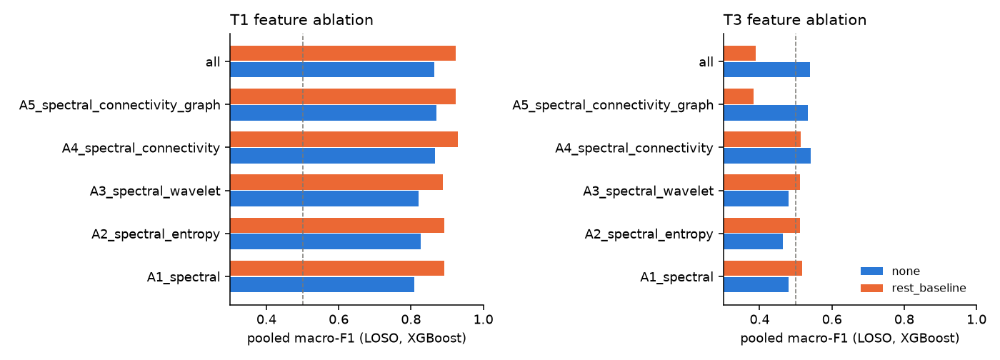

*Figure 5.1 — Feature ablation (generated from the result files by `scripts/build_report.py`).*

Findings: connectivity is the only family that significantly improves T1 over spectral alone
(A4 p = 5.4e-05 [`results/stats_classical.json` → `tests.2.p_value`]); entropy gives a smaller gain
(p = 0.0028 [`results/stats_classical.json` → `tests.0.p_value`]); wavelets add nothing significant
(p = 0.107 [`results/stats_classical.json` → `tests.1.p_value`]); graph metrics add nothing beyond PLV.
On T3 no feature set differs significantly from A1 without the rest baseline (all Holm p ≥ 0.76).

## 5.5 Statistical tests
**Wilcoxon signed-rank test** (`src/eegengine/evaluation/ablation.py:paired_wilcoxon`, scipy): compares two
configurations on the **same test subjects**, using one score per subject (macro-F1 for T1/T2; accuracy for
T3 because each subject has one class). **Why this test:** the scores are paired (same subjects), there are
only 45–48 of them, and they are bounded and often skewed, so a non-parametric paired test is appropriate;
a paired t-test would assume normal differences. **Multiple comparisons:** Holm–Bonferroni correction within
each group of related tests (`ablation.py:holm`).

<!-- BEGIN TABLE:stats_classical -->
| # | Group | A | B | Per-subject metric | n | mean A | mean B | A better / B better / ties | p (Wilcoxon) | p (Holm) |
|---|---|---|---|---|---|---|---|---|---|---|
| 0 | ablation_vs_A1/T1/none | cls_T1_xgb_A2_spectral_entropy_none_loso | cls_T1_xgb_A1_spectral_none_loso | macro_f1 | 48 | 0.8192 | 0.8017 | 30/14/4 | 0.003 | 0.006 |
| 1 | ablation_vs_A1/T1/none | cls_T1_xgb_A3_spectral_wavelet_none_loso | cls_T1_xgb_A1_spectral_none_loso | macro_f1 | 48 | 0.8123 | 0.8017 | 29/19/0 | 0.107 | 0.107 |
| 2 | ablation_vs_A1/T1/none | cls_T1_xgb_A4_spectral_connectivity_none_loso | cls_T1_xgb_A1_spectral_none_loso | macro_f1 | 48 | 0.8601 | 0.8017 | 35/13/0 | 5.43e-05 | 1.68e-04 |
| 3 | ablation_vs_A1/T1/none | cls_T1_xgb_A5_spectral_connectivity_graph_none_loso | cls_T1_xgb_A1_spectral_none_loso | macro_f1 | 48 | 0.8653 | 0.8017 | 38/9/1 | 3.35e-05 | 1.68e-04 |
| 4 | ablation_vs_A1/T1/none | cls_T1_xgb_all_none_loso | cls_T1_xgb_A1_spectral_none_loso | macro_f1 | 48 | 0.8586 | 0.8017 | 38/9/1 | 3.85e-05 | 1.68e-04 |
| 5 | ablation_vs_A1/T1/rest_baseline | cls_T1_xgb_A2_spectral_entropy_rest_baseline_loso | cls_T1_xgb_A1_spectral_rest_baseline_loso | macro_f1 | 48 | 0.8868 | 0.8854 | 22/22/4 | 0.875 | 1.000 |
| 6 | ablation_vs_A1/T1/rest_baseline | cls_T1_xgb_A3_spectral_wavelet_rest_baseline_loso | cls_T1_xgb_A1_spectral_rest_baseline_loso | macro_f1 | 48 | 0.8791 | 0.8854 | 29/17/2 | 0.840 | 1.000 |
| 7 | ablation_vs_A1/T1/rest_baseline | cls_T1_xgb_A4_spectral_connectivity_rest_baseline_loso | cls_T1_xgb_A1_spectral_rest_baseline_loso | macro_f1 | 48 | 0.9245 | 0.8854 | 37/10/1 | 4.42e-04 | 0.002 |
| 8 | ablation_vs_A1/T1/rest_baseline | cls_T1_xgb_A5_spectral_connectivity_graph_rest_baseline_loso | cls_T1_xgb_A1_spectral_rest_baseline_loso | macro_f1 | 48 | 0.9175 | 0.8854 | 37/10/1 | 0.005 | 0.015 |
| 9 | ablation_vs_A1/T1/rest_baseline | cls_T1_xgb_all_rest_baseline_loso | cls_T1_xgb_A1_spectral_rest_baseline_loso | macro_f1 | 48 | 0.9181 | 0.8854 | 36/10/2 | 0.002 | 0.008 |
| 10 | rest_baseline_vs_none/T1 | cls_T1_lr_all_rest_baseline_loso | cls_T1_lr_all_none_loso | macro_f1 | 48 | 0.8824 | 0.8359 | 34/14/0 | 0.008 | 0.008 |
| 11 | best_vs_other_model/T1/none | cls_T1_xgb_all_none_loso | cls_T1_lr_all_none_loso | macro_f1 | 48 | 0.8586 | 0.8359 | 34/12/2 | 0.006 | 0.017 |
| 12 | rest_baseline_vs_none/T1 | cls_T1_svm_all_rest_baseline_loso | cls_T1_svm_all_none_loso | macro_f1 | 48 | 0.9475 | 0.8502 | 40/6/2 | 2.56e-06 | 1.02e-05 |
| 13 | best_vs_other_model/T1/none | cls_T1_xgb_all_none_loso | cls_T1_svm_all_none_loso | macro_f1 | 48 | 0.8586 | 0.8502 | 26/20/2 | 0.287 | 0.287 |
| 14 | rest_baseline_vs_none/T1 | cls_T1_rf_all_rest_baseline_loso | cls_T1_rf_all_none_loso | macro_f1 | 48 | 0.9221 | 0.8444 | 39/8/1 | 3.57e-06 | 1.07e-05 |
| 15 | best_vs_other_model/T1/none | cls_T1_xgb_all_none_loso | cls_T1_rf_all_none_loso | macro_f1 | 48 | 0.8586 | 0.8444 | 30/15/3 | 0.016 | 0.033 |
| 16 | rest_baseline_vs_none/T1 | cls_T1_xgb_all_rest_baseline_loso | cls_T1_xgb_all_none_loso | macro_f1 | 48 | 0.9181 | 0.8586 | 35/11/2 | 0.001 | 0.002 |
| 17 | ablation_vs_A1/T3/none | cls_T3_xgb_A2_spectral_entropy_none_loso | cls_T3_xgb_A1_spectral_none_loso | accuracy | 45 | 0.4712 | 0.4844 | 20/21/4 | 0.546 | 1.000 |
| 18 | ablation_vs_A1/T3/none | cls_T3_xgb_A3_spectral_wavelet_none_loso | cls_T3_xgb_A1_spectral_none_loso | accuracy | 45 | 0.4847 | 0.4844 | 15/21/9 | 1.000 | 1.000 |
| 19 | ablation_vs_A1/T3/none | cls_T3_xgb_A4_spectral_connectivity_none_loso | cls_T3_xgb_A1_spectral_none_loso | accuracy | 45 | 0.5508 | 0.4844 | 24/20/1 | 0.229 | 0.917 |
| 20 | ablation_vs_A1/T3/none | cls_T3_xgb_A5_spectral_connectivity_graph_none_loso | cls_T3_xgb_A1_spectral_none_loso | accuracy | 45 | 0.5420 | 0.4844 | 21/23/1 | 0.378 | 1.000 |
| 21 | ablation_vs_A1/T3/none | cls_T3_xgb_all_none_loso | cls_T3_xgb_A1_spectral_none_loso | accuracy | 45 | 0.5468 | 0.4844 | 23/20/2 | 0.152 | 0.762 |
| 22 | ablation_vs_A1/T3/rest_baseline | cls_T3_xgb_A2_spectral_entropy_rest_baseline_loso | cls_T3_xgb_A1_spectral_rest_baseline_loso | accuracy | 45 | 0.5165 | 0.5225 | 21/19/5 | 0.867 | 1.000 |
| 23 | ablation_vs_A1/T3/rest_baseline | cls_T3_xgb_A3_spectral_wavelet_rest_baseline_loso | cls_T3_xgb_A1_spectral_rest_baseline_loso | accuracy | 45 | 0.5165 | 0.5225 | 21/23/1 | 0.591 | 1.000 |
| 24 | ablation_vs_A1/T3/rest_baseline | cls_T3_xgb_A4_spectral_connectivity_rest_baseline_loso | cls_T3_xgb_A1_spectral_rest_baseline_loso | accuracy | 45 | 0.5195 | 0.5225 | 16/24/5 | 0.432 | 1.000 |
| 25 | ablation_vs_A1/T3/rest_baseline | cls_T3_xgb_A5_spectral_connectivity_graph_rest_baseline_loso | cls_T3_xgb_A1_spectral_rest_baseline_loso | accuracy | 45 | 0.4015 | 0.5225 | 13/29/3 | 0.013 | 0.051 |
| 26 | ablation_vs_A1/T3/rest_baseline | cls_T3_xgb_all_rest_baseline_loso | cls_T3_xgb_A1_spectral_rest_baseline_loso | accuracy | 45 | 0.4039 | 0.5225 | 13/30/2 | 0.007 | 0.035 |
| 27 | best_vs_other_model/T3/none | cls_T3_xgb_all_none_loso | cls_T3_lr_all_none_loso | accuracy | 45 | 0.5468 | 0.5075 | 21/22/2 | 0.340 | 0.680 |
| 28 | best_vs_other_model/T3/none | cls_T3_xgb_all_none_loso | cls_T3_svm_all_none_loso | accuracy | 45 | 0.5468 | 0.4928 | 26/14/5 | 0.025 | 0.074 |
| 29 | best_vs_other_model/T3/none | cls_T3_xgb_all_none_loso | cls_T3_rf_all_none_loso | accuracy | 45 | 0.5468 | 0.5438 | 15/23/7 | 0.862 | 0.862 |
| 30 | rest_baseline_vs_none/T3 | cls_T3_xgb_all_rest_baseline_loso | cls_T3_xgb_all_none_loso | accuracy | 45 | 0.4039 | 0.5468 | 13/32/0 | 0.010 | 0.010 |
| 31 | best_vs_other_model/T2/none | cls_T2_xgb_all_none_loso | cls_T2_lr_all_none_loso | macro_f1 | 45 | 0.4624 | 0.4298 | 26/19/0 | 0.120 | 0.240 |
| 32 | best_vs_other_model/T2/none | cls_T2_xgb_all_none_loso | cls_T2_svm_all_none_loso | macro_f1 | 45 | 0.4624 | 0.4358 | 31/13/1 | 0.009 | 0.026 |
| 33 | best_vs_other_model/T2/none | cls_T2_xgb_all_none_loso | cls_T2_rf_all_none_loso | macro_f1 | 45 | 0.4624 | 0.4508 | 25/20/0 | 0.414 | 0.414 |
| 34 | rest_baseline_vs_none/T2 | cls_T2_xgb_all_rest_baseline_loso | cls_T2_xgb_all_none_loso | macro_f1 | 45 | 0.4492 | 0.4624 | 18/26/1 | 0.608 | 0.608 |

Source: `results/stats_classical.json` (row # = index in `tests`)
<!-- END TABLE:stats_classical -->

## 5.6 Additional analyses requested in the brief
| Analysis | Status |
|---|---|
| Label-permutation test | **Done** for the pipeline (LR, all features, T1, 3 permutations): balanced accuracy 0.506 [`results/leakage_audit.json` → `permutation_test.mean_balanced_accuracy`] (§7.5) |
| Subject-level (per-recording) T3 predictions | **Done** — `recording_level` view; e.g. XGBoost T3 recording macro-F1 0.545 [`results/cls_T3_xgb_all_none_loso/metrics.json` → `recording_level.macro_f1`] |
| Bootstrap confidence intervals | **Not done** — NOT AVAILABLE |
| Spearman correlation of predictions with the 1–9 rating | **Not done** — NOT AVAILABLE |
| Nested hyper-parameter tuning | **Not done** (D12) |

## 5.7 Limitations
Fixed hyper-parameters; SVM scores uncalibrated; LOSO estimates have high variance per subject
(fold std ≈ 0.13–0.15 on T1); the reduced grid (D14, D15) means T2/T3 rest-baseline comparisons exist only
for XGBoost; feature selection/PCA was not explored.


---

# 6. Deep models

All deep code is plain PyTorch (`src/eegengine/models/deep/`), configured by
`configs/experiments/deep.yaml`, trained by `src/eegengine/training/trainer.py` and run per experiment
by `src/eegengine/training/deep_runner.py:run_deep` from `scripts/run_deep.py`.

## 6.1 Input representations
| Input | Shape | Built by | Scaling (fit on the fit subjects of the fold only) |
|---|---|---|---|
| raw epochs | `(L, 14, 512)` per sample (L epochs × 14 channels × 4 s at 128 Hz) | `data/processed/epochs_*.npz` | divided by a per-channel robust scale = median over training epochs of each epoch's channel std, clipped to ±20 (`trainer.py:Scalers`, `DeepInputs.batch`) |
| node features (GAT) | `(L, 14, 5)` | log10 band power per channel (delta…gamma) from `features_*_arrays.npz` | z-scored per channel and band with training-fold mean/std |
| edges (GAT) | `(L, 14, 14)` | PLV averaged over the 4 bands (`trainer.py:edge_matrix`, `input.edge_source: plv`, `edge_band: mean`) | none (PLV is already 0–1) |
| sequences | `L = 8` consecutive epochs of the same recording = 18 s | `training/sequences.py:strided_items` / `sample_items` | — |

Sequences never cross recordings, so each has a single label. Test windows: stride 2 epochs (4 s); 3264
test sequences for T1 (`results/deep_T1_A10_hybrid_kfold5/metrics.json` → `n_sequences`). EEGNet is a
single-epoch model: it is trained on epochs (`L = 1`) and its calibrated probabilities are averaged over
the same 8-epoch test windows, so all models are scored on identical windows.

## 6.2 EEGNet (baseline)
**WHAT.** A compact CNN for EEG (Lawhern et al., 2018, *J. Neural Eng.* — cited in
`src/eegengine/models/deep/eegnet.py`). Layer by layer for one epoch `(1, 14, 512)`
(shapes verified by instantiating the model):

| # | Layer | Parameters | Output shape |
|---|---|---|---|
| 1 | temporal Conv2d, F1 = 8 filters, kernel (1, 32), padding 16, no bias | learns 8 band-pass filters | (8, 14, 513) |
| 2 | BatchNorm2d | | (8, 14, 513) |
| 3 | depthwise spatial Conv2d (14, 1), D = 2 per filter, groups = 8 | learns 2 spatial filters per band (like CSP) | (16, 1, 513) |
| 4 | BatchNorm2d → ELU → AvgPool (1, 4) → Dropout 0.25 | | (16, 1, 128) |
| 5 | separable conv = depthwise temporal Conv2d (1, 16), groups 16 + pointwise Conv2d 1×1 → F2 = 16 | combines feature maps over time | (16, 1, 129) |
| 6 | BatchNorm2d → ELU → AvgPool (1, 8) → Dropout 0.25 | | (16, 1, 16) |
| 7 | flatten → Linear(256, n_classes) | | (n_classes) |

Parameters: 1586 [`results/deep_T1_eegnet_kfold5/metrics.json` → `n_params`].
**WHY.** It is the standard, widely replicated EEG deep-learning baseline: few parameters (suits small
datasets), physiologically interpretable filters, and it works across paradigms.
**DEVIATION FROM PROPOSAL.** The original EEGNet uses a temporal kernel of fs/2 = 64 samples. The kernel was set
to 32 (0.25 s) because a 64-sample kernel hit a very slow CPU convolution path (≈ 26 s per training step vs
≈ 1.3 s measured during development; D17).

## 6.3 CNN-LSTM
`src/eegengine/models/deep/cnn_lstm.py:build_cnn_lstm` = the hybrid with only the CNN and LSTM branches (A7),
so baseline and ablation share one implementation:
1. **CNN encoder** per epoch = EEGNet blocks 1–6 + `Linear(256, 64)` → embedding e_t ∈ ℝ⁶⁴ (`eegnet.py:EEGNetEncoder`, 17520 parameters).
2. **LSTM** (1 layer, hidden 64, batch-first) over e_1…e_8; Z_lstm = last hidden state (33280 parameters).
3. Z_cnn = mean of e_t; fusion `[Z_cnn; Z_lstm]` → MLP → heads (§6.4).
Parameters: 59576 [`results/deep_T1_A7_cnn_lstm_kfold5/metrics.json` → `n_params`].

## 6.4 Hybrid CNN + LSTM + Transformer + GAT (multi-task)
`src/eegengine/models/deep/hybrid.py:HybridModel`. Input `x (B, L, 14, 512)`, `node (B, L, 14, 5)`,
`adj (B, L, 14, 14)`. Every branch can be switched off (`branches` in the config).

**CNN branch** — the shared `EEGNetEncoder` applied to each of the L epochs → `e (B, L, 64)`;
`Z_cnn = mean_t e_t` (64-d).

**LSTM branch** — `nn.LSTM(64, 64)` over the embedding sequence; `Z_lstm = h_L` (64-d).

**Transformer branch** — sinusoidal positional encoding
`PE(pos, 2i) = sin(pos / 10000^{2i/d})`, `PE(pos, 2i+1) = cos(pos / 10000^{2i/d})`, d = 64, added to e;
2 `TransformerEncoderLayer`s (4 heads, feed-forward 128, dropout 0.1, batch-first);
`Z_trans = mean over positions` (64-d). Self-attention lets every epoch attend to every other epoch of the window.
Branch parameters: 66944.

**GAT branch** (`src/eegengine/models/deep/gat.py`, plain PyTorch, dense 14 × 14 adjacency). For node i with
features h_i and neighbours j:
```
e_ij  = LeakyReLU_0.2( a_srcᵀ W h_i + a_dstᵀ W h_j ) + log(A_ij)      (A = PLV, self-loops = 1)
α_ij  = softmax_j(e_ij)   over edges with A_ij > 0 (others masked to −∞), dropout 0.1
h_i'  = Σ_j α_ij W h_j     per head
```
Layer 1: 5 → 16 per head × 4 heads, concatenated (64) + ELU; layer 2: 64 → 32, 4 heads averaged + ELU
(`GATEncoder`, 448 + 8448 parameters). Node embeddings are mean-pooled over the 14 nodes, then over the
L epochs → `Z_gnn` (32-d). The `log(A_ij)` term is a prior: strongly phase-locked pairs get more attention,
while the learned part decides which connections matter (Veličković et al., 2018, cited in `gat.py`).
Tested: with no edges each node's output depends only on itself (`tests/test_models_cv.py:test_gat_respects_adjacency`).

**Fusion** — concatenate the enabled Z's (A10: 64 + 64 + 64 + 32 = 224) → `Linear(224, 64) → ELU →
Dropout(0.3)` (14400 parameters).

**Four task heads** — `workload: Linear(64, n_classes)`, `attention / fatigue / readiness: Linear(64, 2)` each (520 parameters in total).

**Masked multi-task loss** (`hybrid.py:masked_multitask_loss`):
`L = Σ_h w_h · CE_h( logits_h[m_h], y_h[m_h]; class weights c_h )`, summed over the heads h that have at least one
labelled sample in the batch (mask m_h). A head with no labels contributes exactly 0 and receives no gradient
(tested: `test_masked_loss_ignores_unlabelled_heads`). On STEW only the workload mask is ever true, so
attention/fatigue/readiness heads are present but **inert**, ready for the team-collected labels.

**Parameter count per model:**
| Model | Branches | Params |
|---|---|---|
| EEGNet | — | 1586 [`results/deep_T1_eegnet_kfold5/metrics.json` → `n_params`] |
| A6 CNN | cnn | 22200 [`results/deep_T1_A6_cnn_kfold5/metrics.json` → `n_params`] |
| A7 CNN-LSTM | cnn, lstm | 59576 [`results/deep_T1_A7_cnn_lstm_kfold5/metrics.json` → `n_params`] |
| A8 CNN-LSTM-Transformer | cnn, lstm, transformer | 130616 [`results/deep_T1_A8_cnn_lstm_trans_kfold5/metrics.json` → `n_params`] |
| A9 CNN-LSTM-GAT | cnn, lstm, gnn | 70520 [`results/deep_T1_A9_cnn_lstm_gnn_kfold5/metrics.json` → `n_params`] |
| A10 full hybrid | all four | 141560 [`results/deep_T1_A10_hybrid_kfold5/metrics.json` → `n_params`] |

All models accept any sequence length L ≥ 1, so the live engine can predict before 8 epochs exist
(`test_hybrid_accepts_shorter_sequences`).

## 6.5 Training
`trainer.py:train_model` / `run_fold`, settings from `configs/experiments/deep.yaml` → `train` / `augment`:
| Setting | Value |
|---|---|
| Optimiser | AdamW, lr 0.001 [`configs/experiments/deep.yaml` → `train.lr`], weight decay 0.01 [`configs/experiments/deep.yaml` → `train.weight_decay`], gradient-norm clip 1.0 |
| Batch | 16 [`configs/experiments/deep.yaml` → `train.batch_size`] sequences (EEGNet: 4× = 64 epochs) |
| Items per epoch | 8 [`configs/experiments/deep.yaml` → `train.epoch_items_per_recording`] fresh random sequence starts per training recording each epoch (EEGNet 32 epochs) — fixed cost per epoch, more variety than a fixed list |
| Epochs | at most 25 [`configs/experiments/deep.yaml` → `train.max_epochs`], early stopping patience 5 [`configs/experiments/deep.yaml` → `train.patience`] on validation loss; best weights restored |
| Validation | 15 % of the training subjects (`val_frac` 0.15 [`configs/experiments/deep.yaml` → `train.val_frac`]), subject-wise, re-drawn until it contains every class; validation stride 4 epochs |
| Class weights | inverse class frequency over the fit recordings, normalised to mean 1 |
| Augmentation | Gaussian noise σ = 0.1 [`configs/experiments/deep.yaml` → `augment.noise_std`] (in channel-scale units), channel dropout p = 0.1 [`configs/experiments/deep.yaml` → `augment.channel_dropout`] (same channel zeroed in all epochs of a sequence), circular time shift up to ±16 [`configs/experiments/deep.yaml` → `augment.max_shift`] samples (125 ms) |
| Seeds | `seed 42 + fold` for Python, NumPy and PyTorch (`trainer.py:set_torch_seed`) |
| Hardware | CPU only (Intel i5-1135G7, 4 cores; D17), 4 threads [`configs/experiments/deep.yaml` → `train.threads`] |

CPU time per experiment (train + evaluate, 5 folds) is in the table below (column "Train+eval s").
**Known issue — early stopping on a tiny validation set.** The validation split holds only ≈ 6 subjects. In
fold 1 of T1 *every* deep model had its best validation loss at epoch 0 and stopped at epoch 6; most T3
folds stop at epochs 0–2 (column "Best epoch per fold"). Early stopping (and temperature scaling) are
therefore noisy, which is one reason the deep models under-perform (§7.7).

## 6.6 Results and architecture ablation (A6–A10), 5 subject folds, 18-s windows
<!-- BEGIN TABLE:deep -->
| Task | Model | Params | Fold macro-F1 | Fold bal. acc | Pooled AUROC | Recording macro-F1 | ECE before → after | CPU ms / window (1 thread) | Best epoch per fold | Train+eval s | Source |
|---|---|---|---|---|---|---|---|---|---|---|---|
| T1 | EEGNet | 1586 | 0.772 ± 0.099 | 0.773 ± 0.098 | 0.843 | 0.812 | 0.086 → 0.105 | 0.9 | [23, 0, 22, 8, 23] | 410 | `deep_T1_eegnet_kfold5` |
| T1 | A6 CNN | 22200 | 0.701 ± 0.138 | 0.709 ± 0.127 | 0.782 | 0.768 | 0.031 → 0.082 | 4.4 | [22, 0, 0, 3, 10] | 359 | `deep_T1_A6_cnn_kfold5` |
| T1 | A7 CNN-LSTM | 59576 | 0.730 ± 0.091 | 0.736 ± 0.085 | 0.807 | 0.771 | 0.093 → 0.084 | 9.8 | [23, 0, 14, 4, 10] | 667 | `deep_T1_A7_cnn_lstm_kfold5` |
| T1 | A8 CNN-LSTM-Transformer | 130616 | 0.773 ± 0.045 | 0.775 ± 0.045 | 0.835 | 0.833 | 0.074 → 0.053 | 11.3 | [9, 3, 18, 4, 14] | 805 | `deep_T1_A8_cnn_lstm_trans_kfold5` |
| T1 | A9 CNN-LSTM-GAT | 70520 | 0.751 ± 0.077 | 0.751 ± 0.077 | 0.827 | 0.812 | 0.088 → 0.068 | 6.5 | [5, 0, 23, 7, 17] | 842 | `deep_T1_A9_cnn_lstm_gnn_kfold5` |
| T1 | A10 full hybrid (CNN+LSTM+Transformer+GAT) | 141560 | 0.758 ± 0.103 | 0.765 ± 0.093 | 0.853 | 0.802 | 0.098 → 0.055 | 21.8 | [20, 0, 9, 15, 14] | 783 | `deep_T1_A10_hybrid_kfold5` |
| T3 | EEGNet | 1586 | 0.514 ± 0.076 | 0.536 ± 0.085 | 0.543 | 0.464 | 0.048 → 0.061 | 3.2 | [5, 21, 0, 0, 0] | 115 | `deep_T3_eegnet_kfold5` |
| T3 | A6 CNN | 22200 | 0.458 ± 0.076 | 0.468 ± 0.084 | 0.447 | 0.434 | 0.111 → 0.103 | 4.9 | [1, 14, 0, 2, 2] | 222 | `deep_T3_A6_cnn_kfold5` |
| T3 | A7 CNN-LSTM | 59576 | 0.433 ± 0.089 | 0.476 ± 0.067 | 0.485 | 0.440 | 0.125 → 0.134 | 6.3 | [1, 12, 0, 2, 6] | 1700 | `deep_T3_A7_cnn_lstm_kfold5` |
| T3 | A8 CNN-LSTM-Transformer | 130616 | 0.412 ± 0.097 | 0.500 ± 0.043 | 0.504 | 0.527 | 0.125 → 0.129 | 4.7 | [1, 14, 0, 2, 0] | 138 | `deep_T3_A8_cnn_lstm_trans_kfold5` |
| T3 | A9 CNN-LSTM-GAT | 70520 | 0.487 ± 0.058 | 0.493 ± 0.058 | 0.484 | 0.398 | 0.113 → 0.171 | 7.7 | [1, 16, 0, 1, 2] | 260 | `deep_T3_A9_cnn_lstm_gnn_kfold5` |
| T3 | A10 full hybrid (CNN+LSTM+Transformer+GAT) | 141560 | 0.389 ± 0.062 | 0.492 ± 0.023 | 0.501 | 0.466 | 0.138 → 0.133 | 5.3 | [1, 12, 0, 1, 1] | 138 | `deep_T3_A10_hybrid_kfold5` |
<!-- END TABLE:deep -->

Paired Wilcoxon tests (`scripts/deep_stats.py`; per-subject macro-F1 on T1, accuracy on T3):
<!-- BEGIN TABLE:stats_deep -->
| # | Group | A | B | Per-subject metric | n | mean A | mean B | A better / B better / ties | p (Wilcoxon) | p (Holm) |
|---|---|---|---|---|---|---|---|---|---|---|
| 0 | deep_ablation/T1 | deep_T1_A10_hybrid_kfold5 | deep_T1_A6_cnn_kfold5 | macro_f1 | 48 | 0.7267 | 0.6778 | 28/15/5 | 0.089 | 0.443 |
| 1 | deep_ablation/T1 | deep_T1_A10_hybrid_kfold5 | deep_T1_A7_cnn_lstm_kfold5 | macro_f1 | 48 | 0.7267 | 0.7022 | 30/16/2 | 0.188 | 0.752 |
| 2 | deep_ablation/T1 | deep_T1_A10_hybrid_kfold5 | deep_T1_A8_cnn_lstm_trans_kfold5 | macro_f1 | 48 | 0.7267 | 0.7569 | 24/20/4 | 0.930 | 1.000 |
| 3 | deep_ablation/T1 | deep_T1_A10_hybrid_kfold5 | deep_T1_A9_cnn_lstm_gnn_kfold5 | macro_f1 | 48 | 0.7267 | 0.7264 | 26/19/3 | 0.710 | 1.000 |
| 4 | deep_ablation/T1 | deep_T1_A10_hybrid_kfold5 | deep_T1_eegnet_kfold5 | macro_f1 | 48 | 0.7267 | 0.7443 | 21/22/5 | 0.664 | 1.000 |
| 5 | classical_vs_deep/T1 | deep_T1_A10_hybrid_kfold5 | cls_T1_xgb_all_none_kfold5[windows] | macro_f1 | 48 | 0.7267 | 0.9071 | 8/36/4 | 4.03e-06 | 4.83e-06 |
| 6 | classical_vs_deep/T1 | deep_T1_A8_cnn_lstm_trans_kfold5 | cls_T1_xgb_all_none_kfold5[windows] | macro_f1 | 48 | 0.7569 | 0.9071 | 6/38/4 | 2.42e-06 | 4.83e-06 |
| 7 | deep_ablation/T3 | deep_T3_A10_hybrid_kfold5 | deep_T3_A6_cnn_kfold5 | accuracy | 45 | 0.4837 | 0.4699 | 23/20/2 | 0.814 | 1.000 |
| 8 | deep_ablation/T3 | deep_T3_A10_hybrid_kfold5 | deep_T3_A7_cnn_lstm_kfold5 | accuracy | 45 | 0.4837 | 0.4876 | 19/18/8 | 0.898 | 1.000 |
| 9 | deep_ablation/T3 | deep_T3_A10_hybrid_kfold5 | deep_T3_A8_cnn_lstm_trans_kfold5 | accuracy | 45 | 0.4837 | 0.5190 | 18/19/8 | 0.763 | 1.000 |
| 10 | deep_ablation/T3 | deep_T3_A10_hybrid_kfold5 | deep_T3_A9_cnn_lstm_gnn_kfold5 | accuracy | 45 | 0.4837 | 0.5026 | 23/22/0 | 0.892 | 1.000 |
| 11 | deep_ablation/T3 | deep_T3_A10_hybrid_kfold5 | deep_T3_eegnet_kfold5 | accuracy | 45 | 0.4837 | 0.5444 | 21/22/2 | 0.432 | 1.000 |
| 12 | classical_vs_deep/T3 | deep_T3_A10_hybrid_kfold5 | cls_T3_xgb_all_none_kfold5[windows] | accuracy | 45 | 0.4837 | 0.5784 | 17/22/6 | 0.418 | 0.801 |
| 13 | classical_vs_deep/T3 | deep_T3_eegnet_kfold5 | cls_T3_xgb_all_none_kfold5[windows] | accuracy | 45 | 0.5444 | 0.5784 | 21/24/0 | 0.400 | 0.801 |

Source: `results/stats_deep.json` (row # = index in `tests`)
<!-- END TABLE:stats_deep -->

Findings (T1): the order A6 CNN 0.701 [`results/deep_T1_A6_cnn_kfold5/metrics.json` → `per_fold.macro_f1.mean`] →
A7 +LSTM 0.730 [`results/deep_T1_A7_cnn_lstm_kfold5/metrics.json` → `per_fold.macro_f1.mean`] →
A8 +Transformer 0.773 [`results/deep_T1_A8_cnn_lstm_trans_kfold5/metrics.json` → `per_fold.macro_f1.mean`] →
A9 +GAT instead of Transformer 0.751 [`results/deep_T1_A9_cnn_lstm_gnn_kfold5/metrics.json` → `per_fold.macro_f1.mean`] →
A10 all 0.758 [`results/deep_T1_A10_hybrid_kfold5/metrics.json` → `per_fold.macro_f1.mean`] suggests temporal context helps
and the GAT branch does not, but **none of the differences to A10 is significant** (smallest p = 0.089 [`results/stats_deep.json` → `tests.0.p_value`]).
EEGNet with 1.1 % of the hybrid's parameters is as good as the best sequence model
(0.772 [`results/deep_T1_eegnet_kfold5/metrics.json` → `per_fold.macro_f1.mean`]). On T3 all deep models are at chance.

## 6.7 Calibration — temperature scaling
**WHAT.** `p = softmax(z / T)` with a single scalar T > 0 (Guo et al., 2017, cited in
`src/eegengine/training/calibration.py`). T > 1 softens over-confident predictions; the argmax (and
therefore accuracy/F1) does not change. T is fit by minimising the negative log-likelihood on the
**inner validation subjects** (LBFGS on log T; `calibration.py:fit_temperature`), clipped to [0.05, 20];
if the validation set has a single class T = 1.
**ECE.** `ECE = Σ_b (n_b/n) · |acc_b − conf_b|` over 15 equal-width confidence bins
(`evaluation/metrics.py:expected_calibration_error`).
**PRODUCED.** ECE before → after is in the table above. Temperature scaling improved ECE for the hybrid on T1
(0.098 [`results/deep_T1_A10_hybrid_kfold5/metrics.json` → `calibration.ece_before`] →
0.055 [`results/deep_T1_A10_hybrid_kfold5/metrics.json` → `calibration.ece_after`]) and A8
(0.074 [`results/deep_T1_A8_cnn_lstm_trans_kfold5/metrics.json` → `calibration.ece_before`] → 0.053 [`results/deep_T1_A8_cnn_lstm_trans_kfold5/metrics.json` → `calibration.ece_after`])
but made EEGNet worse (0.086 [`results/deep_T1_eegnet_kfold5/metrics.json` → `calibration.ece_before`] →
0.105 [`results/deep_T1_eegnet_kfold5/metrics.json` → `calibration.ece_after`]) and A6 worse
(0.031 [`results/deep_T1_A6_cnn_kfold5/metrics.json` → `calibration.ece_before`] → 0.082 [`results/deep_T1_A6_cnn_kfold5/metrics.json` → `calibration.ece_after`]).
Reason: T is estimated from ≈ 6 validation subjects, whose confidence behaviour differs from the test
subjects'. Fitted temperatures per fold:
<!-- BEGIN TABLE:temps -->
| Task | Model | Temperature T per fold (bounds 0.05–20) | Source (calibration.temperatures) |
|---|---|---|---|
| T1 | EEGNet | 1.00, 7.80, 1.25, 1.73, 0.97 | `deep_T1_eegnet_kfold5` |
| T1 | A6 CNN | 1.58, 10.14, 2.40, 1.72, 0.79 | `deep_T1_A6_cnn_kfold5` |
| T1 | A7 CNN-LSTM | 1.17, 7.26, 1.32, 1.91, 0.71 | `deep_T1_A7_cnn_lstm_kfold5` |
| T1 | A8 CNN-LSTM-Transformer | 0.93, 2.22, 1.36, 1.91, 0.71 | `deep_T1_A8_cnn_lstm_trans_kfold5` |
| T1 | A9 CNN-LSTM-GAT | 1.17, 2.29, 1.64, 1.98, 1.05 | `deep_T1_A9_cnn_lstm_gnn_kfold5` |
| T1 | A10 full hybrid (CNN+LSTM+Transformer+GAT) | 1.39, 1.87, 1.75, 1.89, 1.02 | `deep_T1_A10_hybrid_kfold5` |
| T3 | EEGNet | 0.85, 0.70, 9.06, 0.53, 0.41 | `deep_T3_eegnet_kfold5` |
| T3 | A6 CNN | 0.66, 0.82, 20.00, 10.98, 1.31 | `deep_T3_A6_cnn_kfold5` |
| T3 | A7 CNN-LSTM | 0.74, 0.66, 2.47, 0.70, 1.28 | `deep_T3_A7_cnn_lstm_kfold5` |
| T3 | A8 CNN-LSTM-Transformer | 1.74, 1.22, 20.00, 0.59, 0.66 | `deep_T3_A8_cnn_lstm_trans_kfold5` |
| T3 | A9 CNN-LSTM-GAT | 20.00, 0.57, 20.00, 0.05, 1.32 | `deep_T3_A9_cnn_lstm_gnn_kfold5` |
| T3 | A10 full hybrid (CNN+LSTM+Transformer+GAT) | 1.80, 0.73, 1.99, 2.07, 0.52 | `deep_T3_A10_hybrid_kfold5` |
<!-- END TABLE:temps -->

Several T3 folds hit the bounds (T = 20 flattens the probabilities to ≈ 0.5; T = 0.05 in one A9 fold) —
a symptom of models that learned nothing transferable on T3.

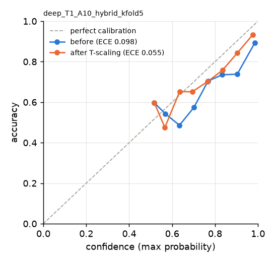

*Figure 6.1 — Reliability diagram, full hybrid A10, T1 (before vs after temperature scaling).*

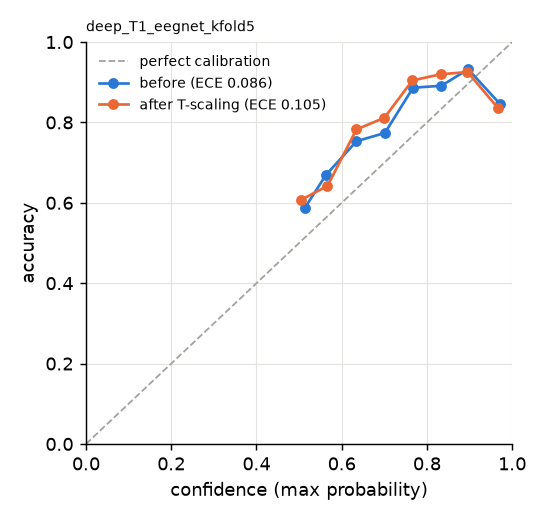

*Figure 6.2 — Reliability diagram, EEGNet T1: calibration got worse after temperature scaling.*

## 6.8 Latency per window (CPU)
<!-- BEGIN TABLE:latency -->
| Model | Kind | Feature extraction ms | Model ms (single window, median) | Classical end-to-end ms | Source |
|---|---|---|---|---|---|
| Logistic Regression | classical | 40.53 | 1.32 | 41.85 | `cls_T1_lr_all_none_kfold5` |
| SVM (RBF) | classical | 40.53 | 2.75 | 43.28 | `cls_T1_svm_all_none_kfold5` |
| Random Forest | classical | 40.53 | 10.56 | 51.09 | `cls_T1_rf_all_none_kfold5` |
| XGBoost | classical | 40.53 | 0.95 | 41.48 | `cls_T1_xgb_all_none_kfold5` |
| EEGNet | deep (1 epoch(s) per forward pass) | — | 0.88 (p95 1.16) | — | `deep_T1_eegnet_kfold5` |
| A6 CNN | deep (8 epoch(s) per forward pass) | — | 4.37 (p95 6.64) | — | `deep_T1_A6_cnn_kfold5` |
| A7 CNN-LSTM | deep (8 epoch(s) per forward pass) | — | 9.76 (p95 13.07) | — | `deep_T1_A7_cnn_lstm_kfold5` |
| A8 CNN-LSTM-Transformer | deep (8 epoch(s) per forward pass) | — | 11.30 (p95 13.71) | — | `deep_T1_A8_cnn_lstm_trans_kfold5` |
| A9 CNN-LSTM-GAT | deep (8 epoch(s) per forward pass) | — | 6.51 (p95 8.44) | — | `deep_T1_A9_cnn_lstm_gnn_kfold5` |
| A10 full hybrid (CNN+LSTM+Transformer+GAT) | deep (8 epoch(s) per forward pass) | — | 21.78 (p95 40.99) | — | `deep_T1_A10_hybrid_kfold5` |

End-to-end engine latency per window (filtering 20 s context + quality + features + model + JSON), from the offline demo streams produced by `scripts/export_demo.py` (model `T1_xgb_all`, 592 windows): median 98.4 ms, p95 121.4 ms — saved to `results/engine_latency.json`.
<!-- END TABLE:latency -->

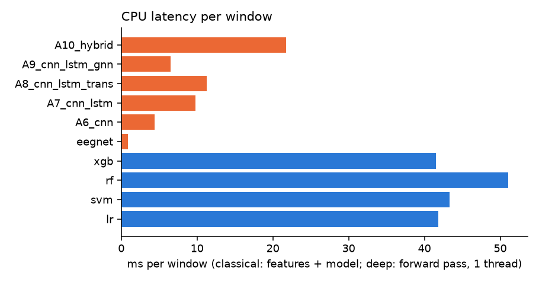

*Figure 6.3 — CPU latency per window (generated from the result files).*

## 6.9 Deployable checkpoints and the T3 hybrid issue
After cross-validation, deployable models were trained on all labelled subjects (`scripts/run_deep.py --final`,
`scripts/train_final_classical.py`):
<!-- BEGIN TABLE:models_deployed -->
| Model id (models/) | Task | Version | Temperature | CV experiment it represents | That experiment's fold macro-F1 |
|---|---|---|---|---|---|
| `T1_A10_hybrid` | workload_binary | A10_hybrid-T1-20261019 | 1.62 | deep_T1_A10_hybrid_kfold5 | 0.758 |
| `T1_A8_cnn_lstm_trans` | workload_binary | A8_cnn_lstm_trans-T1-20261019 | 1.10 | deep_T1_A8_cnn_lstm_trans_kfold5 | 0.773 |
| `T1_xgb_all` | workload_binary | xgb-all-T1-20261019 | — | cls_T1_xgb_all_none_loso | 0.859 |
| `T3_A10_hybrid` | workload_within_task | A10_hybrid-T3-20261019 | 20.00 | deep_T3_A10_hybrid_kfold5 | 0.389 |
| `T3_xgb_all` | workload_within_task | xgb-all-T3-20261019 | — | cls_T3_xgb_all_none_loso | — |

Source: `models/*.json` (written by `scripts/train_final_classical.py` and `scripts/run_deep.py --final`)
<!-- END TABLE:models_deployed -->

**Is the T3 hybrid "early stop at epoch 0" fixed? — No, and it cannot be fixed by tuning alone.** The final
T3 hybrid stopped at epoch 0 with T = 20.00 [`models/T3_A10_hybrid.json` → `temperature`] (the upper bound), so its
probabilities are ≈ 0.5. In cross-validation the same model is at chance (pooled AUROC
0.501 [`results/deep_T3_A10_hybrid_kfold5/metrics.json` → `pooled.auroc`]). Two code fixes were made before the
full runs — the validation split must contain both classes, and T = 1 when it does not
(`trainer.py:run_fold`, `train_model`) — but the underlying cause is that T3 contains no signal these models
can learn from 45 recordings. The near-0.5 output is the honest behaviour. It is documented in D18.

## 6.10 Limitations
Small, untuned models (no hyper-parameter search); 5 folds instead of LOSO; validation sets of ≈ 6 subjects
make early stopping and calibration noisy; CPU-only training capped at 25 epochs; kernel 32 instead of 64;
no data from more subjects; the GAT uses a single averaged PLV graph (band-specific graphs not tried).


---

# 7. Evaluation and results

## 7.1 Metrics — definitions and why
Implemented in `src/eegengine/evaluation/metrics.py:classification_metrics` (scikit-learn).

| Metric | Definition | Why it is used |
|---|---|---|
| **Macro-F1** (primary) | mean over classes of `F1_c = 2·P_c·R_c / (P_c + R_c)` | weights every class equally, so a model cannot score well by favouring the majority class; standard for imbalanced multi-class EEG tasks (T2/T3 are imbalanced) |
| **Balanced accuracy** | mean over classes of recall `TP_c / (TP_c + FN_c)` | chance level is exactly 1/n_classes regardless of imbalance — easy to compare with 0.5 |
| **Precision (macro)** | mean of `TP_c / (TP_c + FP_c)` | how trustworthy a predicted class is |
| **Recall (macro)** | mean of `TP_c / (TP_c + FN_c)` | how many true cases are found (= balanced accuracy) |
| **AUROC** | area under the ROC curve; binary: of P(high); 3-class: macro one-vs-rest over the classes present | threshold-free ranking quality; 0.5 = chance |
| **Confusion matrix** | counts of true vs predicted classes | shows *which* errors happen |
| **ECE** | `Σ_b (n_b/n)·|acc_b − conf_b|`, 15 bins | whether probabilities can be trusted (needed by the fusion component) |
| **Latency** | median ms per window on CPU | real-time feasibility (an output is due every 2 s) |

Three views of the out-of-fold predictions: **per fold** (mean ± std over folds where defined), **pooled**
(all predictions together) and **per recording** (mean probability per recording → one decision; for T3 one
decision per subject). Per-subject scores for the Wilcoxon tests use macro-F1 when every subject has both
classes (T1, T2) and accuracy otherwise (T3) (`metrics.py:per_subject_scores`).

## 7.2 Master results table (every experiment in `results/`)
<!-- BEGIN TABLE:master -->
| Experiment id (results/<id>/metrics.json) | Task | Kind | Model | Features | Norm | CV | Folds | Fold macro-F1 | Fold bal. acc | Pooled macro-F1 | Pooled precision | Pooled recall | Pooled AUROC | Recording macro-F1 | 18-s window fold macro-F1 (kfold5 classical) |
|---|---|---|---|---|---|---|---|---|---|---|---|---|---|---|---|
| cls_T1_lr_all_none_kfold5 | T1 | classical | lr | all | none | kfold5 | 5 | 0.841 ± 0.037 | 0.841 ± 0.036 | 0.841 | 0.843 | 0.841 | 0.912 | 0.927 | 0.896 ± 0.051 |
| cls_T1_lr_all_none_loso | T1 | classical | lr | all | none | loso | 48 | 0.836 ± 0.134 | 0.845 ± 0.118 | 0.845 | 0.845 | 0.845 | 0.918 | 0.948 | — |
| cls_T1_lr_all_rest_baseline_loso | T1 | classical | lr | all | rest_baseline | loso | 48 | 0.882 ± 0.142 | 0.892 ± 0.121 | 0.891 | 0.906 | 0.892 | 0.959 | 0.927 | — |
| cls_T1_rf_all_none_kfold5 | T1 | classical | rf | all | none | kfold5 | 5 | 0.860 ± 0.035 | 0.860 ± 0.035 | 0.859 | 0.859 | 0.859 | 0.929 | 0.948 | 0.907 ± 0.039 |
| cls_T1_rf_all_none_loso | T1 | classical | rf | all | none | loso | 48 | 0.844 ± 0.140 | 0.851 ± 0.128 | 0.851 | 0.851 | 0.851 | 0.926 | 0.938 | — |
| cls_T1_rf_all_rest_baseline_loso | T1 | classical | rf | all | rest_baseline | loso | 48 | 0.922 ± 0.109 | 0.926 ± 0.092 | 0.926 | 0.927 | 0.926 | 0.977 | 0.979 | — |
| cls_T1_svm_all_none_kfold5 | T1 | classical | svm | all | none | kfold5 | 5 | 0.854 ± 0.046 | 0.854 ± 0.046 | 0.855 | 0.858 | 0.855 | 0.932 | 0.896 | 0.897 ± 0.048 |
| cls_T1_svm_all_none_loso | T1 | classical | svm | all | none | loso | 48 | 0.850 ± 0.148 | 0.860 ± 0.130 | 0.859 | 0.862 | 0.860 | 0.938 | 0.906 | — |
| cls_T1_svm_all_rest_baseline_loso | T1 | classical | svm | all | rest_baseline | loso | 48 | 0.948 ± 0.101 | 0.951 ± 0.083 | 0.951 | 0.953 | 0.951 | 0.990 | 0.990 | — |
| cls_T1_xgb_A1_spectral_none_loso | T1 | classical | xgb | A1_spectral | none | loso | 48 | 0.802 ± 0.137 | 0.810 ± 0.124 | 0.810 | 0.811 | 0.810 | 0.890 | 0.895 | — |
| cls_T1_xgb_A1_spectral_rest_baseline_loso | T1 | classical | xgb | A1_spectral | rest_baseline | loso | 48 | 0.885 ± 0.133 | 0.893 ± 0.114 | 0.892 | 0.901 | 0.893 | 0.969 | 0.958 | — |
| cls_T1_xgb_A2_spectral_entropy_none_loso | T1 | classical | xgb | A2_spectral_entropy | none | loso | 48 | 0.819 ± 0.128 | 0.826 ± 0.116 | 0.826 | 0.828 | 0.826 | 0.904 | 0.927 | — |
| cls_T1_xgb_A2_spectral_entropy_rest_baseline_loso | T1 | classical | xgb | A2_spectral_entropy | rest_baseline | loso | 48 | 0.887 ± 0.127 | 0.893 ± 0.110 | 0.893 | 0.903 | 0.893 | 0.971 | 0.948 | — |
| cls_T1_xgb_A3_spectral_wavelet_none_loso | T1 | classical | xgb | A3_spectral_wavelet | none | loso | 48 | 0.812 ± 0.147 | 0.822 ± 0.130 | 0.822 | 0.823 | 0.822 | 0.897 | 0.895 | — |
| cls_T1_xgb_A3_spectral_wavelet_rest_baseline_loso | T1 | classical | xgb | A3_spectral_wavelet | rest_baseline | loso | 48 | 0.879 ± 0.155 | 0.889 ± 0.132 | 0.889 | 0.902 | 0.889 | 0.973 | 0.927 | — |
| cls_T1_xgb_A4_spectral_connectivity_none_loso | T1 | classical | xgb | A4_spectral_connectivity | none | loso | 48 | 0.860 ± 0.132 | 0.866 ± 0.121 | 0.866 | 0.867 | 0.866 | 0.938 | 0.927 | — |
| cls_T1_xgb_A4_spectral_connectivity_rest_baseline_loso | T1 | classical | xgb | A4_spectral_connectivity | rest_baseline | loso | 48 | 0.924 ± 0.114 | 0.929 ± 0.096 | 0.929 | 0.934 | 0.929 | 0.987 | 0.969 | — |
| cls_T1_xgb_A5_spectral_connectivity_graph_none_loso | T1 | classical | xgb | A5_spectral_connectivity_graph | none | loso | 48 | 0.865 ± 0.123 | 0.870 ± 0.113 | 0.870 | 0.871 | 0.870 | 0.940 | 0.937 | — |
| cls_T1_xgb_A5_spectral_connectivity_graph_rest_baseline_loso | T1 | classical | xgb | A5_spectral_connectivity_graph | rest_baseline | loso | 48 | 0.918 ± 0.127 | 0.924 ± 0.107 | 0.923 | 0.930 | 0.924 | 0.987 | 0.958 | — |
| cls_T1_xgb_all_none_kfold5 | T1 | classical | xgb | all | none | kfold5 | 5 | 0.874 ± 0.035 | 0.874 ± 0.035 | 0.874 | 0.875 | 0.874 | 0.942 | 0.958 | 0.915 ± 0.035 |
| cls_T1_xgb_all_none_loso | T1 | classical | xgb | all | none | loso | 48 | 0.859 ± 0.139 | 0.865 ± 0.127 | 0.865 | 0.867 | 0.865 | 0.941 | 0.917 | — |
| cls_T1_xgb_all_rest_baseline_loso | T1 | classical | xgb | all | rest_baseline | loso | 48 | 0.918 ± 0.128 | 0.924 ± 0.108 | 0.924 | 0.931 | 0.924 | 0.986 | 0.958 | — |
| cls_T2_lr_all_none_loso | T2 | classical | lr | all | none | loso | 45 | 0.417 ± 0.126 | 0.588 ± 0.192 | 0.537 | 0.537 | 0.538 | 0.738 | 0.568 | — |
| cls_T2_rf_all_none_loso | T2 | classical | rf | all | none | loso | 45 | 0.427 ± 0.139 | 0.631 ± 0.203 | 0.555 | 0.562 | 0.563 | 0.768 | 0.629 | — |
| cls_T2_svm_all_none_loso | T2 | classical | svm | all | none | loso | 45 | 0.421 ± 0.136 | 0.601 ± 0.212 | 0.544 | 0.544 | 0.546 | 0.726 | 0.572 | — |
| cls_T2_xgb_all_none_loso | T2 | classical | xgb | all | none | loso | 45 | 0.436 ± 0.134 | 0.623 ± 0.209 | 0.565 | 0.564 | 0.567 | 0.770 | 0.618 | — |
| cls_T2_xgb_all_rest_baseline_loso | T2 | classical | xgb | all | rest_baseline | loso | 45 | 0.439 ± 0.152 | 0.650 ± 0.211 | 0.555 | 0.571 | 0.563 | 0.821 | 0.538 | — |
| cls_T3_lr_all_none_kfold5 | T3 | classical | lr | all | none | kfold5 | 5 | 0.480 ± 0.103 | 0.501 ± 0.085 | 0.487 | 0.487 | 0.487 | 0.483 | 0.440 | 0.467 ± 0.117 |
| cls_T3_lr_all_none_loso | T3 | classical | lr | all | none | loso | 45 | — | — | 0.501 | 0.501 | 0.501 | 0.509 | 0.472 | — |
| cls_T3_rf_all_none_kfold5 | T3 | classical | rf | all | none | kfold5 | 5 | 0.512 ± 0.119 | 0.527 ± 0.105 | 0.531 | 0.536 | 0.533 | 0.534 | 0.583 | 0.525 ± 0.133 |
| cls_T3_rf_all_none_loso | T3 | classical | rf | all | none | loso | 45 | — | — | 0.527 | 0.531 | 0.529 | 0.536 | 0.556 | — |
| cls_T3_svm_all_none_kfold5 | T3 | classical | svm | all | none | kfold5 | 5 | 0.481 ± 0.099 | 0.493 ± 0.093 | 0.499 | 0.499 | 0.499 | 0.494 | 0.499 | 0.489 ± 0.129 |
| cls_T3_svm_all_none_loso | T3 | classical | svm | all | none | loso | 45 | — | — | 0.481 | 0.481 | 0.482 | 0.485 | 0.434 | — |
| cls_T3_xgb_A1_spectral_none_loso | T3 | classical | xgb | A1_spectral | none | loso | 45 | — | — | 0.481 | 0.481 | 0.481 | 0.474 | 0.440 | — |
| cls_T3_xgb_A1_spectral_rest_baseline_loso | T3 | classical | xgb | A1_spectral | rest_baseline | loso | 45 | — | — | 0.518 | 0.518 | 0.519 | 0.541 | 0.530 | — |
| cls_T3_xgb_A2_spectral_entropy_none_loso | T3 | classical | xgb | A2_spectral_entropy | none | loso | 45 | — | — | 0.465 | 0.465 | 0.465 | 0.450 | 0.440 | — |
| cls_T3_xgb_A2_spectral_entropy_rest_baseline_loso | T3 | classical | xgb | A2_spectral_entropy | rest_baseline | loso | 45 | — | — | 0.512 | 0.512 | 0.512 | 0.530 | 0.460 | — |
| cls_T3_xgb_A3_spectral_wavelet_none_loso | T3 | classical | xgb | A3_spectral_wavelet | none | loso | 45 | — | — | 0.481 | 0.481 | 0.481 | 0.464 | 0.464 | — |
| cls_T3_xgb_A3_spectral_wavelet_rest_baseline_loso | T3 | classical | xgb | A3_spectral_wavelet | rest_baseline | loso | 45 | — | — | 0.512 | 0.512 | 0.512 | 0.528 | 0.460 | — |
| cls_T3_xgb_A4_spectral_connectivity_none_loso | T3 | classical | xgb | A4_spectral_connectivity | none | loso | 45 | — | — | 0.542 | 0.543 | 0.542 | 0.562 | 0.564 | — |
| cls_T3_xgb_A4_spectral_connectivity_rest_baseline_loso | T3 | classical | xgb | A4_spectral_connectivity | rest_baseline | loso | 45 | — | — | 0.513 | 0.513 | 0.513 | 0.512 | 0.453 | — |
| cls_T3_xgb_A5_spectral_connectivity_graph_none_loso | T3 | classical | xgb | A5_spectral_connectivity_graph | none | loso | 45 | — | — | 0.534 | 0.534 | 0.534 | 0.552 | 0.570 | — |
| cls_T3_xgb_A5_spectral_connectivity_graph_rest_baseline_loso | T3 | classical | xgb | A5_spectral_connectivity_graph | rest_baseline | loso | 45 | — | — | 0.384 | 0.383 | 0.387 | 0.350 | 0.415 | — |
| cls_T3_xgb_all_none_kfold5 | T3 | classical | xgb | all | none | kfold5 | 5 | 0.530 ± 0.109 | 0.545 ± 0.093 | 0.548 | 0.548 | 0.548 | 0.550 | 0.590 | 0.543 ± 0.135 |
| cls_T3_xgb_all_none_loso | T3 | classical | xgb | all | none | loso | 45 | — | — | 0.538 | 0.539 | 0.539 | 0.544 | 0.545 | — |
| cls_T3_xgb_all_rest_baseline_loso | T3 | classical | xgb | all | rest_baseline | loso | 45 | — | — | 0.390 | 0.389 | 0.392 | 0.356 | 0.380 | — |
| deep_T1_A10_hybrid_kfold5 | T1 | deep | A10_hybrid | raw_epochs+graph | train_fold_channel_scale | kfold5 | 5 | 0.758 ± 0.103 | 0.765 ± 0.093 | 0.762 | 0.764 | 0.762 | 0.853 | 0.802 | — |
| deep_T1_A6_cnn_kfold5 | T1 | deep | A6_cnn | raw_epochs | train_fold_channel_scale | kfold5 | 5 | 0.701 ± 0.138 | 0.709 ± 0.127 | 0.705 | 0.710 | 0.706 | 0.782 | 0.768 | — |
| deep_T1_A7_cnn_lstm_kfold5 | T1 | deep | A7_cnn_lstm | raw_epochs | train_fold_channel_scale | kfold5 | 5 | 0.730 ± 0.091 | 0.736 ± 0.085 | 0.733 | 0.734 | 0.733 | 0.807 | 0.771 | — |
| deep_T1_A8_cnn_lstm_trans_kfold5 | T1 | deep | A8_cnn_lstm_trans | raw_epochs | train_fold_channel_scale | kfold5 | 5 | 0.773 ± 0.045 | 0.775 ± 0.045 | 0.774 | 0.778 | 0.775 | 0.835 | 0.833 | — |
| deep_T1_A9_cnn_lstm_gnn_kfold5 | T1 | deep | A9_cnn_lstm_gnn | raw_epochs+graph | train_fold_channel_scale | kfold5 | 5 | 0.751 ± 0.077 | 0.751 ± 0.077 | 0.749 | 0.749 | 0.749 | 0.827 | 0.812 | — |
| deep_T1_eegnet_kfold5 | T1 | deep | eegnet | raw_epochs | train_fold_channel_scale | kfold5 | 5 | 0.772 ± 0.099 | 0.773 ± 0.098 | 0.771 | 0.771 | 0.771 | 0.843 | 0.812 | — |
| deep_T3_A10_hybrid_kfold5 | T3 | deep | A10_hybrid | raw_epochs+graph | train_fold_channel_scale | kfold5 | 5 | 0.389 ± 0.062 | 0.492 ± 0.023 | 0.484 | 0.489 | 0.489 | 0.501 | 0.466 | — |
| deep_T3_A6_cnn_kfold5 | T3 | deep | A6_cnn | raw_epochs | train_fold_channel_scale | kfold5 | 5 | 0.458 ± 0.076 | 0.468 ± 0.084 | 0.469 | 0.470 | 0.470 | 0.447 | 0.434 | — |
| deep_T3_A7_cnn_lstm_kfold5 | T3 | deep | A7_cnn_lstm | raw_epochs | train_fold_channel_scale | kfold5 | 5 | 0.433 ± 0.089 | 0.476 ± 0.067 | 0.487 | 0.491 | 0.491 | 0.485 | 0.440 | — |
| deep_T3_A8_cnn_lstm_trans_kfold5 | T3 | deep | A8_cnn_lstm_trans | raw_epochs | train_fold_channel_scale | kfold5 | 5 | 0.412 ± 0.097 | 0.500 ± 0.043 | 0.501 | 0.505 | 0.504 | 0.504 | 0.527 | — |
| deep_T3_A9_cnn_lstm_gnn_kfold5 | T3 | deep | A9_cnn_lstm_gnn | raw_epochs+graph | train_fold_channel_scale | kfold5 | 5 | 0.487 ± 0.058 | 0.493 ± 0.058 | 0.495 | 0.495 | 0.495 | 0.484 | 0.398 | — |
| deep_T3_eegnet_kfold5 | T3 | deep | eegnet | raw_epochs | train_fold_channel_scale | kfold5 | 5 | 0.514 ± 0.076 | 0.536 ± 0.085 | 0.540 | 0.540 | 0.540 | 0.543 | 0.464 | — |
<!-- END TABLE:master -->

Headline comparison (same 5 folds, same 18-s windows, no rest baseline):

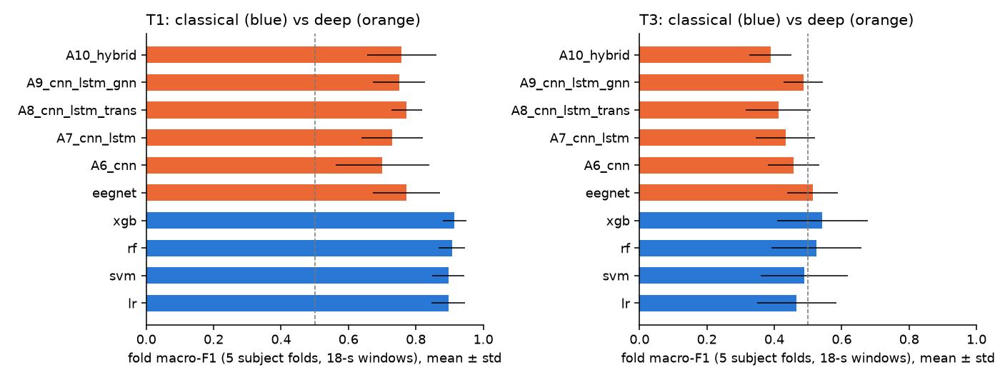

*Figure 7.1 — Classical (blue) vs deep (orange) models on identical folds and windows (generated from the result files).*

<!-- BEGIN TABLE:cls_kfold5 -->
| Task | Model | Epoch-level fold macro-F1 | Epoch-level pooled AUROC | 18-s window fold macro-F1 | 18-s window fold bal. acc | 18-s window pooled AUROC | Source |
|---|---|---|---|---|---|---|---|
| T1 | Logistic Regression | 0.841 ± 0.037 | 0.912 | 0.896 ± 0.051 | 0.897 ± 0.050 | 0.955 | `cls_T1_lr_all_none_kfold5` |
| T1 | SVM (RBF) | 0.854 ± 0.046 | 0.932 | 0.897 ± 0.048 | 0.897 ± 0.047 | 0.966 | `cls_T1_svm_all_none_kfold5` |
| T1 | Random Forest | 0.860 ± 0.035 | 0.929 | 0.907 ± 0.039 | 0.907 ± 0.039 | 0.969 | `cls_T1_rf_all_none_kfold5` |
| T1 | XGBoost | 0.874 ± 0.035 | 0.942 | 0.915 ± 0.035 | 0.915 ± 0.035 | 0.977 | `cls_T1_xgb_all_none_kfold5` |
| T3 | Logistic Regression | 0.480 ± 0.103 | 0.483 | 0.467 ± 0.117 | 0.485 ± 0.109 | 0.482 | `cls_T3_lr_all_none_kfold5` |
| T3 | SVM (RBF) | 0.481 ± 0.099 | 0.494 | 0.489 ± 0.129 | 0.503 ± 0.127 | 0.492 | `cls_T3_svm_all_none_kfold5` |
| T3 | Random Forest | 0.512 ± 0.119 | 0.534 | 0.525 ± 0.133 | 0.539 ± 0.120 | 0.542 | `cls_T3_rf_all_none_kfold5` |
| T3 | XGBoost | 0.530 ± 0.109 | 0.550 | 0.543 ± 0.135 | 0.559 ± 0.123 | 0.565 | `cls_T3_xgb_all_none_kfold5` |
<!-- END TABLE:cls_kfold5 -->

## 7.3 Rest-baseline inflation
<!-- BEGIN TABLE:rest_inflation -->
| Task | Model | Pooled bal. acc — none | — rest baseline | Δ | Recording bal. acc — none | — rest baseline | Sources |
|---|---|---|---|---|---|---|---|
| T1 | Logistic Regression | 0.845 | 0.892 | +0.047 | 0.948 | 0.927 | `cls_T1_lr_all_none_loso` / `cls_T1_lr_all_rest_baseline_loso` |
| T1 | SVM (RBF) | 0.860 | 0.951 | +0.091 | 0.906 | 0.990 | `cls_T1_svm_all_none_loso` / `cls_T1_svm_all_rest_baseline_loso` |
| T1 | Random Forest | 0.851 | 0.926 | +0.075 | 0.938 | 0.979 | `cls_T1_rf_all_none_loso` / `cls_T1_rf_all_rest_baseline_loso` |
| T1 | XGBoost | 0.865 | 0.924 | +0.059 | 0.917 | 0.958 | `cls_T1_xgb_all_none_loso` / `cls_T1_xgb_all_rest_baseline_loso` |
| T2 | XGBoost | 0.567 | 0.563 | -0.003 | 0.619 | 0.552 | `cls_T2_xgb_all_none_loso` / `cls_T2_xgb_all_rest_baseline_loso` |
| T3 | XGBoost | 0.539 | 0.392 | -0.147 | 0.545 | 0.385 | `cls_T3_xgb_all_none_loso` / `cls_T3_xgb_all_rest_baseline_loso` |
<!-- END TABLE:rest_inflation -->

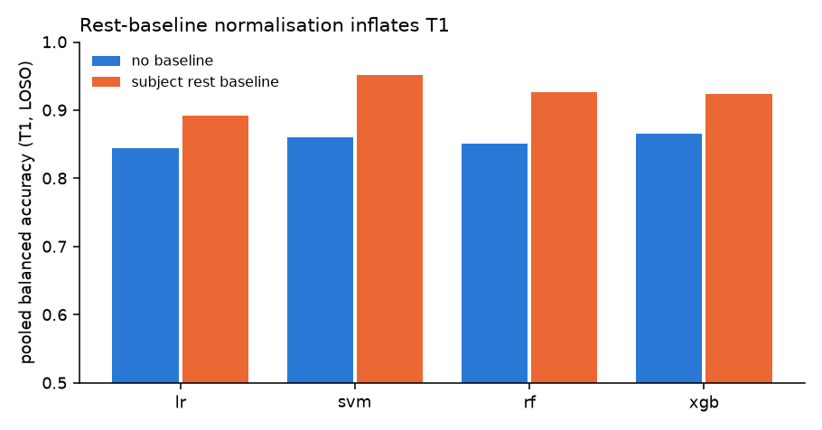

*Figure 7.2 — T1 balanced accuracy with vs without the subject rest baseline.*

With the rest baseline, every T1 model improves significantly (Wilcoxon on per-subject macro-F1:
SVM p = 2.6e-06 [`results/stats_classical.json` → `tests.12.p_value`], RF p = 3.6e-06 [`results/stats_classical.json` → `tests.14.p_value`],
XGBoost p = 0.0011 [`results/stats_classical.json` → `tests.16.p_value`], LR p = 0.0079 [`results/stats_classical.json` → `tests.10.p_value`]).
The reason is mechanical, not neurophysiological: z-scoring with the subject's own rest recording makes the
rest recording's average feature vector exactly 0 (§3.8), so recognising "the reference recording" becomes
easy. On T3 the rest baseline makes XGBoost *worse* (per-subject accuracy 0.404 [`results/stats_classical.json` → `tests.30.mean_a`]
vs 0.547 [`results/stats_classical.json` → `tests.30.mean_b`], p = 0.010 [`results/stats_classical.json` → `tests.30.p_value`]) — T3 contains no
rest/task contrast for it to exploit, and the extra subject-specific scaling adds variance. **No headline
result uses the rest baseline.**

## 7.4 Confusion matrices of the key models
<!-- BEGIN TABLE:confusions -->
**`cls_T1_xgb_all_none_loso` — pooled** (source: `results/cls_T1_xgb_all_none_loso/metrics.json` → `confusion_pooled`)

| true \ predicted | low | high |
|---|---|---|
| low | 2964 | 588 |
| high | 368 | 3184 |

**`cls_T1_xgb_all_none_loso` — per recording** (source: `results/cls_T1_xgb_all_none_loso/metrics.json` → `confusion_recording`)

| true \ predicted | low | high |
|---|---|---|
| low | 42 | 6 |
| high | 2 | 46 |

**`cls_T1_xgb_all_none_kfold5` — pooled** (source: `results/cls_T1_xgb_all_none_kfold5/metrics.json` → `confusion_pooled`)

| true \ predicted | low | high |
|---|---|---|
| low | 3023 | 529 |
| high | 367 | 3185 |

**`cls_T1_xgb_all_none_kfold5` — per recording** (source: `results/cls_T1_xgb_all_none_kfold5/metrics.json` → `confusion_recording`)

| true \ predicted | low | high |
|---|---|---|
| low | 46 | 2 |
| high | 2 | 46 |

**`deep_T1_A8_cnn_lstm_trans_kfold5` — pooled** (source: `results/deep_T1_A8_cnn_lstm_trans_kfold5/metrics.json` → `confusion_pooled`)

| true \ predicted | low | high |
|---|---|---|
| low | 1179 | 453 |
| high | 282 | 1350 |

**`deep_T1_A8_cnn_lstm_trans_kfold5` — per recording** (source: `results/deep_T1_A8_cnn_lstm_trans_kfold5/metrics.json` → `confusion_recording`)

| true \ predicted | low | high |
|---|---|---|
| low | 39 | 9 |
| high | 7 | 41 |

**`deep_T1_A10_hybrid_kfold5` — pooled** (source: `results/deep_T1_A10_hybrid_kfold5/metrics.json` → `confusion_pooled`)

| true \ predicted | low | high |
|---|---|---|
| low | 1311 | 321 |
| high | 456 | 1176 |

**`deep_T1_A10_hybrid_kfold5` — per recording** (source: `results/deep_T1_A10_hybrid_kfold5/metrics.json` → `confusion_recording`)

| true \ predicted | low | high |
|---|---|---|
| low | 41 | 7 |
| high | 12 | 36 |

**`cls_T3_xgb_all_none_loso` — pooled** (source: `results/cls_T3_xgb_all_none_loso/metrics.json` → `confusion_pooled`)

| true \ predicted | moderate | high |
|---|---|---|
| moderate | 686 | 794 |
| high | 715 | 1135 |

**`cls_T3_xgb_all_none_loso` — per recording** (source: `results/cls_T3_xgb_all_none_loso/metrics.json` → `confusion_recording`)

| true \ predicted | moderate | high |
|---|---|---|
| moderate | 9 | 11 |
| high | 9 | 16 |

**`deep_T3_A10_hybrid_kfold5` — pooled** (source: `results/deep_T3_A10_hybrid_kfold5/metrics.json` → `confusion_pooled`)

| true \ predicted | moderate | high |
|---|---|---|
| moderate | 367 | 313 |
| high | 477 | 373 |

**`deep_T3_A10_hybrid_kfold5` — per recording** (source: `results/deep_T3_A10_hybrid_kfold5/metrics.json` → `confusion_recording`)

| true \ predicted | moderate | high |
|---|---|---|
| moderate | 10 | 10 |
| high | 14 | 11 |

**`cls_T2_xgb_all_none_loso` — pooled** (source: `results/cls_T2_xgb_all_none_loso/metrics.json` → `confusion_pooled`)

| true \ predicted | low | medium | high |
|---|---|---|---|
| low | 2608 | 288 | 212 |
| medium | 427 | 561 | 714 |
| high | 172 | 695 | 983 |

**`cls_T2_xgb_all_none_loso` — per recording** (source: `results/cls_T2_xgb_all_none_loso/metrics.json` → `confusion_recording`)

| true \ predicted | low | medium | high |
|---|---|---|---|
| low | 38 | 2 | 2 |
| medium | 5 | 9 | 9 |
| high | 1 | 10 | 14 |

<!-- END TABLE:confusions -->

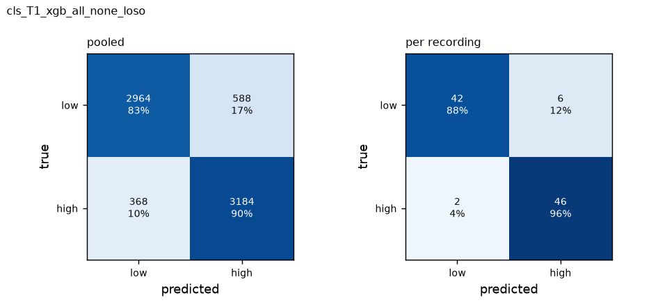

*Figure 7.3 — XGBoost T1 LOSO: more rest epochs are predicted as task (588) than task epochs as rest (368)
(`results/cls_T1_xgb_all_none_loso/metrics.json` → `confusion_pooled`); per recording only 8 of 96 are wrong.*

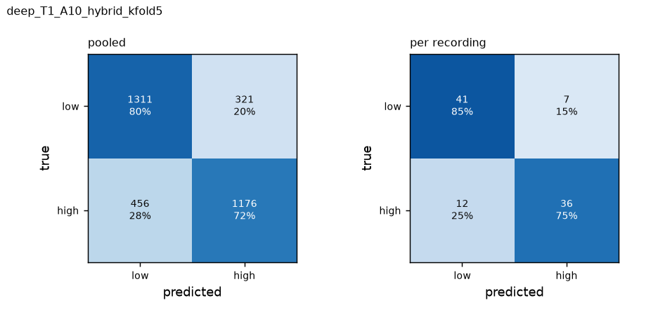

*Figure 7.4 — Full hybrid T1: more task windows are classified as rest than vice versa.*

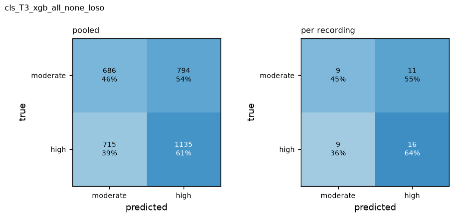

*Figure 7.5 — XGBoost T3 LOSO: near-random confusion.*

## 7.5 Leakage audit
Re-runnable with `scripts/audit_leakage.py`; written up in `docs/leakage_audit.md`.
<!-- BEGIN TABLE:leakage -->
| Check | Result | Verdict |
|---|---|---|
| Fold integrity | 58 experiments, problems: 0 | OK |
| Feature locality (5 epochs re-extracted alone) | max abs difference 0.0 | OK |
| Label-permutation test (3 runs, LR LOSO T1) | balanced accuracy 0.498, 0.508, 0.512; mean 0.506 | ≈ chance → OK |
| Subject-identity probe (random epoch split) | accuracy 0.995 (chance 0.021) | shows why subject-wise CV is required |
| Results with balanced accuracy > 0.97 | cls_T1_rf_all_rest_baseline_loso (recording_level, 0.979, rest_baseline); cls_T1_svm_all_rest_baseline_loso (recording_level, 0.990, rest_baseline) | audited (rest-baseline effect) |

Source: `results/leakage_audit.json`
<!-- END TABLE:leakage -->

* **Fold integrity:** for every saved prediction the fold id is compared with the subject — LOSO fold id must
  equal the test subject; 5-fold runs must match `results/folds_5fold.json`.
* **Shuffled-label control:** the full LOSO pipeline (StandardScaler + LR, all features, T1) with the lo/hi
  labels randomly swapped per subject and shuffled within subject, 3 times: balanced accuracy
  0.498 [`results/leakage_audit.json` → `permutation_test.runs.0.pooled_balanced_accuracy`],
  0.508 [`results/leakage_audit.json` → `permutation_test.runs.1.pooled_balanced_accuracy`],
  0.512 [`results/leakage_audit.json` → `permutation_test.runs.2.pooled_balanced_accuracy`] — chance. A leaking pipeline would
  stay above chance.
* **Feature locality:** features of 5 epochs re-extracted alone equal the batch values exactly.
* **Built-in guards:** `cv.py:assert_no_subject_overlap` on every split (also fit/val/test inside the deep
  trainer); scalers, selection and PCA inside the sklearn Pipeline; deep scalers fit on fit subjects; early
  stopping and temperature scaling on a subject-wise inner validation split; hyper-parameters fixed in advance.
* **The > 97 % cases:** only two, both **T1 + rest baseline, per-recording view**: SVM
  0.990 [`results/leakage_audit.json` → `results_above_97pct.1.balanced_accuracy`] and RF
  0.979 [`results/leakage_audit.json` → `results_above_97pct.0.balanced_accuracy`]. Without the baseline the same models give
  per-recording balanced accuracy 0.906 [`results/cls_T1_svm_all_none_loso/metrics.json` → `recording_level.balanced_accuracy`] and
  0.938 [`results/cls_T1_rf_all_none_loso/metrics.json` → `recording_level.balanced_accuracy`]. Explanation: the reference-recording
  effect of §3.8 (averaging a recording's 74 epochs makes "is this the zero-mean reference?" almost trivial). Not
  cross-subject leakage; reported separately and never used as a headline.
* **Answer to "is 0.95 real?":** the 0.951 [`results/cls_T1_svm_all_rest_baseline_loso/metrics.json` → `pooled.balanced_accuracy`] (SVM,
  T1, rest baseline) is real *for that protocol* but it is inflated by the rest baseline; the honest T1 number is
  0.865 [`results/cls_T1_xgb_all_none_loso/metrics.json` → `pooled.balanced_accuracy`] (XGBoost, no baseline, LOSO).

## 7.6 Key numbers
| What | Value |
|---|---|
| T1 best classical, LOSO, pooled macro-F1 | 0.865 [`results/cls_T1_xgb_all_none_loso/metrics.json` → `pooled.macro_f1`] |
| T1 best classical, LOSO, fold macro-F1 | 0.859 [`results/cls_T1_xgb_all_none_loso/metrics.json` → `per_fold.macro_f1.mean`] ± 0.139 [`results/cls_T1_xgb_all_none_loso/metrics.json` → `per_fold.macro_f1.std`] |
| T1 best classical, 5-fold, 18-s windows, fold macro-F1 | 0.915 [`results/cls_T1_xgb_all_none_kfold5/metrics.json` → `sequence_level.per_fold.macro_f1.mean`] ± 0.035 [`results/cls_T1_xgb_all_none_kfold5/metrics.json` → `sequence_level.per_fold.macro_f1.std`] |
| T1 best deep (A8), fold macro-F1 | 0.773 [`results/deep_T1_A8_cnn_lstm_trans_kfold5/metrics.json` → `per_fold.macro_f1.mean`] ± 0.045 [`results/deep_T1_A8_cnn_lstm_trans_kfold5/metrics.json` → `per_fold.macro_f1.std`] |
| T1 full hybrid (A10), fold macro-F1 | 0.758 [`results/deep_T1_A10_hybrid_kfold5/metrics.json` → `per_fold.macro_f1.mean`] ± 0.103 [`results/deep_T1_A10_hybrid_kfold5/metrics.json` → `per_fold.macro_f1.std`] |
| T3 best classical, LOSO, pooled macro-F1 / AUROC | 0.538 [`results/cls_T3_xgb_all_none_loso/metrics.json` → `pooled.macro_f1`] / 0.544 [`results/cls_T3_xgb_all_none_loso/metrics.json` → `pooled.auroc`] |
| T3 best deep (EEGNet), fold macro-F1 | 0.514 [`results/deep_T3_eegnet_kfold5/metrics.json` → `per_fold.macro_f1.mean`] |
| T3 full hybrid, fold macro-F1 / pooled AUROC | 0.389 [`results/deep_T3_A10_hybrid_kfold5/metrics.json` → `per_fold.macro_f1.mean`] / 0.501 [`results/deep_T3_A10_hybrid_kfold5/metrics.json` → `pooled.auroc`] |

## 7.7 Interpretation
1. **T1 works across subjects.** Rest and multitasking are separated for unseen people with balanced accuracy
   ≈ 0.87 per epoch and ≈ 0.92 over 18-s windows. Averaging over a longer window helps because single 4-s
   epochs are noisy.
2. **Connectivity helps.** Adding PLV/coherence is the only significant improvement over band power on T1 —
   the network-level coupling between regions changes between rest and task beyond what local power shows.
   Graph metrics add nothing beyond the PLV values they are computed from.
3. **T3 ≈ chance — the central scientific finding.** When condition is held fixed, neither 1,499 handcrafted
   features nor any deep model separates moderate from high self-rated workload. Plausible reasons: (a) only 45
   labelled recordings, one per subject, so between-subject differences in EEG dwarf the effect; (b) self-ratings
   are subjective and compressed (task ratings 4–9, most 5–8), so the "moderate" vs "high" boundary at 6/7 is
   noisy; (c) all subjects did the same task, so the true workload difference between groups may be small;
   (d) consumer-grade EEG with frequent artefacts. Consequence: high T1 scores mainly reflect the rest-vs-task
   difference (which also includes eye/hand movement and arousal), not a calibrated workload scale.
4. **The hybrid does not beat XGBoost on 48 subjects.** Reasons, in order of likely importance: (a) **data size**
   — ≈ 38 training subjects per fold is very small for a 141 k-parameter model that must learn its own filters,
   whereas XGBoost starts from 1,499 engineered features that already encode decades of EEG knowledge;
   (b) **inductive bias** — band power and PLV are exactly the information that separates T1, and the trees use
   it directly; the network must discover it from raw signals under strong between-subject variability;
   (c) **training budget/tuning** — CPU-only training, ≤ 25 epochs, untuned hyper-parameters, kernel 32, and
   early stopping on ≈ 6 validation subjects (best epoch 0 in T1 fold 1 for every deep model, §6.5); (d) the
   deep models never see the rest baseline or engineered connectivity features except through the GAT's mean-PLV
   graph. EEGNet (1.6 k parameters) doing as well as the 141 k-parameter hybrid supports the small-data explanation.
5. **Calibration** is partially successful; with tiny validation sets it can also hurt.

## 7.8 Comparison with published STEW results
The repository does **not** cite any published STEW classification results, so no comparison numbers are
given here (NOT AVAILABLE). What should be looked up before the final report:
* the original STEW paper (Lim, Sourina & Wang, 2018, IEEE TNSRE) — its reported rest-vs-task and
  rating-based accuracies and **its evaluation protocol**;
* later papers that report STEW accuracies (often > 90 %) — check whether they use **random epoch splits or
  within-subject splits** (which our subject-identity probe shows to be heavily optimistic) vs subject-independent
  evaluation like ours;
* any subject-independent (LOSO) STEW results for a like-for-like comparison.


---

# 8. System architecture — engine, API, dashboard

## 8.1 Repository structure (`component1/`)
```
component1/
├── CLAUDE.md, README.md, PROGRESS.md      project conventions, user guide (with generated results), progress log
├── pyproject.toml, requirements.txt       package definition (eegengine), Python dependencies
├── configs/                               YAML for preprocessing, features and every experiment
│   ├── quality.yaml  preprocess.yaml  preprocess_2s.yaml  features.yaml
│   └── experiments/ classical.yaml  classical_rest.yaml  classical_kfold5.yaml  deep.yaml
├── data/                                  (git-ignored) raw/STEW/*.txt + processed/ epochs & features (hash-named)
├── src/eegengine/                         the Python package
│   ├── io/stew.py                         STEW loader, labels helper, MNE conversion
│   ├── labels.py                          T1/T2/T3 label builder + masks
│   ├── quality/                           checks.py (per-window checks), report.py (dataset report)
│   ├── preprocess/                        dc, filters, bad_channels, ica, epoching, normalize, pipeline
│   ├── features/                          spectral, entropy, wavelet, connectivity, graph, extract
│   ├── models/                            classical.py; deep/ eegnet, cnn_lstm, gat, hybrid
│   ├── training/                          cv, sequences, classical_runner, trainer, deep_runner, calibration
│   ├── evaluation/                        metrics, ablation (Wilcoxon + Holm), reports
│   ├── inference/                         engine, schema (output contract), heuristics, predictors
│   ├── config.py, data.py                 paths/YAML/seeding; hash-based data location
├── scripts/                               one entry point per pipeline step + run_all.py + build_report.py
├── api/main.py                            FastAPI app (REST + WebSocket)
├── frontend/                              React + Vite + TypeScript + Tailwind dashboard (+ public/demo snapshot)
├── models/                                deployable models (*.joblib / *.pt) + JSON metadata
├── results/                               every experiment's outputs + summaries + figures
├── tests/                                 pytest suite
├── docs/                                  decisions, labels, output contract (+schema, example), leakage audit, viva notes, this report
└── Dockerfile.api, frontend/Dockerfile, frontend/nginx.conf, docker-compose.yml   optional containers
```
The full file-by-file index is in the appendix.

## 8.2 CognitiveEngine — the real-time flow
`src/eegengine/inference/engine.py:CognitiveEngine` (default `model="T1_xgb_all"`, `ema_alpha=0.4`,
`context_s=20`, `connectivity_band="alpha"`). `push(chunk)` appends raw samples (14 × n, µV, DC offset
allowed); every time a new 4-s window is complete (a new one every 2 s, the same grid as the training epochs)
`_process(end)` runs:

```mermaid
sequenceDiagram
    participant Src as Headset / replay
    participant E as CognitiveEngine
    participant P as Predictor (XGB .joblib or deep .pt)
    Src->>E: push(chunk 14×n µV)
    E->>E: filter last 20 s (mean removal, FIR 0.5–45 Hz, notch 50 Hz), keep newest 4 s
    E->>E: assess_window → quality flags; rolling history of hard-bad channels (30 windows)
    E->>E: channel bad in ≥ 60 % of ≥ 10 recent windows → spherical-spline interpolation, re-assess
    E->>E: extract_features (same function as training) → features, band power, PLV
    E->>P: predict(buffer of the last 1 or 8 windows)
    P-->>E: calibrated class probabilities
    E->>E: heuristic indices; EMA smoothing s_t = α·x_t + (1−α)·s_{t−1}, α = 0.4
    E-->>Src: CognitiveStateOutput (pydantic) incl. latency_ms
```
* **Predictors** (`inference/predictors.py`): `ClassicalPredictor` (joblib bundle: estimator + feature
  columns; uses the newest window) and `DeepPredictor` (checkpoint with state_dict, model/scaler config and
  temperature; uses the last ≤ 8 windows; EEGNet averages per-epoch probabilities). `list_models()` reads the
  JSON sidecars in `models/`.
* **Streaming = batch:** pushing odd-sized chunks gives exactly the same outputs as one big push
  (`tests/test_engine_api.py:test_engine_streaming_matches_batch`).
* **Online vs offline filtering:** online uses 20 s of context instead of the whole recording; band powers
  agree within 5 % (`test_engine_band_power_close_to_offline`).
* **End-to-end latency** (filter + quality + features + model + JSON) measured on the replayed demo
  recordings: median 98.4 [`results/engine_latency.json` → `median_ms`] ms per window, p95
  121.4 [`results/engine_latency.json` → `p95_ms`] ms, with XGBoost — far below the 2-s budget.

### Heuristic indices — exact formulas and why they are heuristic
`src/eegengine/inference/heuristics.py:heuristic_indices` (band power summed over the listed channels):
* **attention = engagement index** `E = β / (α + θ)` over all 14 channels (Pope, Bogart & Bartolome, 1995).
* **fatigue** `F = (θ + α) / β` over P7, P8, O1, O2 (Jap, Lal, Fischer & Bekiaris, 2009). Computed over the
  *same* channels it would be exactly 1/E, so the posterior sites — where alpha/theta increase most with
  fatigue — are used to give it information of its own.
* **readiness** `R = 0.5·E/(1+E) + 0.5·1/(1+F)` — a transparent 0–1 combination (high engagement and low
  fatigue → near 1) chosen for the dashboard, **not a validated measure**.
They are **heuristic, not trained**, because STEW has no attention/fatigue/readiness labels: there is nothing
to train or validate a model against. Every output marks them `source: "heuristic_index"` with the note
"heuristic index — not a trained prediction", and the dashboard shows a visible badge. Being ratios, their
scale differs between people; they should be compared within a person over time.

## 8.3 Output contract
`src/eegengine/inference/schema.py` (pydantic, schema version 1.0.0); documentation `docs/output_contract.md`;
JSON Schema `docs/output_contract.schema.json` (also served at `GET /schema`); real example
`docs/output_example.json` (also `GET /contract/sample`), regenerated by `scripts/export_contract.py`.

| Field | Meaning |
|---|---|
| `schema_version`, `participant_id`, `session_id`, `window_index` | identification; window 0, 1, 2, … |
| `timestamp_start/end` (ISO 8601 UTC), `t_start_s/t_end_s` | window edges |
| `signal_quality.overall` (0–1), `.flag` (good/warn/bad), `.bad_channels`, `.interpolated_channels` | trust in this window |
| `states.workload.label/probabilities/raw_probabilities/confidence/source="model"/model_version/task` | the trained prediction (smoothed and raw) |
| `states.attention/fatigue/readiness.value/raw_value/source="heuristic_index"/formula/note` | heuristic indices |
| `band_power` {channel: {band: µV²}}, `band_power_unit` | evidence for XAI |
| `connectivity` {metric "plv", band, channels, 14×14 matrix} | evidence for XAI / brain view |
| `latency_ms` | processing time of the window |

`task` tells consumers the label set (`workload_binary`: low/high; `workload_within_task`: moderate/high).
Stability promise: fields are never removed within a major version; when attention/fatigue/readiness become
trained, their `source` switches to `"model"`.

Full real example (`docs/output_example.json`):
<!-- BEGIN TABLE:output_example -->
```json
{
  "schema_version": "1.0.0",
  "participant_id": "sub01",
  "session_id": "example-sub01-hi",
  "window_index": 8,
  "timestamp_start": "2026-10-19T14:53:44.162120+00:00",
  "timestamp_end": "2026-10-19T14:53:48.162120+00:00",
  "t_start_s": 16.0,
  "t_end_s": 20.0,
  "signal_quality": {
    "overall": 0.9285714285714286,
    "flag": "warn",
    "bad_channels": [
      "AF3"
    ],
    "interpolated_channels": []
  },
  "states": {
    "workload": {
      "label": "high",
      "probabilities": {
        "low": 0.058183277882667174,
        "high": 0.9418167221173328
      },
      "raw_probabilities": {
        "low": 0.06814136609961711,
        "high": 0.9318586339003829
      },
      "confidence": 0.9418167221173328,
      "source": "model",
      "model_version": "A10_hybrid-T1-20261019",
      "task": "workload_binary"
    },
    "attention": {
      "value": 0.3720720888940098,
      "raw_value": 0.5138092523912298,
      "source": "heuristic_index",
      "formula": "engagement = beta / (alpha + theta), all channels (Pope et al., 1995)",
      "note": "heuristic index \u2014 not a trained prediction"
    },
    "fatigue": {
      "value": 2.0113450543829896,
      "raw_value": 2.4474272969254836,
      "source": "heuristic_index",
      "formula": "(theta + alpha) / beta, channels P7 P8 O1 O2 (Jap et al., 2009)",
      "note": "heuristic index \u2014 not a trained prediction"
    },
    "readiness": {
      "value": 0.3009565440055719,
      "raw_value": 0.31474308690206165,
      "source": "heuristic_index",
      "formula": "0.5*E/(1+E) + 0.5*1/(1+F), E = engagement, F = fatigue index",
      "note": "heuristic index \u2014 not a trained prediction"
    }
  },
  "band_power": {
    "AF3": {
      "delta": 110.75843048095703,
      "theta": 20.783336639404297,
      "alpha": 8.348448753356934,
      "beta": 19.349763870239258,
      "gamma": 6.644127368927002
    },
    "F7": {
      "delta": 274.59295654296875,
      "theta": 49.26381301879883,
      "alpha": 13.707437515258789,
      "beta": 21.706527709960938,
      "gamma": 11.24522876739502
    },
    "F3": {
      "delta": 25.103782653808594,
      "theta": 5.944693088531494,
      "alpha": 7.127309322357178,
      "beta": 9.699406623840332,
      "gamma": 5.452876091003418
    },
    "FC5": {
      "delta": 71.22528839111328,
      "theta": 13.248261451721191,
      "alpha": 4.13751745223999,
      "beta": 12.077031135559082,
      "gamma": 6.392486572265625
    },
    "T7": {
      "delta": 51.396480560302734,
      "theta": 6.120129585266113,
      "alpha": 3.723794937133789,
      "beta": 6.83806037902832,
      "gamma": 5.176726341247559
    },
    "P7": {
      "delta": 58.926937103271484,
      "theta": 8.264906883239746,
      "alpha": 3.197747230529785,
      "beta": 8.67247200012207,
      "gamma": 5.52169132232666
    },
    "O1": {
      "delta": 140.0385284423828,
      "theta": 21.865211486816406,
      "alpha": 8.788727760314941,
      "beta": 8.367042541503906,
      "gamma": 4.035991668701172
    },
    "O2": {
      "delta": 56.313079833984375,
      "theta": 13.507505416870117,
      "alpha": 11.93719482421875,
      "beta": 10.40793514251709,
      "gamma": 5.905566215515137
    },
    "P8": {
      "delta": 93.63929748535156,
      "theta": 16.901254653930664,
      "alpha": 8.860452651977539,
      "beta": 10.683611869812012,
      "gamma": 6.831902503967285
    },
    "T8": {
      "delta": 97.138916015625,
      "theta": 21.19915771484375,
      "alpha": 10.347604751586914,
      "beta": 11.547039985656738,
      "gamma": 7.321165561676025
    },
    "FC6": {
      "delta": 382.5666198730469,
      "theta": 23.34512710571289,
      "alpha": 10.680864334106445,
      "beta": 16.667661666870117,
      "gamma": 6.2488884925842285
    },
    "F4": {
      "delta": 858.5726318359375,
      "theta": 20.60382843017578,
      "alpha": 10.7993745803833,
      "beta": 18.579910278320312,
      "gamma": 9.950177192687988
    },
    "F8": {
      "delta": 416.6779479980469,
      "theta": 40.217376708984375,
      "alpha": 21.798734664916992,
      "beta": 19.0502872467041,
      "gamma": 7.097566604614258
    },
    "AF4": {
      "delta": 93.14506530761719,
      "theta": 19.432640075683594,
      "alpha": 18.049301147460938,
      "beta": 43.28441619873047,
      "gamma": 30.396207809448242
    }
  },
  "band_power_unit": "uV^2",
  "connectivity": {
    "metric": "plv",
    "band": "alpha",
    "channels": [
      "AF3",
      "F7",
      "F3",
      "FC5",
      "T7",
      "P7",
      "O1",
      "O2",
      "P8",
      "T8",
      "FC6",
      "F4",
      "F8",
      "AF4"
    ],
    "matrix": [
      [
        1.0,
        0.6753000020980835,
        0.46959999203681946,
        0.5468999743461609,
        0.3140999972820282,
        0.19009999930858612,
        0.039000000804662704,
        0.14790000021457672,
        0.08349999785423279,
        0.11469999700784683,
        0.22030000388622284,
        0.4032999873161316,
        0.3066999912261963,
        0.49230000376701355
      ],
      [
        0.6753000020980835,
        1.0,
        0.5202999711036682,
        0.7307000160217285,
        0.3546999990940094,
        0.2240999937057495,
        0.08250000327825546,
        0.026900000870227814,
        0.1282999962568283,
        0.2125999927520752,
        0.1615000069141388,
        0.38989999890327454,
        0.10779999941587448,
        0.27489998936653137
      ],
      [
        0.46959999203681946,
        0.5202999711036682,
        1.0,
        0.6031000018119812,
        0.3578000068664551,
        0.2517000138759613,
        0.11020000278949738,
        0.2554999887943268,
        0.3328999876976013,
        0.25690001249313354,
        0.49079999327659607,
        0.6873000264167786,
        0.5078999996185303,
        0.6420000195503235
      ],
      [
        0.5468999743461609,
        0.7307000160217285,
        0.6031000018119812,
        1.0,
        0.4537999927997589,
        0.2676999866962433,
        0.0357000008225441,
        0.1632000058889389,
        0.19550000131130219,
        0.20360000431537628,
        0.2797999978065491,
        0.4300000071525574,
        0.26460000872612,
        0.29330000281333923
      ],
      [
        0.3140999972820282,
        0.3546999990940094,
        0.3578000068664551,
        0.4537999927997589,
        1.0,
        0.48739999532699585,
        0.09000000357627869,
        0.14000000059604645,
        0.271699994802475,
        0.19550000131130219,
        0.33980000019073486,
        0.24959999322891235,
        0.3644999861717224,
        0.35670000314712524
      ],
      [
        0.19009999930858612,
        0.2240999937057495,
        0.2517000138759613,
        0.2676999866962433,
        0.48739999532699585,
        1.0,
        0.2248000055551529,
        0.4438000023365021,
        0.2605000138282776,
        0.4088999927043915,
        0.3059999942779541,
        0.164900004863739,
        0.3336000144481659,
        0.14480000734329224
      ],
      [
        0.039000000804662704,
        0.08250000327825546,
        0.11020000278949738,
        0.0357000008225441,
        0.09000000357627869,
        0.2248000055551529,
        1.0,
        0.3978999853134155,
        0.4027999937534332,
        0.31709998846054077,
        0.38999998569488525,
        0.21140000224113464,
        0.30329999327659607,
        0.21240000426769257
      ],
      [
        0.14790000021457672,
        0.026900000870227814,
        0.2554999887943268,
        0.1632000058889389,
        0.14000000059604645,
        0.4438000023365021,
        0.3978999853134155,
        1.0,
        0.8057000041007996,
        0.8050000071525574,
        0.7303000092506409,
        0.3968000113964081,
        0.6855000257492065,
        0.4009999930858612
      ],
      [
        0.08349999785423279,
        0.1282999962568283,
        0.3328999876976013,
        0.19550000131130219,
        0.271699994802475,
        0.2605000138282776,
        0.4027999937534332,
        0.8057000041007996,
        1.0,
        0.8355000019073486,
        0.8614000082015991,
        0.5059000253677368,
        0.7806000113487244,
        0.4941999912261963
      ],
      [
        0.11469999700784683,
        0.2125999927520752,
        0.25690001249313354,
        0.20360000431537628,
        0.19550000131130219,
        0.4088999927043915,
        0.31709998846054077,
        0.8050000071525574,
        0.8355000019073486,
        1.0,
        0.7213000059127808,
        0.3215999901294708,
        0.7598999738693237,
        0.44749999046325684
      ],
      [
        0.22030000388622284,
        0.1615000069141388,
        0.49079999327659607,
        0.2797999978065491,
        0.33980000019073486,
        0.3059999942779541,
        0.38999998569488525,
        0.7303000092506409,
        0.8614000082015991,
        0.7213000059127808,
        1.0,
        0.614799976348877,
        0.8553000092506409,
        0.657800018787384
      ],
      [
        0.4032999873161316,
        0.38989999890327454,
        0.6873000264167786,
        0.4300000071525574,
        0.24959999322891235,
        0.164900004863739,
        0.21140000224113464,
        0.3968000113964081,
        0.5059000253677368,
        0.3215999901294708,
        0.614799976348877,
        1.0,
        0.5454999804496765,
        0.5740000009536743
      ],
      [
        0.3066999912261963,
        0.10779999941587448,
        0.5078999996185303,
        0.26460000872612,
        0.3644999861717224,
        0.3336000144481659,
        0.30329999327659607,
        0.6855000257492065,
        0.7806000113487244,
        0.7598999738693237,
        0.8553000092506409,
        0.5454999804496765,
        1.0,
        0.733299970626831
      ],
      [
        0.49230000376701355,
        0.27489998936653137,
        0.6420000195503235,
        0.29330000281333923,
        0.35670000314712524,
        0.14480000734329224,
        0.21240000426769257,
        0.4009999930858612,
        0.4941999912261963,
        0.44749999046325684,
        0.657800018787384,
        0.5740000009536743,
        0.733299970626831,
        1.0
      ]
    ]
  },
  "latency_ms": 45.18480000842828
}
```
<!-- END TABLE:output_example -->

## 8.4 FastAPI backend
`api/main.py` (FastAPI 0.146, uvicorn). Run: `.venv\Scripts\python -m uvicorn api.main:app --host 127.0.0.1 --port 8000`.
<!-- BEGIN TABLE:api_endpoints -->
| Method | Path |
|---|---|
| GET | `/health` |
| GET | `/subjects` |
| GET | `/models` |
| GET | `/results/summary` |
| GET | `/results/{experiment_id}` |
| GET | `/results/{experiment_id}/files/{name}` |
| GET | `/quality` |
| GET | `/quality/{subject}/{condition}` |
| GET | `/schema` |
| GET | `/contract/sample` |
| POST | `/predict` |
| WS | `/stream/{subject}/{condition}` |

Source: decorators in `api/main.py`
<!-- END TABLE:api_endpoints -->

| Endpoint | Request | Response | Errors |
|---|---|---|---|
| `GET /health` | — | status, version, number of models, fs, channels | — |
| `GET /subjects` | — | 48 subjects with ratings, T2 levels, T3 label, rated flag; falls back to `results/eda/recordings.csv` if the raw data is absent | 503 if neither exists |
| `GET /models` | — | deployable models from `models/*.json` | — |
| `GET /results/summary` | — | `results/summary.json` (all tables, built by `scripts/export_report.py`) | 404 if not generated |
| `GET /results/{experiment_id}` | — | that experiment's `metrics.json` + list of files | 404 unknown / path traversal |
| `GET /results/{id}/files/{name}` | — | a PNG/CSV/YAML of the experiment | 404 |
| `GET /quality` | — | per-recording good/warn/bad counts, usable fraction, interpolated channels + reasons | 503 if processed data missing |
| `GET /quality/{subject}/{condition}` | — | per-window flag, score, bad channels | 404 unknown recording |
| `GET /schema` | — | JSON Schema of `CognitiveStateOutput` | — |
| `GET /contract/sample?model=` | — | one real output (first 10 s of sub01 task) | 404 unknown model, 503 data missing |
| `POST /predict` | multipart: `file` (STEW text samples×14, or JSON `{"data": [[14 × n]]}`), `model`, `participant_id`, `session_id` | list of `CognitiveStateOutput` | 400 unparsable / not 14 channels / < 4 s |
| `WS /stream/{subject}/{condition}?model=&speed=` | — | `meta` once; per window a `raw` message (newest 2 s of filtered signal at 64 Hz; first window 4 s) then a `state` message; finally `end`; `error` on problems | error message if recording/model missing |

**WebSocket streaming design.** The server replays a STEW recording in 2-s chunks, waits `2 s / speed` between
chunks (speed 1–50), and runs `engine.push` in a worker thread (`run_in_executor`) so the event loop stays
responsive. The display signal is decimated to 64 Hz to keep messages small.

**Errors as 503, and the "CORS" bug story.** During testing the dashboard reported *"blocked by CORS policy:
No 'Access-Control-Allow-Origin' header"* although `CORSMiddleware` allowed `localhost:5173`. Diagnosis with
`curl -i -H "Origin: http://localhost:5173"`: `/health` carried the CORS header but `/subjects` returned a bare
**500** — the raw STEW folder had been deleted, `ratings.txt` was missing, and Starlette's 500 error page
carries **no CORS headers**, so the browser misreported a server crash as a CORS block. Fixes (commit `59d5fb8`):
a `FileNotFoundError` handler returns **503 with a hint** (and keeps the CORS headers); `/subjects` falls back
to the committed EDA table; the WebSocket explains missing recordings; tests cover both
(`test_missing_data_is_503_with_cors`, `test_subjects_fallback_without_raw_data`). The dataset was restored
from the original download and the rebuilt features were byte-identical to the originals.

**CORS + Vite proxy.** The dashboard calls the relative base `/api`; the Vite dev server (and `vite preview`)
proxies `/api` — HTTP and the `/api/stream` WebSocket — to `http://127.0.0.1:8000` (`frontend/vite.config.ts`),
so the browser never makes a cross-origin request. `127.0.0.1` is used instead of `localhost` because on
Windows `localhost` may resolve to IPv6 `::1`, where uvicorn is not listening. `VITE_API_URL` bypasses the
proxy (then CORS applies, allowed for ports 5173/4173); `API_TARGET` retargets it; nginx does the same proxying
in Docker (`frontend/nginx.conf`).

## 8.5 React dashboard
Stack: React 19, Vite 6, TypeScript 5.8, Tailwind CSS 4, Recharts 2, React Router 7 (HashRouter so the built
site runs from any folder), IBM Plex fonts; colour tokens for light/dark themes in `src/index.css`.

| Page (route) | What it shows | Main components |
|---|---|---|
| Live Monitor (`/`) | subject/recording/model/speed pickers; scrolling 14-channel EEG (canvas, ±75 µV per row, bad channels red, interpolated marked *); workload card (label, confidence, probability bars, model version); attention/fatigue/readiness cards with sparklines and a visible **"heuristic index — not a trained prediction"** badge; workload probability timeline with a confidence band (±1 SD of the last 5 per-window predictions); per-window quality squares | `StreamControls`, `EEGTrace`, `StateCards`, `WorkloadTimeline`, `QualityIndicator` |
| Brain View (`/brain`) | SVG 10-20 head map coloured by band power (band selector; relative/absolute), PLV network graph with a threshold slider (edge width/opacity = PLV, node size = strength) — both update live | `HeadMap`, `NetworkGraph` |
| Signal Quality (`/quality`) | summary stats, sortable/filterable per-recording table (good/warn/bad, usable %, interpolated channels with reasons), channel × window grid of flagged windows | `SignalQuality` |
| Results (`/results`) | task selector; baseline table; feature ablation A1–A5 bars (norm toggle); architecture ablation A6–A10 bars; 5-fold comparison table; confusion matrices (selectable); reliability diagram; latency chart; Wilcoxon table — **all from `/results/summary`, nothing hard-coded** | `MetricBars`, `Reliability`, `Confusion` |
| Integration / API (`/integration`) | endpoint list, output-contract field table rendered from `/schema`, live JSON of the latest output (or `/contract/sample`) | `Integration` |
| About (`/about`) | pipeline diagram (SVG), dataset description, limitations (workload-only labels, heuristic indices, rest-vs-task confound, why T3 matters, rest baseline, consumer headset, CPU) | `About` |

**Data flow.** `lib/api.ts:getJSON` (REST via `/api`) and `lib/stream.tsx:StreamProvider` (one WebSocket for the
whole app, shared by Live Monitor and Brain View, survives page changes) → React state → Recharts / SVG /
canvas. `lib/useApi.ts` refetches when demo mode toggles.
**Demo mode (offline).** `scripts/export_demo.py` calls the same functions the API serves and writes
`frontend/public/demo/*.json` (subjects, models, results summary, quality tables, schema, sample, and the exact
WebSocket message sequences of 8 recordings: subjects 1, 2, 16, 38 × rest/task). `lib/settings.tsx` switches to
demo mode automatically when the API is unreachable; `stream.tsx` replays the messages with the same timing.
Header toggles: Demo/Live, Projector (larger type), Light/Dark (remembered in `localStorage`, guarded).

## 8.6 How to run
```powershell
cd component1
py -3.13 -m venv .venv
.venv\Scripts\python -m pip install -r requirements.txt
.venv\Scripts\python -m pip install -e .
# put STEW files in data\raw\STEW\  (sub01_lo.txt … sub48_hi.txt, ratings.txt)
.venv\Scripts\python scripts\run_all.py            # whole pipeline (hours); --quick skips long runs; --from <step>
.venv\Scripts\python -m uvicorn api.main:app --host 127.0.0.1 --port 8000
cd frontend; npm install; npm run dev              # http://127.0.0.1:5173
.venv\Scripts\python -m pytest                     # tests
.venv\Scripts\python scripts\build_report.py       # this report
```
`scripts/run_all.py` steps: eda → quality → preprocess (+ICA demo) → preprocess_2s → features → baselines →
baselines_rest → ablation → classical_kfold5 → deep_smoke → deep → deep_stats → final_classical → final_deep →
report → contract → audit → demo → tests (each logged to `results/logs/`, stops at the first failure).

## 8.7 Reproducibility
* Fixed seeds (42; deep folds 42 + fold); fixed, saved 5-fold assignment (`results/folds_5fold.json`).
* Every experiment is a YAML config; each results folder holds a copy (`config.yaml`), `metrics.json`,
  `folds.csv`, `predictions.csv`, `confusion_matrix.png` (deep: + `history.csv`, `reliability.png`).
* Generated data are named by configuration hash (`epochs_6d7dd612`, `features_4041d9e6`).
* **Byte-identical rebuild:** `run_all.py --quick` from a deleted `data/processed/` produced a features file
  with the same MD5 (`65dc139f8d39…`) as the original; the same check was repeated after restoring the raw
  dataset from the original download.
* Summary tables are generated, never typed (`scripts/export_report.py`, `scripts/build_report.py`).

## 8.8 Docker (optional)
`docker-compose.yml` defines `api` (from `Dockerfile.api`, Python 3.11-slim, CPU PyTorch) and `frontend`
(Node build → nginx with `/api` proxy), mounting `data/`, `results/`, `models/` read-only.
**The Docker images were written but not built or tested** on the development machine (NOT AVAILABLE).

## 8.9 Tests
<!-- BEGIN TABLE:tests -->
| Test file | What it covers | Test functions |
|---|---|---|
| `tests/test_engine_api.py` | Phase 6 tests: inference engine, output contract, heuristics, and the FastAPI app. | 15 |
| `tests/test_features.py` | Phase 3 tests: connectivity, band powers, graph metrics, feature table structure. | 18 |
| `tests/test_models_cv.py` | Tests for the deep models, the masked multi-task loss, calibration, metrics and the CV leakage guard. | 14 |
| `tests/test_preprocess.py` | Phase 2 tests: filters, epoching, bad-channel repair, normalisation, labels. | 17 |
| `tests/test_quality.py` | Tests for the signal quality checks, using synthetic signals with known defects. | 12 |
| `tests/test_stew_loader.py` | Tests for the STEW loader and label builder. | 13 |

Test functions: 89; collected test cases (after `@pytest.mark.parametrize` expansion): 105.
<!-- END TABLE:tests -->

Coverage in brief: loader shapes/labels/missing ratings/orientation/MNE conversion; each quality check on
synthetic defects; filter responses, zero phase, notch, epoch counts, blink tolerance, bad-channel repair,
normalisation (rest baseline uses only rest), label rules and real class counts; PLV limits, coherence vs SciPy,
band-power sums, entropy/Hjorth/wavelet properties, graph metrics on known graphs, feature structure;
**CV leakage guard** (LOSO, fixed folds, overlap assertion, scaler inside pipeline), sequences within recordings,
every hybrid branch combination, masked loss, GAT adjacency, temperature scaling, metrics, Wilcoxon/Holm;
engine full recording, streaming = batch, online ≈ offline band power, heuristic formulas, every API endpoint,
WebSocket, upload, 503/CORS and fallback. Tests that need the raw data skip cleanly when it is absent.

## 8.10 Tech stack (versions)
<!-- BEGIN TABLE:versions -->
| Package | Required (requirements.txt / package.json) | Installed in the dev environment |
|---|---|---|
| Python | ≥ 3.11 (pyproject) | 3.13.7 |
| numpy | numpy>=1.26 | 2.5.4 |
| scipy | scipy>=1.11 | 1.18.1 |
| pandas | pandas>=2.1 | 3.0.6 |
| pyarrow | pyarrow>=14 | 26.0.0 |
| matplotlib | matplotlib>=3.8 | 3.11.2 |
| PyYAML | PyYAML>=6.0 | 6.0.3 |
| mne | mne>=1.6 | 1.13.2 |
| PyWavelets | PyWavelets>=1.5 | 1.10.0 |
| networkx | networkx>=3.2 | 3.7 |
| scikit-learn | scikit-learn>=1.4 | 1.9.1 |
| xgboost | xgboost>=2.0 | 3.4.1 |
| torch | torch>=2.2 | 2.14.1 |
| joblib | (dependency) | 1.6.0 |
| fastapi | fastapi>=0.110 | 0.146.0 |
| uvicorn | uvicorn[standard]>=0.27 | 0.54.0 |
| pydantic | pydantic>=2.5 | 2.14.1 |
| python-multipart | python-multipart>=0.0.9 | 0.0.32 |
| httpx | httpx>=0.27 | 0.28.1 |
| websockets | (dependency) | 17.2 |
| pytest | pytest>=8.0 | 9.1.1 |
| react | ^19.1.0 | 19.3.1 |
| react-dom | ^19.1.0 | 19.3.1 |
| react-router-dom | ^7.6.2 | 7.18.4 |
| recharts | ^2.15.3 | 2.15.3 |
| @tailwindcss/vite | ^4.1.10 | 4.1.10 |
| @vitejs/plugin-react | ^4.4.1 | 4.7.0 |
| tailwindcss | ^4.1.10 | 4.1.10 |
| typescript | ~5.8.3 | 5.8.3 |
| vite | ^6.3.5 | 6.4.4 |
<!-- END TABLE:versions -->


---

# 9. Proposal alignment

**The proposal document (`docs/proposal.docx`) is NOT AVAILABLE in the repository**, so proposal section
numbers (§1.4, §3, §4.6–4.15) could not be checked against the text. The table maps every requirement of
the author's brief — which summarises those sections — to its implementation. Where the brief named a
proposal section, it is shown; otherwise "brief".

| Requirement (source) | Implemented? | Where | Evidence | Deviation + reason |
|---|---|---|---|---|
| Reproducible Python engine, config-driven, seeds fixed (brief) | Yes | `configs/`, `src/eegengine/config.py`, `scripts/run_all.py` | byte-identical rebuild (§8.7) | — |
| STEW loader, 96 recordings, labels, MNE RawArray + 10-20 montage (brief) | Yes | `io/stew.py` | 19 loader tests | `colin27_1020` = `standard_1020` positions (D5) |
| Missing ratings masked, never dropped (brief) | Yes | `labels.py` | `docs/labels.md` | — |
| Signal quality: flatline, amplitude, robust variance z, HF/line-noise; mark not delete; CSV + JSON (brief) | Yes | `quality/` | `results/quality/`, `results/preprocessing/` | EMG band 30–45 Hz instead of > 45 Hz (D4); detrended windows (D6); blink tolerance (D7) |
| DC removal, 0.5–45 Hz zero-phase FIR, 50 Hz notch (brief, proposal preprocessing section) | Yes | `preprocess/filters.py` | filter tests, PSD figures | — |
| Optional ICA with AF3/AF4 as EOG proxies, default OFF, log components (brief) | Yes (OFF) | `preprocess/ica.py` | `results/preprocessing/ica_demo_log.json` | effect on accuracy not evaluated |
| Persistent bad channels interpolated (spherical spline), logged (brief) | Yes | `preprocess/bad_channels.py` | `results/preprocessing/interpolation_log.csv` | rule refined to median-window std (D8) |
| Epoching 4 s / 50 % overlap; also test 2 s (brief) | Partly | `preprocess/epoching.py`, `configs/preprocess_2s.yaml` | 7104 epochs | **2-s epochs generated but not evaluated** (time, D14) |
| Normalisation none / epoch z / rest baseline; report with and without baseline (brief) | Yes | `preprocess/normalize.py` | §7.3 | T2/T3 baseline comparison only for XGBoost (D14) |
| T1, T2, T3 labels; T3 as confound-free primary result (brief) | Yes | `labels.py` | `docs/labels.md` | — |
| Features: Welch abs/rel band power, ratios, frontal asymmetry (brief, proposal features section) | Yes | `features/spectral.py` | 185 features | — |
| Spectral entropy, Hjorth, variance, skewness, kurtosis (brief) | Yes | `features/entropy.py` | 84 features | Hjorth activity stored once as log variance |
| DWT db4 5 levels: energy, relative energy, std, wavelet entropy (brief) | Yes | `features/wavelet.py` | 266 features | — |
| PLV (Hilbert) + magnitude-squared coherence per band; matrices saved + upper triangles (brief) | Yes | `features/connectivity.py` | 2 × 364 features, `features_*_arrays.npz` | — |
| Graph metrics from PLV with proportional/absolute/weighted thresholding (brief) | Yes | `features/graph.py` | 236 features | proportional 30 % used |
| Tests: PLV identical = 1, random ≈ 0, band sums (brief) | Yes | `tests/test_features.py` | 18 tests | — |
| Classical pipelines LR/SVM/RF/XGB, fit inside folds (brief, proposal models section) | Yes | `models/classical.py` | §5 | fixed hyper-parameters, smaller RF/XGB (D12) |
| LOSO for T1, T2, T3; per-subject aggregation for T3 (brief) | Yes | `training/cv.py`, `classical_runner.py` | `results/cls_*_loso` | 4 workers / reduced grid on the shared laptop (D14) |
| Feature ablation A1–A5 + all with best model (brief / proposal ablation A1–A5) | Yes | `scripts/run_ablation.py` | §5.4 | T2 only "all" with baseline (D15) |
| Wilcoxon signed-rank on per-subject scores (brief) | Yes | `evaluation/ablation.py` | 35 + 14 tests | Holm correction added |
| Metrics macro-F1, bal. acc., precision, recall, AUROC, confusion, latency; mean ± std (brief) | Yes | `evaluation/metrics.py` | §7 | — |
| Deep inputs: raw epochs, connectivity matrices, sequences of 8 (brief) | Yes | `training/trainer.py`, `sequences.py` | §6.1 | — |
| EEGNet (brief) | Yes | `models/deep/eegnet.py` | §6.2 | temporal kernel 32 instead of 64 (D17) |
| CNN-LSTM (brief) | Yes | `models/deep/cnn_lstm.py` | §6.3 | — |
| Hybrid per proposal §4.10: CNN, LSTM, Transformer (2 layers + PE), GAT in plain PyTorch, fusion, 4 heads, masked multi-task loss, switchable branches (brief) | Yes | `models/deep/hybrid.py`, `gat.py` | §6.4 | GAT uses one mean-PLV graph |
| AdamW, early stopping on subject-wise inner validation, class weights, augmentation, seeds (brief) | Yes | `training/trainer.py` | §6.5 | small validation sets make early stopping noisy |
| 5-fold by subject, same folds for all deep models; T1 and T3 (T2 optional) (brief) | Yes (T2 not run) | `results/folds_5fold.json` | 12 deep experiments | T2 deep not run (optional in the brief) |
| Architecture ablation A6–A10 (brief / proposal A6–A10) | Yes | `configs/experiments/deep.yaml` | §6.6 | — |
| Temperature scaling, ECE before/after, reliability diagram (brief) | Yes | `training/calibration.py` | §6.7 | does not improve every model |
| CPU latency per window (brief) | Yes | `trainer.py:measure_latency`, `results/engine_latency.json` | §6.8 | — |
| Best checkpoints in `models/`; summary_deep.md; summary_all.md (brief) | Yes | `models/`, `results/summary_*.md` | — | — |
| CognitiveEngine: quality → preprocess → features → model → EMA → pydantic output (brief) | Yes | `inference/engine.py` | §8.2 | — |
| Heuristic attention/fatigue/readiness with documented formulas, marked heuristic (brief) | Yes | `inference/heuristics.py` | — | fatigue uses posterior channels (else = 1/engagement) |
| Output contract doc + JSON Schema for teammates (brief) | Yes | `docs/output_contract.md`, `.schema.json` | — | — |
| FastAPI: health, subjects, models, results, schema, predict, WS stream; CORS; API tests (brief) | Yes | `api/main.py` | 15 engine/API tests | added `/quality`, `/contract/sample`, 503 handler, Vite proxy |
| React dashboard: 6 pages, dark/light, projector, demo mode, no hard-coded numbers (brief) | Yes | `frontend/` | `npm run build` clean | browser console not inspected by the author's tooling |
| run_all, leakage guard tests, leakage audit, README, viva notes, Docker (brief) | Yes (Docker untested) | `scripts/run_all.py`, `docs/` | 105 test cases | Docker not built (NOT AVAILABLE) |
| Proposal §1.4 scope items | NOT AVAILABLE | — | — | proposal document missing |
| Proposal §3 objectives | mapped via the brief in `01_overview.md` §1.3 | — | — | proposal document missing |
| Proposal §2.14 STEW as pilot dataset | consistent | — | — | proposal document missing |

## 9.1 Still planned for the team-collected data
| Item | Status | What is ready | What is missing |
|---|---|---|---|
| Attention / fatigue / readiness labels | Not started (no data) | masked heads in the hybrid; label CSV format in README; heuristic indices as placeholders | labelled recordings; label columns + masks; retraining; validation |
| Live acquisition via LSL (Lab Streaming Layer) | **Not implemented** | `CognitiveEngine.push(chunk)` accepts any chunk size; streaming = batch is tested | an LSL inlet (e.g. `pylsl`) that reads the Emotiv stream and calls `push` |
| Emotiv integration (EmotivPRO / Cortex API) | **Not implemented** | channel order, 128 Hz, µV with DC offset are already the expected input | API credentials/SDK, mapping of the Emotiv stream to `push`, device contact-quality |
| Per-user calibration session | Partly | rest-baseline normalisation implemented and evaluated | protocol for a short baseline before each session; with/without comparison on team data |
| Multimodal fusion with the computer-vision component | Interface ready | timestamped JSON + quality flag + calibrated probabilities | fusion model (other component) |


---

# 10. Limitations and future work

## 10.1 Limitations (honest list)
1. **Workload-only labels.** STEW labels only workload (condition + self-rating). Attention, fatigue and
   learning readiness are heuristic band-power indices, not trained or validated predictions.
2. **Rest-vs-task confound.** T1 compares sitting still with a demanding visual-motor task; eye movements,
   hand movements and arousal differ, so T1 accuracy overstates what is learned about mental workload.
3. **T2 ≈ T1.** Rest is rated low (42/3/0) and task medium/high (0/20/25); T2 mostly re-measures T1.
4. **T3 is small and at chance.** 45 labelled recordings, one per subject; no model beats chance. This limits
   any claim of graded workload detection.
5. **Small N for deep learning.** 48 subjects (≈ 38 training subjects per fold) is small for a 141 k-parameter
   hybrid; EEGNet with 1.6 k parameters performs as well.
6. **CPU-only, lightly tuned deep models.** ≤ 25 epochs, fixed hyper-parameters, kernel 32, early stopping on
   ≈ 6 validation subjects (best epoch 0 in T1 fold 1 for every model).
7. **Deep models on 5 folds, not LOSO**, so classical-LOSO and deep numbers are not directly comparable (the
   paired 5-fold comparison is).
8. **Calibration is fragile** — temperature scaling from small validation sets improved some models and hurt
   others; T hits its bounds on T3.
9. **Fixed classical hyper-parameters** (no nested tuning) and a reduced experiment grid (D14, D15).
10. **ICA off; no EOG channel.** Blinks are flagged, not removed; frontal channels carry eye artefacts.
11. **Consumer headset artefacts.** Final flags: bad 0.1225 [`results/preprocessing/quality_raw_vs_filtered.json` → `filtered_interpolated_final.bad`]
    of windows; 30 channels interpolated in 26 recordings; two recordings < 50 % usable.
12. **Volume conduction** inflates PLV/coherence between neighbouring electrodes; no lag-insensitive measure.
13. **2-s epochs not evaluated**, bootstrap CIs and rating correlation (Spearman) not computed.
14. **Online vs offline filtering differ slightly** (20-s context; band power within 5 %).
15. **Heuristic indices are ratios** with person-specific scales; readiness is an ad-hoc combination.
16. **No live headset integration** (LSL/Emotiv) and Docker images untested.
17. **Single dataset**; no external validation; the proposal document was not available to check alignment.
18. **Shared development machine** — runtime/latency measurements vary with background load.

## 10.2 Future work (prioritised)
| Priority | Work | Why | What is needed |
|---|---|---|---|
| 1 | Collect the team Emotiv dataset with attention/fatigue/readiness labels | the core goal of the component; replaces heuristic indices | protocol + ethics approval, labelling scheme (README format), ≥ 20–30 participants |
| 2 | Design tasks with graded workload *within* one condition (e.g. n-back levels) | T3 showed STEW cannot test graded workload; a within-task manipulation gives clean labels | task software, counterbalancing |
| 3 | Live acquisition (LSL inlet → `CognitiveEngine.push`) | real-time use in the learning system | `pylsl`, Emotiv Cortex access, device contact-quality |
| 4 | Per-user calibration protocol (short rest + easy-task baseline before a session) and evaluate with/without | between-subject variability dominates; calibration is realistic in deployment | protocol + evaluation on team data (baseline from a *separate* recording) |
| 5 | Deep-model improvements: GPU training, hyper-parameter search, LOSO, larger validation sets, pre-training on larger public EEG corpora, band-specific graphs | close the gap to XGBoost | GPU access, time |
| 6 | Statistics: bootstrap CIs, Spearman correlation of P(high) with ratings, more permutations | stronger evidence | compute time only |
| 7 | Artefact handling: evaluate ICA on/off, lag-insensitive connectivity (wPLI, imaginary coherence) | reduce eye/EMG and volume-conduction effects | compute time |
| 8 | Evaluate 2-s epochs (already preprocessed) | faster response, more windows | compute time |
| 9 | Explainability for the XAI component: feature importances / SHAP for XGBoost, attention maps for the GAT | trust and interpretability | integration with the XAI component |
| 10 | Build and test the Docker images; CI pipeline running the tests | deployment | a machine with Docker |


---

# 11. Viva guide

## 11.1 Two-minute explanation (spoken)
"My component is the EEG engine of our neuroadaptive learning system. It takes raw 14-channel EEG from an
Emotiv EPOC headset and, every two seconds, outputs a timestamped JSON message with the learner's estimated
workload, its confidence, a signal-quality flag, and the brain evidence behind it, for the fusion, XAI and
cueing components and for our dashboard.

I developed and validated it on STEW, a public dataset recorded with the same headset: 48 people, each at
rest and during a multitasking test, with a 1-to-9 workload rating. The pipeline checks signal quality,
filters 0.5 to 45 Hz with a zero-phase FIR filter, removes 50 Hz mains noise, repairs broken electrodes by
spherical-spline interpolation, cuts 4-second windows and extracts 1,499 features — band powers, entropy,
wavelets, phase-locking and coherence between electrodes, and brain-network graph metrics. I compared
logistic regression, SVM, random forest and XGBoost with leave-one-subject-out validation, and EEGNet,
a CNN-LSTM and a hybrid CNN-LSTM-Transformer-graph-attention network on fixed subject folds.

Rest versus task is detected well for unseen people — XGBoost reaches about 0.87 macro-F1 per 4-second
window and about 0.92 over 18-second windows — and connectivity features help most. But when I remove the
rest-versus-task difference and only compare moderate against high self-rated workload during the task,
every model is at chance. So the honest conclusion is: the engine detects 'doing a demanding task versus
resting' reliably, but STEW does not support graded workload detection. The system, API and dashboard are
complete, and the multi-task heads for attention, fatigue and readiness are ready for our own labelled data."

## 11.2 Five-minute explanation (spoken, with structure)
1. **Problem and role (30 s).** Adaptive learning needs a continuous, objective measure of the learner's
   cognitive state. EEG gives that directly. My component converts raw EEG into calibrated state estimates in
   a stable JSON contract for the other three components.
2. **Data and labels (45 s).** STEW: 48 subjects, Emotiv EPOC, 128 Hz, 2.5 min rest + 2.5 min SIMKAP
   multitasking, 1–9 workload ratings, three subjects unrated. Three tasks: T1 rest vs task; T2 rating levels;
   T3 moderate vs high *within* the task. I showed that T2 is almost identical to T1 (rest is rated low, task
   medium/high), so T3 is the only confound-free workload test.
3. **Signal processing (60 s).** Quality checks per window and channel (flat, amplitude, variance z-score,
   EMG at 30–45 Hz because the Emotiv low-passes at 43 Hz, 50 Hz line noise); windows are marked, never deleted,
   and frontal blinks only produce 'warn'. Mean removal, zero-phase FIR 0.5–45 Hz (linear phase preserves the
   phase relations PLV needs), 50 Hz notch (Sri Lanka mains), spherical-spline interpolation of 30 persistently
   broken channels, 4-s windows with 50 % overlap.
4. **Features and models (60 s).** 1,499 features in six families; four classical models in sklearn pipelines;
   leave-one-subject-out because a random split lets the model recognise the person — I measured 99.5 % subject
   identification with random splits. Deep models: EEGNet, CNN-LSTM, and a hybrid where a CNN encodes each
   epoch, an LSTM and a Transformer model the sequence of 8 epochs, and a graph-attention network uses band power
   as node features and phase-locking as edges; four task heads with a masked loss so unlabelled states don't
   train. Temperature scaling for calibration.
5. **Results (60 s).** T1: XGBoost best (pooled macro-F1 0.865 LOSO; 0.915 on 18-s windows); connectivity is the
   family that adds significantly; deep models are significantly worse on the same folds (best 0.773). The
   rest-baseline normalisation inflates T1 to 0.95 for the SVM, which I explain and exclude from headlines.
   T3 is at chance for all models. A label-permutation test gives 0.506, so there is no leakage.
6. **System (30 s).** Real-time engine with EMA smoothing, ~100 ms per window; FastAPI with REST and WebSocket
   streaming; React dashboard with live EEG, head map, brain network, quality, results and an offline demo mode.
7. **Limitations and next steps (15 s).** Workload-only labels, small N, CPU training. Next: our own labelled
   Emotiv data, a within-task workload manipulation, live LSL streaming, per-user calibration.

## 11.3 Demo script (evaluation day)
Preparation (before the panel arrives): close other heavy applications; open two terminals in `component1/`.
1. Terminal 1: `.venv\Scripts\python -m uvicorn api.main:app --host 127.0.0.1 --port 8000` — wait for
   "Application startup complete". (If "Errno 10048": `netstat -ano | findstr :8000`, `taskkill /PID <pid> /F`.)
2. Terminal 2: `cd frontend` → `npm run dev` → open **http://127.0.0.1:5173**. Header must show "API online"
   and "Live API" (if the API fails, switch on **Demo (offline)** — subjects 1, 2, 16, 38 are bundled).
3. **About page (30 s):** show the pipeline diagram and the limitations box — sets honest expectations.
4. **Live Monitor:** model `T1_xgb_all`, Subject 01, recording **hi — SIMKAP task**, speed **2×**, Start.
   Point out: scrolling 14-channel EEG; red rows = channels failing quality now; the workload card ("model
   prediction" badge) with probabilities and confidence; attention/fatigue/readiness with the **"heuristic index
   — not a trained prediction"** badge; the probability timeline with the confidence band; the quality squares.
   Then Stop, switch to **lo — rest**, Start: the workload moves towards "low".
5. **Brain View:** while streaming, change the band (theta → alpha → beta) on the head map; move the PLV
   threshold slider and show edges appearing/disappearing; mention volume conduction.
6. **Signal Quality:** sort by "usable ↑": show sub27_hi / sub37_lo below 50 % (kept, not dropped); click
   sub01_lo → the channel × window grid shows T7 bad everywhere before interpolation → interpolated.
7. **Results:** T1 tab — baseline table, rest-baseline rows in amber, feature ablation bars (connectivity), the
   5-fold comparison (XGBoost vs deep), reliability diagram; then **T3 tab** — everything at chance; explain why
   this is the key finding.
8. **Integration / API:** the contract table and the live JSON; open `http://127.0.0.1:8000/docs` to show the
   Swagger UI.
9. Optional: `.venv\Scripts\python -m pytest` — 105 tests pass (~40 s).

## 11.4 Likely examiner questions with model answers

### A. Dataset and labels
1. **Why STEW?** — Same Emotiv EPOC headset (14 channels, 128 Hz) as our planned system, public, and it has
   workload labels, so I could build and validate the full pipeline before our own data exists.
2. **What exactly are the conditions?** — 2.5 min resting and 2.5 min SIMKAP multitasking per subject; each
   followed by a 1–9 workload self-rating.
3. **What about the three subjects without ratings?** — Subjects 5, 24 and 42 keep their rest/task labels (T1)
   but are masked (label −1) for T2 and T3; they are never dropped.
4. **What is T3 and why did you create it?** — Moderate (4–6) vs high (7–9) workload inside the task only. T1 and
   T2 are confounded with the condition; T3 keeps the condition fixed, so only workload differs.
5. **Why is T2 confounded?** — Rest recordings are rated low/medium/high 42/3/0 and task recordings 0/20/25, so
   predicting the level is almost the same as predicting rest vs task.
6. **Is the rating difference real?** — Yes: all 45 rated subjects rated the task higher; Wilcoxon p ≈ 4.3e-9.
7. **How many samples do you have?** — 96 recordings × 74 four-second epochs = 7,104 epochs; for T3, 45
   recordings = 3,330 epochs, but only 45 independent labels.
8. **Is class balance an issue?** — T1 is balanced; T2/T3 are imbalanced, so I use macro-F1, balanced accuracy and
   class weights.

### B. Preprocessing
9. **Why 0.5–45 Hz?** — 0.5 Hz removes drift and sweat artefacts but keeps delta; 45 Hz keeps gamma for the features,
   stays below 50 Hz mains and matches the Emotiv's ~43 Hz on-board low-pass.
10. **Why a zero-phase FIR filter?** — Linear phase does not distort the waveform or the phase relations between
    channels, which PLV depends on; zero-phase compensates the delay.
11. **Why a 50 Hz notch?** — Sri Lanka's mains frequency is 50 Hz; it is mostly redundant after the 45 Hz low-pass but
    protects against other headsets/rooms.
12. **Why is ICA off?** — No EOG channel, so AF3/AF4 must act as proxies, and they contain frontal brain signal —
    removing those components risks deleting frontal theta, the key workload rhythm. With 14 channels ICA is also
    limited. It is implemented and logged as an option.
13. **How do you detect bad channels?** — Persistently bad = flat or hard-failing in ≥ 60 % of windows, or a median
    window amplitude > 4× the median channel. At most 3 per recording are rebuilt by spherical-spline interpolation;
    30 channels in 26 recordings, each logged with its reason.
14. **Why the median, not the overall std?** — A few huge spikes inflate the overall std and would condemn a good
    channel; those windows are flagged instead.
15. **Why do blinks only produce "warn"?** — Blinks are normal and frequent, and they also occur in live use; the
    models must cope with them. Only non-blink failures make a window "bad".
16. **Why 30–45 Hz for EMG, not above 45 Hz?** — The Emotiv low-passes on board at ~43 Hz; above 45 Hz there was no
    power even in noisy data (ratio ≈ 0.001), so the check had to move inside the passband.
17. **Why 4-s windows with 50 % overlap?** — 4 s gives stable spectra and phase estimates down to delta; the overlap
    doubles training windows and gives an output every 2 s.
18. **Do you delete bad windows?** — No. They are flagged; experiments could exclude them from training, but all
    reported results train on all windows so the models see realistic noise.

### C. Features
19. **What does theta/alpha/beta mean for workload?** — Frontal theta rises with working-memory load; alpha drops
    with engagement/visual attention (it reflects idling/inhibition); beta reflects active processing.
20. **Why relative and absolute power?** — Absolute power depends on impedance and skull thickness; relative power
    normalises within each channel and epoch.
21. **What is Welch's method?** — Averaging periodograms of overlapping windowed segments (here 2-s Hann segments,
    50 % overlap) to reduce variance.
22. **What are Hjorth parameters?** — Activity = variance; mobility = √(var(x′)/var(x)) ≈ mean frequency;
    complexity = mobility of the derivative / mobility ≈ bandwidth.
23. **Why db4 wavelets?** — Compact, EEG-like shape, the most common choice; 5 levels at 128 Hz map onto the
    classical bands.
24. **What is PLV?** — |mean over time of exp(i·phase difference)| after band filtering and the Hilbert transform;
    1 = phase-locked, 0 = random.
25. **PLV vs coherence?** — Coherence depends on amplitude and phase consistency across segments; PLV on phase
    only. They give partly independent views.
26. **What is volume conduction?** — One source reaches several nearby electrodes instantly, inflating zero-lag
    coupling between neighbours. Measures like wPLI would avoid it; I list it as a limitation.
27. **Why proportional thresholding for graphs?** — It fixes the density (top 30 % edges), so graph metrics compare
    structure rather than overall PLV level, which differs between people.
28. **Which feature family mattered?** — Connectivity: spectral 0.810 → spectral + connectivity 0.866 on T1,
    p = 5.4e-05; entropy helps a little; wavelets and graph metrics add nothing significant.
29. **Isn't 1,499 features too many for 48 subjects?** — Tree ensembles and L2-regularised models handle it, and
    everything is fit inside the folds; the ablation shows a few families carry the signal. Feature selection is
    implemented but was not needed.

### D. Classical models
30. **Why these four models?** — A linear baseline (LR), the classic EEG kernel method (SVM), and two tree
    ensembles that are strong on tabular features (RF, XGBoost).
31. **Why XGBoost as the best?** — A pre-defined rule: lowest mean rank of pooled macro-F1 over T1 and T3 without
    the baseline; XGBoost ranked first on both.
32. **Did you tune hyper-parameters?** — No; fixed conventional settings, chosen before evaluation, so there is no
    optimism from tuning on test subjects (D12).
33. **How do you handle class imbalance?** — Balanced class weights (LR, SVM, RF) and balanced sample weights
    (XGBoost); macro metrics.
34. **Are your SVM probabilities calibrated?** — No, I skipped Platt scaling for speed; the scores are used for
    ranking (AUROC) only (D13).

### E. Deep models
35. **Describe the hybrid.** — CNN encoder per 4-s epoch (EEGNet blocks → 64-d), LSTM and a 2-layer Transformer
    over the 8-epoch sequence, a 2-layer GAT on the electrode graph (band-power nodes, PLV edges); the embeddings are
    concatenated, passed through an MLP and four heads.
36. **How does the GAT attention work?** — For each node, attention scores over its neighbours from a learned
    vector on the projected features, plus log(PLV) as a prior, softmax over existing edges, weighted sum of
    neighbours; 4 heads.
37. **Why plain PyTorch for the GAT?** — The graph has only 14 nodes, so a dense implementation is simple and
    avoids installing torch_geometric.
38. **What is the masked multi-task loss?** — Sum of cross-entropies over the heads that have labels in the batch;
    a head without labels contributes zero and gets no gradient, so attention/fatigue/readiness are inert until
    labels exist.
39. **Why EEGNet as a baseline?** — It is the standard compact EEG CNN (Lawhern et al., 2018) with interpretable
    temporal and spatial filters.
40. **Why sequences of 8 epochs?** — 18 s of context lets the temporal branches model how the state evolves;
    the classical models are scored on the same 18-s windows for fairness.
41. **How did you prevent overfitting?** — Small models, dropout, weight decay, augmentation (noise, channel
    dropout, time shift), early stopping on validation subjects, class weights.
42. **What does the architecture ablation show?** — Adding the Transformer helped most (0.773), the GAT did not add,
    and none of the differences to the full hybrid is significant.
43. **What is temperature scaling?** — Dividing logits by one scalar T fitted on validation data to minimise NLL;
    it changes confidence but not the predicted class.
44. **Did calibration work?** — Partly: ECE improved for the hybrid (0.098 → 0.055) and A8, but worsened for EEGNet
    and A6, because T is estimated from only ~6 validation subjects.

### F. Evaluation, CV and leakage
45. **Why leave-one-subject-out?** — The engine must work for new people. With a random epoch split, a classifier
    can identify the person from EEG with 99.5 % accuracy, and overlapping windows would leak; LOSO avoids both.
46. **Why 5 folds for the deep models?** — 48 deep trainings per model were unaffordable on a CPU; the same fixed
    folds are reused for the classical models, so that comparison is paired.
47. **How do you know there is no leakage?** — A subject-overlap assertion on every split, scalers inside the folds,
    fold-integrity check of 58 experiments, feature locality check, and a label-permutation control that gives 0.506.
48. **Why macro-F1?** — It weights classes equally, so the majority class cannot dominate.
49. **Why Wilcoxon?** — Paired, non-parametric, suited to 45–48 bounded, possibly skewed per-subject scores; Holm
    correction for multiple tests.
50. **Why do you report pooled, per-fold and per-recording numbers?** — Per-fold shows variability between people;
    pooled is defined even when a fold has one class (T3); per-recording shows what a longer decision window achieves.

### G. Results interpretation
51. **Why does your hybrid lose to XGBoost?** — Small data (≈ 38 training subjects per fold for 141 k parameters),
    XGBoost starts from features that already encode the relevant physiology, untuned CPU training with noisy early
    stopping, and EEGNet with 1.6 k parameters doing equally well confirms data is the bottleneck.
52. **Why is T3 at chance?** — Only 45 labels (one per subject), subjective and compressed ratings, a small true
    difference between people doing the same task, and large between-subject EEG variability.
53. **Is 0.95 real?** — The SVM's 0.951 uses the subject rest baseline, which mechanically makes the rest recording
    the zero-mean reference; it is real for that protocol but inflated. My honest T1 number is 0.865 (XGBoost, LOSO).
54. **Then what does T1 actually detect?** — The difference between resting and doing a demanding visual-motor task,
    which includes workload but also eye movements, motor activity and arousal.
55. **Why are some T3 scores below 0.5?** — LOSO anti-learning: holding out a subject shifts the training class
    balance against that subject's class; with no real signal, predictions anti-correlate with the truth (D16).
56. **What is the latency?** — ~100 ms per window end-to-end (median 98.4 ms), well within the 2-s update interval.

### H. System and integration
57. **What do the other components get?** — A JSON per window with workload probabilities, confidence, quality
    flag, heuristic indices (clearly marked), band power and the connectivity matrix; schema in docs.
58. **How do you stream?** — A WebSocket replays recordings in real time (speed adjustable) and sends raw display
    chunks and the state; the engine's `push()` accepts any chunk size, so a live LSL inlet can feed it.
59. **What was the CORS bug?** — A missing data file caused a 500 error, which carries no CORS header, so the browser
    reported CORS; I added a 503 handler with a hint and a Vite proxy so the browser never needs CORS.
60. **How is the dashboard kept honest?** — All numbers come from `/results/summary`, generated from result files;
    heuristic states carry a visible badge.
61. **How reproducible is it?** — Configs + seeds + hash-named data; a clean rebuild gave byte-identical features;
    105 tests.

### I. Novelty / contribution
62. **What is new?** — An end-to-end, subject-independent, leakage-audited EEG engine for the Emotiv EPOC with a
    multi-task hybrid model ready for unlabelled states, a documented integration contract, and an explicit
    demonstration that STEW's within-task workload ratings are not decodable — an important negative result
    that many papers miss because they use within-subject splits.

### J. Ethics
63. **Ethical issues?** — EEG is sensitive biometric data (subject fingerprint 99.5 %!); consent, anonymisation,
    secure storage and purpose limitation are needed; outputs must not be used to judge or grade learners; heuristic
    indices must not be presented as diagnoses; the system must allow opting out. STEW is public, de-identified data.
64. **Bias?** — 48 subjects from one study; performance may differ across ages, hair types (electrode contact)
    and cultures; the team data should be diverse.

### K. Future work
65. **What would you do with more time?** — Collect labelled team data, a graded within-task workload paradigm,
    live LSL integration, per-user calibration, GPU-trained deep models with LOSO, bootstrap CIs, SHAP explanations.

## 11.5 Tricky questions — suggested honest answers
* **"Your deep model is the centrepiece of the proposal but it loses. Did the project fail?"** — No: the system is
  complete and the hybrid is implemented, tested and ablated exactly as planned; the evaluation shows, with paired
  statistics, that on 48 subjects engineered features are better. That is a valid, reported finding, and the hybrid's
  multi-task design is what we need once our labelled data arrives.
* **"Isn't T3 at chance just a bug?"** — The same pipeline gets 0.865 on T1, the permutation control is at 0.506,
  and every model independently lands at chance on T3. A bug would not produce exactly this pattern.
* **"Why didn't you tune the deep models until they win?"** — Tuning on the same 48 subjects without a separate test
  set would leak; with a CPU budget I kept them untuned and said so.
* **"Your attention/fatigue numbers — are they predictions?"** — No. They are published band-power ratios marked
  `heuristic_index` everywhere, including the API and dashboard.
* **"Why only 3 permutations?"** — Each permutation is a full 48-fold LOSO run; 3 runs all at chance are sufficient to
  show the pipeline does not leak; more would tighten the null distribution (future work).
* **"Where is your proposal comparison?"** — The proposal document was not in the repository when the report was
  generated; the alignment table maps every requirement of the brief, and deviations are listed with reasons.
* **"Your latency was measured on a busy laptop."** — Yes; even there it is ~100 ms per window against a 2-s budget.

## 11.6 Glossary
| Term | Meaning |
|---|---|
| AUROC | Area under the ROC curve; probability a random positive is ranked above a random negative; 0.5 = chance |
| Balanced accuracy | mean recall over classes |
| Band power | power of the EEG within a frequency band (µV²) |
| Blink tolerance | frontal amplitude/variance-only failures < 300 µV treated as blinks ("warn") |
| Calibration / ECE | agreement between predicted confidence and actual accuracy / its error |
| Coherence (MSC) | frequency-domain correlation of two signals (amplitude + phase) |
| Confound | a variable that differs between classes besides the one of interest |
| Cross-validation | repeatedly training on part of the data and testing on the rest |
| DC offset | constant voltage added by the amplifier (~4333 µV on the Emotiv) |
| DWT | discrete wavelet transform; splits a signal into octave sub-bands |
| EEGNet | compact CNN for EEG (Lawhern et al., 2018) |
| EMA | exponential moving average smoothing |
| EMG | muscle electrical activity, an artefact in EEG |
| Epoch | a fixed-length window of EEG (here 4 s) |
| EOG | eye electrical activity (blinks, eye movements) |
| FIR filter | finite impulse response filter; linear phase possible |
| GAT | graph attention network |
| Hilbert transform | gives the analytic signal → instantaneous phase/amplitude |
| Hjorth parameters | activity, mobility, complexity of a signal |
| Holm correction | step-down multiple-comparison correction |
| ICA | independent component analysis |
| Leakage | information from the test set influencing training |
| LOSO | leave-one-subject-out cross-validation |
| LSL | Lab Streaming Layer, a protocol for real-time biosignal streams |
| Macro-F1 | mean F1 over classes |
| Masked loss | loss computed only on samples that have a label for that head |
| Montage | electrode positions (10-20 system) |
| Notch filter | removes a narrow frequency band (50 Hz) |
| Permutation test | re-running with shuffled labels to get the chance distribution |
| PLV | phase-locking value |
| Proportional threshold | keep the strongest fraction of graph edges |
| PSD / Welch | power spectral density / averaged-periodogram estimator |
| Rest baseline | normalising a subject's features with their own rest recording |
| SIMKAP | multitasking test used for STEW's high-workload condition |
| Spherical-spline interpolation | rebuilding a channel from neighbours on a sphere model of the head |
| STEW | Simultaneous Task EEG Workload dataset |
| Temperature scaling | dividing logits by T to calibrate probabilities |
| Transformer | self-attention sequence model |
| Volume conduction | spread of one source to many electrodes |
| Wilcoxon signed-rank | non-parametric paired test |
| XGBoost | gradient-boosted decision trees |
| Zero-phase filtering | filtering without time shift |

## 11.7 Cheat sheet — 15 numbers to memorise
| # | Number | Meaning | Source |
|---|---|---|---|
| 1 | 48 [`results/eda/dataset_summary.json` → `n_subjects`] | subjects (96 recordings) | EDA |
| 2 | 7104 [`results/preprocessing/preprocess_summary.json` → `X_shape.0`] | 4-s epochs (74 per recording) | preprocessing |
| 3 | 1499 [`results/features/feature_summary.json` → `n_features`] | features in 6 families | features |
| 4 | 30 [`results/preprocessing/preprocess_summary.json` → `n_channels_interpolated`] | channels interpolated (in 26 recordings) | preprocessing |
| 5 | 0.1225 [`results/preprocessing/quality_raw_vs_filtered.json` → `filtered_interpolated_final.bad`] | fraction of windows flagged bad | quality |
| 6 | 0.865 [`results/cls_T1_xgb_all_none_loso/metrics.json` → `pooled.macro_f1`] | T1 XGBoost LOSO pooled macro-F1 | classical |
| 7 | 0.941 [`results/cls_T1_xgb_all_none_loso/metrics.json` → `pooled.auroc`] | T1 XGBoost LOSO AUROC | classical |
| 8 | 0.915 [`results/cls_T1_xgb_all_none_kfold5/metrics.json` → `sequence_level.per_fold.macro_f1.mean`] | T1 XGBoost 5-fold, 18-s windows | classical |
| 9 | 0.773 [`results/deep_T1_A8_cnn_lstm_trans_kfold5/metrics.json` → `per_fold.macro_f1.mean`] | best deep (A8) on T1 | deep |
| 10 | 0.758 [`results/deep_T1_A10_hybrid_kfold5/metrics.json` → `per_fold.macro_f1.mean`] | full hybrid on T1 | deep |
| 11 | 0.538 [`results/cls_T3_xgb_all_none_loso/metrics.json` → `pooled.macro_f1`] | T3 XGBoost LOSO (≈ chance) | classical |
| 12 | 0.951 [`results/cls_T1_svm_all_rest_baseline_loso/metrics.json` → `pooled.balanced_accuracy`] | SVM T1 with rest baseline (inflated) | classical |
| 13 | 0.506 [`results/leakage_audit.json` → `permutation_test.mean_balanced_accuracy`] | permutation control (chance) | audit |
| 14 | 0.995 [`results/leakage_audit.json` → `subject_identity_probe.random_split_subject_id_accuracy`] | subject identification with random splits | audit |
| 15 | 98.4 [`results/engine_latency.json` → `median_ms`] | ms per window end-to-end (median) | engine |


---

# 12. Appendix

## 12.1 All configuration files (verbatim)
<!-- BEGIN TABLE:configs -->
### `configs/experiments/classical.yaml`

```yaml
# Phase 4 classical baselines: every (task x model) on the full feature set, LOSO, no rest baseline.
# The rest-baseline variants are in classical_rest.yaml (T1, all models) and in the ablation (best
# model, all tasks) — see docs/decisions.md D14.
# One results/<experiment_id>/ folder per run, id = cls_<T>_<model>_<feature_set>_<norm>_<cv>.
features_config: features.yaml
seed: 42
cv: loso
tasks: [workload_binary, workload_within_task, workload_level]
models: [lr, svm, rf, xgb]
feature_sets: [all]
normalisations: [none]
selection: null              # or {method: kbest, k: 200} / {method: pca, n_components: 0.95}
exclude_bad_windows: false
n_jobs: 4                    # = physical cores; 8 caused memory thrashing on a 16 GB laptop
```

### `configs/experiments/classical_kfold5.yaml`

```yaml
# Classical models on the SAME 5 subject folds as the deep models (results/folds_5fold.json), so the
# final comparison table is paired. Also scored on the same 8-epoch sequences (sequence_level).
features_config: features.yaml
seed: 42
cv: kfold5
tasks: [workload_binary, workload_within_task]
models: [lr, svm, rf, xgb]
feature_sets: [all]
normalisations: [none]
selection: null
exclude_bad_windows: false
n_jobs: 4
```

### `configs/experiments/classical_rest.yaml`

```yaml
# Phase 4: T1 with the subject rest baseline for every model (the case where it can inflate scores).
# The rest-baseline variants are in classical_rest.yaml (T1, all models) and in the ablation (best
# model, all tasks) — see docs/decisions.md D14.
# One results/<experiment_id>/ folder per run, id = cls_<T>_<model>_<feature_set>_<norm>_<cv>.
features_config: features.yaml
seed: 42
cv: loso
tasks: [workload_binary]
models: [lr, svm, rf, xgb]
feature_sets: [all]
normalisations: [rest_baseline]
selection: null              # or {method: kbest, k: 200} / {method: pca, n_components: 0.95}
exclude_bad_windows: false
n_jobs: 4                    # = physical cores; 8 caused memory thrashing on a 16 GB laptop
```

### `configs/experiments/deep.yaml`

```yaml
# Phase 5 deep models. Same fixed 5 subject folds (results/folds_5fold.json) for every model.
features_config: features.yaml
seed: 42
tasks: [workload_binary, workload_within_task]
folds_file: results/folds_5fold.json

# A6-A10 = architecture ablation of the hybrid; eegnet = published baseline.
models:
  eegnet:          {type: eegnet}
  A6_cnn:          {type: hybrid, branches: [cnn], ablation_id: A6}
  A7_cnn_lstm:     {type: hybrid, branches: [cnn, lstm], ablation_id: A7}
  A8_cnn_lstm_trans: {type: hybrid, branches: [cnn, lstm, transformer], ablation_id: A8}
  A9_cnn_lstm_gnn: {type: hybrid, branches: [cnn, lstm, gnn], ablation_id: A9}
  A10_hybrid:      {type: hybrid, branches: [cnn, lstm, transformer, gnn], ablation_id: A10}

input:
  edge_source: plv          # plv | coh — edge weights of the GAT graph
  edge_band: mean           # mean of theta/alpha/beta/gamma, or a band index 0-3

model:
  emb_dim: 64
  cnn: {F1: 8, D: 2, F2: 16, kernel: 32, dropout: 0.25}
  lstm_hidden: 64
  trans_heads: 4
  trans_layers: 2
  trans_ff: 128
  gnn: {hidden: 16, out_dim: 32, heads: 4, dropout: 0.1}
  fusion_dim: 64
  dropout: 0.3

train:
  seq_len: 8                       # 8 epochs = 18 s
  test_stride: 2                   # evaluation sequences (shared with the classical 5-fold runs)
  val_stride: 4
  epoch_items_per_recording: 8     # fresh random sequence starts per recording per epoch
  epoch_model_multiplier: 4        # EEGNet sees 4x as many (single-epoch) items per epoch
  batch_size: 16
  max_epochs: 25
  patience: 5
  lr: 0.001
  weight_decay: 0.01
  grad_clip: 1.0
  val_frac: 0.15                   # inner validation subjects (early stopping + temperature)
  clip: 20.0
  threads: 4                       # physical cores of the dev laptop

augment:
  noise_std: 0.1                   # in units of the channel scale
  channel_dropout: 0.1
  max_shift: 16                    # samples (125 ms)
```

### `configs/features.yaml`

```yaml
# Phase 3 feature extraction. Output columns are prefixed by family so experiments can select
# families (spectral_, entropy_, wavelet_, plv_, coh_, graph_).
preprocess_config: preprocess.yaml     # which epochs to use (found via its config hash)

families: [spectral, entropy, wavelet, plv, coh, graph]

welch:
  nperseg: 256          # 2 s segments -> 0.5 Hz resolution on 4 s epochs
  noverlap: 128

wavelet:
  name: db4
  level: 5

connectivity:
  bands: [theta, alpha, beta, gamma]
  coh_nperseg: 128      # 1 s segments, 50 % overlap -> 7 segments per 4 s epoch
  filter_order: 4       # Butterworth band filter before the Hilbert transform (PLV)

graph:
  source: plv
  threshold: proportional   # proportional | absolute | none
  proportion: 0.3           # keep the strongest 30 % of edges
  absolute: 0.5             # used when threshold = absolute

n_jobs: 6
out_dir: data/processed
results_dir: results/features
```

### `configs/preprocess.yaml`

```yaml
# Phase 2 preprocessing + epoching. Changing anything below (except paths/plots) changes the
# config hash, so a new epochs_<hash>.npz is written next to the old one.
seed: 42

data:
  stew_dir: data/raw/STEW
  cache: data/processed/stew_raw_cache.npz
  out_dir: data/processed

filter:
  l_freq: 0.5            # Hz, zero-phase FIR (firwin, Hamming)
  h_freq: 45.0
  notch_enabled: true    # Emotiv already notches 50/60 Hz on board and 45 Hz LP makes this
  notch_freq: 50.0       # mostly redundant, but it is cheap and protects other headsets

quality:                 # applied to the FILTERED signal; window/step are taken from `epoching`
  flat_std_uv: 0.5
  max_abs_uv: 150.0      # chosen from the threshold sweep in results/preprocessing (see D7)
  var_z_thresh: 3.5
  hf_band_hz: [30.0, 45.0]
  hf_ratio_thresh: 0.25
  line_freq_hz: 50.0
  line_ratio_thresh: 10.0
  max_bad_channels_warn: 2
  blink_channels: [AF3, AF4, F7, F8]
  blink_max_uv: 300.0    # frontal amp/variance-only failures below this are blinks -> "warn"

bad_channels:
  interpolate: true
  min_bad_fraction: 0.6  # bad in >= 60 % of windows -> persistently bad
  max_std_ratio: 4.0     # or median window std > 4x that of the median channel
  max_interpolated: 3    # never rebuild more than 3 of 14 channels

ica:
  enabled: false         # optional; AF3/AF4 used as EOG proxies
  method: fastica
  n_components: 13
  eog_proxies: [AF3, AF4]
  eog_z_thresh: 3.0
  max_removed: 2

epoching:
  window_s: 4.0          # also supported: 2.0 (use configs/preprocess_2s.yaml)
  step_s: 2.0            # 50 % overlap

normalisation: none      # none | epoch_zscore | rest_baseline (signal level). Feature-level
                         # rest baseline is applied in Phase 4 experiments instead (see D9).

exclude_bad_windows_from_training: false   # flags are kept either way; experiments can opt in

plots:
  psd_subjects: [1, 38]
  out_dir: results/preprocessing
```

### `configs/preprocess_2s.yaml`

```yaml
# 2-second epoch variant of preprocess.yaml (everything else identical).
# config hash, so a new epochs_<hash>.npz is written next to the old one.
seed: 42

data:
  stew_dir: data/raw/STEW
  cache: data/processed/stew_raw_cache.npz
  out_dir: data/processed

filter:
  l_freq: 0.5            # Hz, zero-phase FIR (firwin, Hamming)
  h_freq: 45.0
  notch_enabled: true    # Emotiv already notches 50/60 Hz on board and 45 Hz LP makes this
  notch_freq: 50.0       # mostly redundant, but it is cheap and protects other headsets

quality:                 # applied to the FILTERED signal; window/step are taken from `epoching`
  flat_std_uv: 0.5
  max_abs_uv: 150.0      # chosen from the threshold sweep in results/preprocessing (see D7)
  var_z_thresh: 3.5
  hf_band_hz: [30.0, 45.0]
  hf_ratio_thresh: 0.25
  line_freq_hz: 50.0
  line_ratio_thresh: 10.0
  max_bad_channels_warn: 2
  blink_channels: [AF3, AF4, F7, F8]
  blink_max_uv: 300.0    # frontal amp/variance-only failures below this are blinks -> "warn"

bad_channels:
  interpolate: true
  min_bad_fraction: 0.6  # bad in >= 60 % of windows -> persistently bad
  max_std_ratio: 4.0     # or median window std > 4x that of the median channel
  max_interpolated: 3    # never rebuild more than 3 of 14 channels

ica:
  enabled: false         # optional; AF3/AF4 used as EOG proxies
  method: fastica
  n_components: 13
  eog_proxies: [AF3, AF4]
  eog_z_thresh: 3.0
  max_removed: 2

epoching:
  window_s: 2.0
  step_s: 1.0            # 50 % overlap

normalisation: none      # none | epoch_zscore | rest_baseline (signal level). Feature-level
                         # rest baseline is applied in Phase 4 experiments instead (see D9).

exclude_bad_windows_from_training: false   # flags are kept either way; experiments can opt in

plots:
  psd_subjects: [1, 38]
  out_dir: results/preprocessing_2s
```

### `configs/quality.yaml`

```yaml
# Signal quality assessment (Phase 1). Thresholds are in microvolts after DC removal.
data:
  stew_dir: data/raw/STEW
  cache: data/processed/stew_raw_cache.npz

dc_removal:
  highpass_hz: 0.5          # zero-phase Butterworth high-pass after mean removal

quality:
  window_s: 4.0             # same window/step as the Phase 2 epochs
  step_s: 2.0
  flat_std_uv: 0.5          # std below this -> flatline (Emotiv LSB is ~0.51 uV)
  max_abs_uv: 150.0         # |x| above this -> excessive amplitude (blink / movement)
  var_z_thresh: 3.5         # |robust z| of log-variance across channels
  hf_band_hz: [30.0, 45.0]  # Emotiv low-passes at ~43 Hz -> measure EMG inside the passband
  hf_ratio_thresh: 0.25     # P(30-45 Hz) / P(1-45 Hz) -> muscle / EMG (median on STEW ~0.03)
  line_freq_hz: 50.0        # Sri Lanka mains = 50 Hz
  line_ratio_thresh: 10.0   # PSD at line freq / flanking PSD
  max_bad_channels_warn: 2  # <=2 bad channels -> "warn", more -> "bad"

output_dir: results/quality
```

<!-- END TABLE:configs -->

## 12.2 Decisions log (summary of `docs/decisions.md`)
<!-- BEGIN TABLE:decisions -->
| ID | Decision | Summary (first lines of docs/decisions.md) |
|---|---|---|
| D1 | Proposal document not available | `docs/proposal.docx` is not in the repository. All methods follow the phase specifications given by the author (which summarise proposal sections 4.6–4.15). If the proposal differs on a detail, the code is config-driven and can be adjusted. |
| D2 | Python 3.13 instead of 3.11 | Only Python 3.13.7 is installed on the development machine; all dependencies support it. `requires-python >= 3.11`, so 3.11 also works. |
| D3 | component1/ is the eeg-engine root | The STEW data was already placed in `component1/data/raw/STEW/`, and the git repository is shared with teammates, so `component1/` plays the role of `eeg-engine/`. |
| D4 | HF/EMG quality check uses 30–45 Hz, not > 45 Hz | The Emotiv EPOC low-passes on board at ~43 Hz, so power above 45 Hz is ~0 even in noisy data (measured ratio ~0.001). The EMG check therefore uses P(30–45 Hz) / P(1–45 Hz). |
| D5 | Montage: colin27_1020 (= standard_1020) | MNE 1.13 deprecates the name `standard_1020` in favour of `colin27_1020`. For our 14 Emotiv electrodes the positions of `colin27_1020`, `standard_1020` and `standard_1005` are identical (max difference 0.0 mm, checked in Phase 2). The code uses `colin27_1020` … |
| D6 | Quality checks on detrended windows | The amplitude/variance checks linearly detrend each window first. Without this, slow drift inside a 4 s window counted as an "artifact", and the result depended on how much 0.25–0.5 Hz drift the high-pass let through (MNE's FIR has a 0.5 Hz-wide transition ban… |
| D7 | Amplitude threshold 150 µV + frontal blink tolerance | Threshold sweep on the filtered data (results/preprocessing/quality_raw_vs_filtered.json): 100 µV marks ~26 % of windows bad, 150 µV ~14 %, 200 µV ~10 %. 100 µV is too strict for a consumer headset with dry-ish saline sensors; 150 µV is the common upper bound … |
| D8 | Persistent bad channels: detect + spherical-spline interpolation | Rule (bad_channels.py): flat or hard-failing in >= 60 % of windows, or a median per-window std > 4x that of the median channel. The median (not the whole-recording std) is used so a few huge spikes do not condemn a whole channel — those windows are flagged ins… |
| D9 | Normalisation location | Epochs are saved un-normalised (`normalisation: none`). Signal-level options (epoch z-score, subject rest baseline) are implemented for the deep models; the classical models use the feature-level rest baseline (z-score each feature with the subject's own rest … |
| D10 | Usable epochs | "Usable" = quality flag != "bad". Overall 87.8 % usable; sub27_hi and sub37_lo are below 50 % but are kept. Experiments train on all epochs by default (the model sees realistic noise); `exclude_bad_windows` is an experiment option. |
| D11 | FIR filter edges | MNE's default transition bands are 0.5 Hz at the 0.5 Hz edge and 11.25 Hz at the 45 Hz edge (–6 dB at ~50.6 Hz). Combined with the 50 Hz notch, power at 57–64 Hz drops by roughly 50–60 dB (results/preprocessing/psd_before_after_*.png). |
| D12 | Classical hyper-parameters fixed (no nested tuning) | Nested LOSO tuning (48 outer x k inner folds x grid) is not affordable on a CPU. Each model uses one fixed, conventional configuration (models/classical.py). RF and XGBoost were shrunk (200 trees; RF bootstrap 50 %; XGB 64 bins, 30 % columns) after checking on… |
| D13 | SVM scores are not probabilities | The RBF-SVM is trained without Platt scaling (which would cost 5 extra fits per fold). Its decision values are squashed with a sigmoid/softmax so AUROC and averaging work, but they are not calibrated probabilities. Calibration is studied on the deep models (te… |
| D14 | Classical grid reduced to fit the machine | The development laptop (4 cores, 16 GB, shared with VS Code, Chrome, WSL and SQL Server — commit charge ~31 of 35 GB) paged heavily when 8 LOSO workers ran; RF folds took ~650 s instead of ~17 s. The grid was therefore run with 4 workers and split: |
| D15 | Feature ablation scope | A1–A5 + all are run with the best classical model for T1 and T3 (the two primary tasks), each with and without the rest baseline. T2 gets only the full feature set with the rest baseline (it is nearly the rest/task split, D: docs/labels.md), which keeps the ru… |
| D16 | Below-chance T3 scores under LOSO are an artifact, not a signal | Some T3 runs score clearly below chance (e.g. XGB all features + rest baseline: pooled AUROC 0.36). In T3 every subject contributes exactly one class (20 moderate, 25 high). Leaving one subject out shifts the training class balance *against* that subject's cla… |
| D17 | Deep models: small, early-stopped, 5-fold, random-start sequences | On the 4-core laptop each deep model–task pair had to fit in ~15 min. Choices: EEGNet-style encoder with a 32-sample (0.25 s) temporal kernel (a 64-sample kernel hit a very slow CPU convolution path), 8 random sequence starts per training recording per epoch (… |
| D18 | Deployed models | API/engine models (models/): T1_xgb_all and T3_xgb_all (best classical, trained on all subjects, no rest baseline), T1_A10_hybrid and T3_A10_hybrid (full hybrid), T1_A8_cnn_lstm_trans (best deep on T1). The T3 hybrid's final training stopped at epoch 0 and tem… |
<!-- END TABLE:decisions -->

## 12.3 Figures in this report
All PNGs are copied to `docs/report/figures/` by `scripts/build_report.py`. The `summary_*` figures are
generated by that script directly from the result files (originals in `results/figures/`).
<!-- BEGIN TABLE:figures -->
| File (docs/report/figures/) | Original location | Caption |
|---|---|---|
| `eda_rating_distribution.png` | `results/eda/rating_distribution.png` | Self-rated workload (1–9) for rest vs SIMKAP task; dashed lines = T2 level boundaries. |
| `eda_raw_sub01.png` | `results/eda/raw_sub01.png` | First 10 s of subject 01 (rest vs task), DC removed + 0.5 Hz HP; shows the broken T7 electrode at rest. |
| `eda_raw_sub24.png` | `results/eda/raw_sub24.png` | First 10 s of subject 24 (an unrated subject), rest vs task. |
| `eda_psd_grand_average.png` | `results/eda/psd_grand_average.png` | Grand-average PSD (mean of 14 channels) rest vs task, band = ±1 SD across subjects. |
| `eda_psd_subjects.png` | `results/eda/psd_subjects.png` | Per-subject PSD rest vs task for subjects 01, 12, 24, 36. |
| `prep_psd_before_after_sub01.png` | `results/preprocessing/psd_before_after_sub01.png` | PSD before vs after preprocessing, subject 01. |
| `prep_psd_before_after_sub38.png` | `results/preprocessing/psd_before_after_sub38.png` | PSD before vs after preprocessing, subject 38 (F3 interpolated in the task recording). |
| `cm_cls_T1_xgb_all_none_loso.png` | `results/cls_T1_xgb_all_none_loso/confusion_matrix.png` | Confusion matrices, XGBoost T1 LOSO (pooled epochs and per recording). |
| `cm_cls_T1_xgb_all_none_kfold5.png` | `results/cls_T1_xgb_all_none_kfold5/confusion_matrix.png` | Confusion matrices, XGBoost T1 5-fold. |
| `cm_cls_T1_svm_all_rest_baseline_loso.png` | `results/cls_T1_svm_all_rest_baseline_loso/confusion_matrix.png` | Confusion matrices, SVM T1 LOSO WITH rest baseline (the 0.990 per-recording case). |
| `cm_cls_T3_xgb_all_none_loso.png` | `results/cls_T3_xgb_all_none_loso/confusion_matrix.png` | Confusion matrices, XGBoost T3 LOSO (≈ chance). |
| `cm_cls_T2_xgb_all_none_loso.png` | `results/cls_T2_xgb_all_none_loso/confusion_matrix.png` | Confusion matrices, XGBoost T2 LOSO (rest ≈ low). |
| `cm_deep_T1_eegnet_kfold5.png` | `results/deep_T1_eegnet_kfold5/confusion_matrix.png` | Confusion matrices, EEGNet T1 5-fold (18-s windows). |
| `cm_deep_T1_A8_cnn_lstm_trans_kfold5.png` | `results/deep_T1_A8_cnn_lstm_trans_kfold5/confusion_matrix.png` | Confusion matrices, A8 CNN-LSTM-Transformer T1. |
| `cm_deep_T1_A10_hybrid_kfold5.png` | `results/deep_T1_A10_hybrid_kfold5/confusion_matrix.png` | Confusion matrices, A10 full hybrid T1. |
| `cm_deep_T3_A10_hybrid_kfold5.png` | `results/deep_T3_A10_hybrid_kfold5/confusion_matrix.png` | Confusion matrices, A10 full hybrid T3. |
| `reliability_deep_T1_A10_hybrid_kfold5.png` | `results/deep_T1_A10_hybrid_kfold5/reliability.png` | Reliability diagram before/after temperature scaling, deep_T1_A10_hybrid_kfold5. |
| `reliability_deep_T1_A8_cnn_lstm_trans_kfold5.png` | `results/deep_T1_A8_cnn_lstm_trans_kfold5/reliability.png` | Reliability diagram before/after temperature scaling, deep_T1_A8_cnn_lstm_trans_kfold5. |
| `reliability_deep_T1_eegnet_kfold5.png` | `results/deep_T1_eegnet_kfold5/reliability.png` | Reliability diagram before/after temperature scaling, deep_T1_eegnet_kfold5. |
| `reliability_deep_T3_A10_hybrid_kfold5.png` | `results/deep_T3_A10_hybrid_kfold5/reliability.png` | Reliability diagram before/after temperature scaling, deep_T3_A10_hybrid_kfold5. |
| `summary_feature_ablation.png` | `results/figures/feature_ablation.png` | Feature-family ablation A1–A5 + all (XGBoost, LOSO), pooled macro-F1, with/without rest baseline; dashed = chance. |
| `summary_classical_vs_deep.png` | `results/figures/classical_vs_deep.png` | All models on the same 5 subject folds and the same 18-s windows (fold macro-F1 ± std). |
| `summary_rest_baseline_inflation.png` | `results/figures/rest_baseline_inflation.png` | T1 pooled balanced accuracy with vs without the subject rest baseline (LOSO, all features). |
| `summary_latency.png` | `results/figures/latency.png` | CPU latency per window (T1 models). |
<!-- END TABLE:figures -->

Further figures not reproduced here: a `confusion_matrix.png` in every `results/<experiment>/` folder and
a `reliability.png` in every `results/deep_*/` folder; `results/preprocessing_2s/psd_before_after_*.png`.

## 12.4 File-by-file code index
<!-- BEGIN TABLE:code_index -->
| File | Purpose (first docstring / comment line) | Lines | Public functions / classes / exports |
|---|---|---|---|
| `api/main.py` | FastAPI backend of the EEG Neuro-Cognitive Understanding Engine. | 272 | default_model, check_model, epoch_meta, interpolation_log, read_json, health, subject_ratings, subjects, models, results_summary, result, result_file |
| `scripts/audit_leakage.py` | Leakage audit: checks that can be re-run at any time. Writes results/leakage_audit.json. | 122 | fold_integrity, permutation_test, subject_identity_probe, feature_locality, main |
| `scripts/build_report.py` | Build the technical source report docs/report/ from hand-written section templates + result files. | 729 | jload, metrics, all_results, f3, ms, pfmt, table, src, t_labels, t_ratings, t_quality_rates, t_sweep |
| `scripts/deep_stats.py` | Paired Wilcoxon tests for the deep models (same 5 folds, same 18-s windows). | 61 | seq_view, score, main |
| `scripts/explore_dataset.py` | Exploratory summary of the STEW dataset. | 209 | main, plot_ratings, plot_raw, grand_psd, plot_grand_psd, plot_subject_psd |
| `scripts/export_contract.py` | Export the output contract for teammates: JSON Schema + one REAL example produced by the engine. | 40 | main |
| `scripts/export_demo.py` | Export an offline snapshot for the dashboard's demo mode (frontend/public/demo/). | 86 | dump, stream_messages, main |
| `scripts/export_report.py` | Build every summary table FROM the result files (no number is typed by hand). | 257 | row, sort_key, md_table, pooled, main, write_classical_md, write_deep_md, write_all_md, key_results, key_table_md, update_readme |
| `scripts/run_ablation.py` | Phase 4 feature-family ablation (A1-A5 + all) with the best classical model, plus Wilcoxon tests. | 113 | pick_best_model, main |
| `scripts/run_all.py` | Run the whole pipeline from the raw STEW files, in order, with one command. | 70 | main |
| `scripts/run_baselines.py` | Phase 4: run a suite of classical experiments from a YAML config. | 66 | main |
| `scripts/run_deep.py` | Phase 5: deep models over the fixed 5 subject folds, and final deployable checkpoints. | 131 | ensure_folds, main, train_final |
| `scripts/run_features.py` | Phase 3: extract all feature families from the saved epochs (cached by config hash). | 86 | main |
| `scripts/run_preprocess.py` | Phase 2: preprocess + epoch all STEW recordings. | 261 | flag_rates, main, plot_psd_before_after, write_labels_doc |
| `scripts/run_quality.py` | Run the signal-quality assessment on all STEW recordings. | 47 | main |
| `scripts/train_final_classical.py` | Train deployable classical models on ALL labelled subjects (for the inference engine / API). | 69 | main |
| `src/eegengine/config.py` | Small helpers for YAML configs, project paths and seeding. | 42 | config_path, load_config, resolve, set_seed |
| `src/eegengine/data.py` | Locate and load the generated epochs / features from their config hashes. | 58 | feature_hash, epochs_paths, load_epochs, features_paths, load_features |
| `src/eegengine/evaluation/ablation.py` | Paired statistical comparison of two experiments (Wilcoxon signed-rank on per-subject scores). | 46 | paired_wilcoxon, holm |
| `src/eegengine/evaluation/metrics.py` | Evaluation metrics: macro-F1, balanced accuracy, precision, recall, AUROC, confusion, ECE. | 104 | classification_metrics, auroc, confusion, mean_std, recording_level, per_subject_scores, expected_calibration_error |
| `src/eegengine/evaluation/reports.py` | Write experiment outputs and build summary tables FROM the saved result files. | 100 | save_experiment, plot_confusions, load_results, fmt, num |
| `src/eegengine/features/connectivity.py` | Functional connectivity per frequency band: PLV and magnitude-squared coherence. | 74 | band_filter, plv_matrix, coherence_matrix, connectivity_matrices, upper_triangle_columns |
| `src/eegengine/features/entropy.py` | Complexity / time-domain features (family prefix `entropy_`). | 46 | spectral_entropy, hjorth, entropy_features |
| `src/eegengine/features/extract.py` | Feature extraction entry point: epochs -> feature table + connectivity matrices. | 103 | extract_features, extract_features_parallel, family_columns |
| `src/eegengine/features/graph.py` | Graph-theory features of the PLV brain network (family prefix `graph_`), using networkx. | 96 | threshold_matrix, graph_metrics, graph_features |
| `src/eegengine/features/spectral.py` | Spectral features from the Welch power spectral density (family prefix `spectral_`). | 72 | welch_psd, band_power, spectral_features |
| `src/eegengine/features/wavelet.py` | Discrete wavelet transform features (family prefix `wavelet_`). | 30 | wavelet_features |
| `src/eegengine/inference/engine.py` | Real-time Cognitive Engine: raw 14-channel EEG in, CognitiveStateOutput per window out. | 171 | CognitiveEngine |
| `src/eegengine/inference/heuristics.py` | Heuristic EEG indices for attention, fatigue and readiness (NOT trained predictions). | 41 | heuristic_indices |
| `src/eegengine/inference/predictors.py` | Load deployable models (classical .joblib or deep .pt) behind one small interface. | 97 | ClassicalPredictor, DeepPredictor, load_predictor, list_models |
| `src/eegengine/inference/schema.py` | Output contract of the EEG engine (consumed by the fusion, XAI and cueing components). | 72 | SignalQuality, WorkloadState, HeuristicState, States, Connectivity, CognitiveStateOutput |
| `src/eegengine/io/stew.py` | STEW (Simultaneous Task EEG Workload) dataset loader and label builder. | 257 | Recording, rating_to_level, load_ratings, recording_path, read_signal_file, load_recording, load_stew, recordings_to_frame, to_mne_raw |
| `src/eegengine/labels.py` | Task label builder. STEW only provides WORKLOAD information. | 71 | within_task_label, add_labels, task_view, label_counts |
| `src/eegengine/models/classical.py` | Classical baselines as scikit-learn Pipelines: StandardScaler -> optional SelectKBest/PCA -> model. | 82 | make_pipeline, fit_pipeline, predict_scores |
| `src/eegengine/models/deep/cnn_lstm.py` | CNN-LSTM baseline: per-epoch EEGNet-style CNN encoder -> LSTM over the epoch sequence. | 13 | build_cnn_lstm |
| `src/eegengine/models/deep/eegnet.py` | EEGNet (Lawhern et al., 2018, J. Neural Eng.) and the EEGNet-style epoch encoder. | 64 | EEGNetEncoder, EEGNet |
| `src/eegengine/models/deep/gat.py` | Graph Attention Network layer in plain PyTorch (no torch_geometric needed). | 58 | GATLayer, GATEncoder |
| `src/eegengine/models/deep/hybrid.py` | Hybrid CNN + LSTM + Transformer + GAT multi-task model. | 115 | PositionalEncoding, HybridModel, masked_multitask_loss |
| `src/eegengine/preprocess/bad_channels.py` | Detect persistently bad channels in a recording and repair them by spherical-spline interpolation. | 91 | detect_bad_channels, interpolate_channels, repair_bad_channels |
| `src/eegengine/preprocess/dc.py` | DC-offset removal (the first step for every STEW signal). | 25 | remove_dc |
| `src/eegengine/preprocess/epoching.py` | Cut a continuous (channels x samples) recording into fixed-length, overlapping epochs. | 20 | make_epochs |
| `src/eegengine/preprocess/filters.py` | Zero-phase FIR band-pass and notch filtering (MNE implementations, applied to plain arrays). | 38 | bandpass, notch, filter_recording |
| `src/eegengine/preprocess/ica.py` | Optional ICA ocular-artifact removal (default OFF in preprocess.yaml). | 43 | run_ica |
| `src/eegengine/preprocess/normalize.py` | Normalisation options: none | epoch_zscore | rest_baseline. | 64 | epoch_zscore, rest_baseline_signal, normalize_epochs, rest_baseline_features |
| `src/eegengine/preprocess/pipeline.py` | Full preprocessing pipeline for one recording, driven by configs/preprocess.yaml. | 80 | config_hash, epoch_quality_config, preprocess_recording |
| `src/eegengine/quality/checks.py` | Per-channel, per-window signal quality checks. | 188 | QualityConfig, window_starts, robust_z, channel_metrics, assess_window, assess_recording |
| `src/eegengine/quality/report.py` | Build the dataset-level quality report (CSV + JSON) from per-recording checks. | 83 | build_quality_report, save_quality_report |
| `src/eegengine/training/calibration.py` | Temperature scaling (Guo et al., 2017): divide logits by one scalar T > 0. | 35 | fit_temperature, softmax |
| `src/eegengine/training/classical_runner.py` | Run one classical experiment: (task, model, feature set, normalisation, CV) -> results folder. | 200 | experiment_id, FoldModel, run_classical |
| `src/eegengine/training/cv.py` | Subject-wise cross-validation splitters with a built-in leakage guard. | 74 | assert_no_subject_overlap, loso_splits, subject_fold_assignment, kfold_splits, inner_validation_split, save_assignment, load_assignment |
| `src/eegengine/training/deep_runner.py` | Run one deep experiment (model spec x task) over the fixed 5 subject folds and save results. | 157 | deep_experiment_id, run_deep, plot_reliability, save_checkpoint |
| `src/eegengine/training/sequences.py` | Sequences of consecutive epochs from the SAME recording (input unit of the temporal models). | 61 | make_sequences, sequence_scores_from_epochs, recording_groups, sample_items, strided_items |
| `src/eegengine/training/trainer.py` | Deep model training for one CV fold (and for the final deployable model). | 271 | set_torch_seed, Scalers, DeepInputs, augment_batch, edge_matrix, build_model, is_epoch_model, forward, predict_logits, train_model, run_fold, measure_latency |
| `tests/test_engine_api.py` | Phase 6 tests: inference engine, output contract, heuristics, and the FastAPI app. | 216 | tiny_model, test_heuristic_formulas, test_engine_full_recording, test_engine_streaming_matches_batch, test_engine_band_power_close_to_offline, client, bare_client, test_health, test_subjects, test_models, test_schema, test_quality |
| `tests/test_features.py` | Phase 3 tests: connectivity, band powers, graph metrics, feature table structure. | 160 | test_plv_identical_signals_is_one, test_plv_constant_phase_lag_is_one, test_plv_random_phase_is_near_zero, test_plv_symmetric_unit_diagonal, test_coherence_matches_scipy, test_coherence_bounds, test_relative_band_powers_sum_to_one, test_band_powers_sum_to_total_1_45, test_alpha_sine_lands_in_alpha, test_spectral_entropy_white_vs_sine, test_hjorth_mobility_of_sine, test_wavelet_relative_energy_sums_to_one |
| `tests/test_models_cv.py` | Tests for the deep models, the masked multi-task loss, calibration, metrics and the CV leakage guard. | 150 | test_loso_never_mixes_subjects, test_kfold_assignment_fixed_and_disjoint, test_guard_raises_on_overlap, test_inner_validation_split_by_subject, test_scaler_is_fit_inside_pipeline, test_sequences_stay_within_recording, test_eegnet_shapes, test_hybrid_branches, test_hybrid_accepts_shorter_sequences, test_masked_loss_ignores_unlabelled_heads, test_gat_respects_adjacency, test_temperature_scaling_reduces_nll_on_overconfident_logits |
| `tests/test_preprocess.py` | Phase 2 tests: filters, epoching, bad-channel repair, normalisation, labels. | 186 | sine, gain, test_bandpass_passes_in_band, test_bandpass_attenuates_out_of_band, test_bandpass_is_zero_phase, test_notch_removes_50hz, test_filter_recording_removes_dc, test_epoch_count, test_frontal_blink_is_warn_not_bad, test_non_frontal_artifact_is_bad, test_bad_channel_detected_and_interpolated, test_epoch_zscore |
| `tests/test_quality.py` | Tests for the signal quality checks, using synthetic signals with known defects. | 112 | clean_window, cfg, test_clean_window_is_good, test_flatline_detected, test_excessive_amplitude_detected, test_abnormal_variance_detected, test_line_noise_detected, test_high_frequency_noise_detected, test_many_bad_channels_flag_bad, test_window_starts, test_assess_recording_marks_not_deletes, test_robust_z_constant |
| `tests/test_stew_loader.py` | Tests for the STEW loader and label builder. | 139 | recs, test_rating_to_level, test_rating_out_of_range, test_ratings_missing_subjects, test_all_recordings_loaded, test_shapes_and_metadata, test_binary_labels, test_missing_ratings_are_masked_not_dropped, test_each_recording_uses_its_own_rating, test_file_orientation_matches_raw_text, test_dc_offset_present_in_raw, test_cache_roundtrip |
| `frontend/src/App.tsx` | HashRouter: the built dashboard works from any static folder, including offline demo mode. | 32 | App |
| `frontend/src/components/EEGTrace.tsx` | Scrolling 14-channel EEG trace on a canvas. The display runs 2 s behind the newest data so the | 109 | EEGTrace |
| `frontend/src/components/HeadMap.tsx` | 14-electrode head map (10-20 positions, nose up) coloured by band power (log scale, per window). | 46 | HeadMap |
| `frontend/src/components/Layout.tsx` |  | 62 | Layout |
| `frontend/src/components/NetworkGraph.tsx` | Brain-network graph: electrodes as nodes, PLV above the threshold as edges (width/opacity = PLV). | 49 | NetworkGraph |
| `frontend/src/components/QualityIndicator.tsx` |  | 27 | QualityIndicator |
| `frontend/src/components/ResultCharts.tsx` |  | 88 | MetricBars, Reliability, Confusion |
| `frontend/src/components/StateCards.tsx` |  | 72 | StateCards |
| `frontend/src/components/ui.tsx` |  | 130 | Card, HeuristicBadge, ModelBadge, FlagPill, Select, Button, Segmented, Notice, Stat |
| `frontend/src/components/WorkloadTimeline.tsx` | Probability of the higher-workload class over time, with a confidence band. | 48 | WorkloadTimeline |
| `frontend/src/lib/api.ts` | Data access. Live mode talks to the FastAPI backend; demo mode reads precomputed JSON from | 64 | API_URL, isDemo, setDemo, wsUrl, resultFileUrl |
| `frontend/src/lib/eeg.ts` | EEG constants shared by the views. | 29 | CHANNELS, BANDS, BAND_LABEL, POS, SEQ, seqColor, TASK_LABEL, fmt |
| `frontend/src/lib/settings.tsx` | App-wide settings: theme (light/dark), projector mode (larger type) and demo mode. | 81 | SettingsProvider, useSettings |
| `frontend/src/lib/stream.tsx` | One stream for the whole app (Live Monitor and Brain View share it, and it survives page changes). | 136 | DISPLAY_SECONDS, RawBuffer, StreamProvider, useStream |
| `frontend/src/lib/types.ts` | Types mirror src/eegengine/inference/schema.py (output contract v1.0.0) and the API responses. | 168 | Flag, HeuristicState, CognitiveStateOutput, StreamMeta, StreamMessage, ModelInfo, Subject, QualityRow, QualityWindow, MeanStd, ResultRow, StatTest |
| `frontend/src/lib/useApi.ts` |  | 25 | useApi |
| `frontend/src/main.tsx` |  | 10 |  |
| `frontend/src/pages/About.tsx` |  | 78 | About |
| `frontend/src/pages/BrainView.tsx` |  | 54 | BrainView |
| `frontend/src/pages/Integration.tsx` |  | 90 | Integration |
| `frontend/src/pages/LiveMonitor.tsx` |  | 101 | StreamControls, LiveMonitor |
| `frontend/src/pages/Results.tsx` | Every number on this page comes from /results/summary (built by scripts/export_report.py from results/). | 136 | Results |
| `frontend/src/pages/SignalQuality.tsx` |  | 108 | SignalQuality |
| `frontend/src/vite-env.d.ts` | / <reference types="vite/client" /> | 1 |  |
<!-- END TABLE:code_index -->

## 12.5 Dependencies
<!-- BEGIN TABLE:versions -->
| Package | Required (requirements.txt / package.json) | Installed in the dev environment |
|---|---|---|
| Python | ≥ 3.11 (pyproject) | 3.13.7 |
| numpy | numpy>=1.26 | 2.5.4 |
| scipy | scipy>=1.11 | 1.18.1 |
| pandas | pandas>=2.1 | 3.0.6 |
| pyarrow | pyarrow>=14 | 26.0.0 |
| matplotlib | matplotlib>=3.8 | 3.11.2 |
| PyYAML | PyYAML>=6.0 | 6.0.3 |
| mne | mne>=1.6 | 1.13.2 |
| PyWavelets | PyWavelets>=1.5 | 1.10.0 |
| networkx | networkx>=3.2 | 3.7 |
| scikit-learn | scikit-learn>=1.4 | 1.9.1 |
| xgboost | xgboost>=2.0 | 3.4.1 |
| torch | torch>=2.2 | 2.14.1 |
| joblib | (dependency) | 1.6.0 |
| fastapi | fastapi>=0.110 | 0.146.0 |
| uvicorn | uvicorn[standard]>=0.27 | 0.54.0 |
| pydantic | pydantic>=2.5 | 2.14.1 |
| python-multipart | python-multipart>=0.0.9 | 0.0.32 |
| httpx | httpx>=0.27 | 0.28.1 |
| websockets | (dependency) | 17.2 |
| pytest | pytest>=8.0 | 9.1.1 |
| react | ^19.1.0 | 19.3.1 |
| react-dom | ^19.1.0 | 19.3.1 |
| react-router-dom | ^7.6.2 | 7.18.4 |
| recharts | ^2.15.3 | 2.15.3 |
| @tailwindcss/vite | ^4.1.10 | 4.1.10 |
| @vitejs/plugin-react | ^4.4.1 | 4.7.0 |
| tailwindcss | ^4.1.10 | 4.1.10 |
| typescript | ~5.8.3 | 5.8.3 |
| vite | ^6.3.5 | 6.4.4 |
<!-- END TABLE:versions -->

## 12.6 Generated result files (where every number lives)
| File | Content | Written by |
|---|---|---|
| `results/eda/dataset_summary.json`, `recordings.csv`, `*.png` | dataset facts, ratings, EDA plots | `scripts/explore_dataset.py` |
| `results/quality/quality_summary.json`, `quality_windows.csv`, `quality_channels.csv` | raw-signal quality | `scripts/run_quality.py` |
| `results/preprocessing/preprocess_summary.json`, `quality_raw_vs_filtered.json`, `interpolation_log.{csv,json}`, `usable_epochs_per_subject.csv`, `label_counts.json`, `ica_demo_log.json`, `psd_before_after_*.png` | preprocessing results | `scripts/run_preprocess.py` |
| `results/preprocessing_2s/…` | the 2-s epoch variant | same, `--config preprocess_2s.yaml` |
| `results/features/feature_summary.json`, `feature_columns.txt` | feature counts, timings | `scripts/run_features.py` |
| `results/cls_<T>_<model>_<features>_<norm>_<cv>/` | one classical experiment (metrics.json, folds.csv, predictions.csv, confusion_matrix.png, config.yaml) | `scripts/run_baselines.py`, `run_ablation.py` |
| `results/deep_<T>_<model>_kfold5/` | one deep experiment (+ history.csv, reliability.png) | `scripts/run_deep.py` |
| `results/folds_5fold.json` | fixed subject → fold assignment | `scripts/run_deep.py` |
| `results/stats_classical.json`, `stats_deep.json` | Wilcoxon tests | `run_ablation.py`, `deep_stats.py` |
| `results/leakage_audit.json` | audit checks | `scripts/audit_leakage.py` |
| `results/engine_latency.json` | end-to-end engine latency | `scripts/build_report.py` (from the demo streams) |
| `results/summary.json`, `summary_classical.md`, `summary_deep.md`, `summary_all.md` | generated summary tables | `scripts/export_report.py` |
| `models/*.json` | deployable model metadata | `train_final_classical.py`, `run_deep.py --final` |

## 12.7 References cited in the code and documentation
* Lim, W. L., Sourina, O., & Wang, L. (2018). STEW: Simultaneous Task EEG Workload data set. *IEEE Transactions on
  Neural Systems and Rehabilitation Engineering*. — `src/eegengine/io/stew.py` ("Lim et al., 2018").
* Lawhern, V. J., et al. (2018). EEGNet: a compact convolutional neural network for EEG-based brain–computer
  interfaces. *Journal of Neural Engineering*. — `src/eegengine/models/deep/eegnet.py`.
* Veličković, P., et al. (2018). Graph Attention Networks. *ICLR*. — `src/eegengine/models/deep/gat.py`.
* Guo, C., Pleiss, G., Sun, Y., & Weinberger, K. Q. (2017). On calibration of modern neural networks. *ICML*. —
  `src/eegengine/training/calibration.py`.
* Pope, A. T., Bogart, E. H., & Bartolome, D. S. (1995). Biocybernetic system evaluates indices of operator
  engagement in automated task. *Biological Psychology*. — `src/eegengine/inference/heuristics.py`.
* Jap, B. T., Lal, S., Fischer, P., & Bekiaris, E. (2009). Using EEG spectral components to assess algorithms for
  detecting fatigue. *Expert Systems with Applications*. — `src/eegengine/inference/heuristics.py`.
* Onnela, J.-P., et al. (2005), weighted clustering coefficient — named in `src/eegengine/features/graph.py`
  ("weighted, Onnela"; implemented by networkx).
* Spherical-spline interpolation (Perrin et al., 1989) — the method behind MNE `interpolate_bads`; not cited in the code.

Bibliographic details beyond author/year/venue (volume, pages) are not stored in the repository and should be
completed from the publishers before submission.

## 12.8 Verification of this report
`python scripts/build_report.py` (re)builds every section from `docs/report/_src/` + the result files, copies the
figures, writes `FULL_REPORT.md`, checks every prose citation (`value [`file` → `key`]`) against the cited JSON/YAML
value (rounded to the written precision; 5 % tolerance for numbers written in scientific notation) and checks
that every generated table equals a fresh generation. The outcome is written to `docs/report/verification.json`,
then everything is zipped into `docs/report_bundle.zip`.

