# 1. Overview

## 1.1 The problem
A neuroadaptive learning system has to know, moment by moment, how the learner's brain is coping —
is the material overloading them, are they disengaged, tired, ready to learn? Self-reports interrupt
learning and are delayed; behaviour (clicks, answers) is indirect. EEG measures brain activity
directly and continuously at low cost with consumer headsets such as the Emotiv EPOC (14 channels,
128 Hz). The problem Component 1 solves is: **turn a raw, noisy 14-channel consumer EEG stream into
calibrated, timestamped estimates of the learner's cognitive state every 2 seconds, with an honest
signal-quality flag, in a format the other components can consume.**

## 1.2 Role of Component 1 in the 4-component system
The group project *Neuroadaptive Learning System Using EEG, Computer Vision, and Agentic AI* has four
components. Component 1 (this report) is the EEG engine. The repository also contains a folder
`Component 4/` (another member's work: `api.py`, `policy_service.py`, `algorithms/`, `llm/` …); its
content is outside this report. The roles of the other components are taken from the author's brief
(the proposal itself is NOT AVAILABLE in the repository):

| Consumer | What it receives from Component 1 | Contract field(s) |
|---|---|---|
| Multimodal fusion (EEG + computer vision) | per-window workload probabilities + confidence + signal quality, timestamped | `states.workload.*`, `signal_quality.*`, `timestamp_start/end` |
| Explainable AI (XAI) | the evidence behind a state: per-channel band power and the connectivity matrix | `band_power`, `connectivity` |
| Cueing / adaptive pedagogy agent | the current state label and whether it is trustworthy | `states.*.label/value`, `signal_quality.flag`, `source` |
| Dashboard (this component) | everything above + the raw display signal | WebSocket `raw` + `state` messages |

**Inputs:** raw EEG, 14 channels in Emotiv order (AF3 F7 F3 FC5 T7 P7 O1 O2 P8 T8 FC6 F4 F8 AF4),
µV, 128 Hz, either streamed in chunks (`src/eegengine/inference/engine.py:CognitiveEngine.push`) or uploaded
(`POST /predict`). **Outputs:** one `CognitiveStateOutput` JSON object per 4-s window every 2 s
(`src/eegengine/inference/schema.py`, documented in `docs/output_contract.md`, schema
`docs/output_contract.schema.json`).

## 1.3 Objectives and status
The proposal's objective list (§3) is NOT AVAILABLE as a document; the objectives below are those of
the author's brief, which states the component goal. Status uses the evidence in the repository.

| # | Objective | Status | Evidence |
|---|---|---|---|
| O1 | Reproducible EEG acquisition/loading pipeline for the Emotiv EPOC format | **Done** (offline files); live headset acquisition **Not done** | `src/eegengine/io/stew.py`; no LSL/Emotiv SDK code exists |
| O2 | Signal-quality assessment (flat, amplitude, variance, EMG, line noise), windows marked not deleted | **Done** | `src/eegengine/quality/checks.py`, `results/quality/`, `results/preprocessing/` |
| O3 | Preprocessing: DC removal, 0.5–45 Hz zero-phase band-pass, 50 Hz notch, optional ICA, bad-channel interpolation | **Done** (ICA implemented but OFF by default) | `src/eegengine/preprocess/*`, `configs/preprocess.yaml` |
| O4 | Epoching 4 s / 50 % overlap (2 s variant) + normalisation options | **Done**; 2-s variant preprocessed but **not evaluated** | `results/preprocessing_2s/preprocess_summary.json` |
| O5 | Feature extraction: spectral, entropy, wavelet, PLV, coherence, graph | **Done** (1,499 features) | `src/eegengine/features/*`, `results/features/feature_summary.json` |
| O6 | Classical baselines (LR, SVM, RF, XGBoost) with LOSO | **Done** | `results/cls_*_loso/` |
| O7 | Feature-family ablation A1–A5 + statistics | **Done** (T1, T3; T2 only "all") | `results/cls_*_xgb_A*`, `results/stats_classical.json` |
| O8 | Deep models: EEGNet, CNN-LSTM, hybrid CNN-LSTM-Transformer-GAT (multi-task) | **Done** | `src/eegengine/models/deep/*`, `results/deep_*` |
| O9 | Architecture ablation A6–A10 | **Done** (T1, T3) | `results/deep_*`, `results/stats_deep.json` |
| O10 | Calibrated probabilities (temperature scaling) + ECE + reliability diagram | **Done**; calibration does not improve every model | `results/deep_*/reliability.png` |
| O11 | Cognitive states: workload | **Done** (trained) | T1/T3 models in `models/` |
| O12 | Cognitive states: attention, fatigue, learning readiness | **Partial** — heads exist and are masked; outputs are **heuristic indices, not trained predictions** (no labels in STEW) | `src/eegengine/models/deep/hybrid.py`, `src/eegengine/inference/heuristics.py` |
| O13 | Real-time inference engine + JSON output contract for teammates | **Done** | `src/eegengine/inference/engine.py`, `docs/output_contract.md` |
| O14 | FastAPI backend (REST + WebSocket) | **Done** | `api/main.py`, `tests/test_engine_api.py` |
| O15 | React dashboard (6 pages, offline demo mode) | **Done** | `frontend/` |
| O16 | Leakage audit, reproducibility, tests, documentation | **Done** | `docs/leakage_audit.md`, `scripts/run_all.py`, 105 test cases |
| O17 | Training on team-collected Emotiv data | **Not done** (data not yet collected) | README "Plugging in the team-collected Emotiv data" |

## 1.4 Key findings (one paragraph)
On STEW, rest vs SIMKAP multitasking (T1) is detected well across unseen subjects: the best classical
model, XGBoost on all 1,499 features, reaches a leave-one-subject-out pooled macro-F1 of
0.865 [`results/cls_T1_xgb_all_none_loso/metrics.json` → `pooled.macro_f1`] (AUROC
0.941 [`results/cls_T1_xgb_all_none_loso/metrics.json` → `pooled.auroc`]) and, scored on 18-s windows over
5 subject folds, a fold macro-F1 of 0.915 [`results/cls_T1_xgb_all_none_kfold5/metrics.json` → `sequence_level.per_fold.macro_f1.mean`].
Connectivity features (PLV/coherence) are the family that adds most (spectral only
0.810 [`results/cls_T1_xgb_A1_spectral_none_loso/metrics.json` → `pooled.macro_f1`] → spectral + connectivity
0.866 [`results/cls_T1_xgb_A4_spectral_connectivity_none_loso/metrics.json` → `pooled.macro_f1`],
Wilcoxon p = 5.4e-05 [`results/stats_classical.json` → `tests.2.p_value`]). The deep models are clearly worse on
the same folds and windows (best: A8 CNN-LSTM-Transformer 0.773 [`results/deep_T1_A8_cnn_lstm_trans_kfold5/metrics.json` → `per_fold.macro_f1.mean`];
full hybrid 0.758 [`results/deep_T1_A10_hybrid_kfold5/metrics.json` → `per_fold.macro_f1.mean`]; XGBoost better,
p = 4.0e-06 [`results/stats_deep.json` → `tests.5.p_value`]). However, when the rest/task confound is removed
— moderate vs high self-rated workload *within* the task (T3) — every model is at chance (XGBoost LOSO pooled
macro-F1 0.538 [`results/cls_T3_xgb_all_none_loso/metrics.json` → `pooled.macro_f1`], AUROC
0.544 [`results/cls_T3_xgb_all_none_loso/metrics.json` → `pooled.auroc`]). So the engine reliably detects
"doing a demanding task vs resting", but on 45 STEW recordings it does **not** detect graded workload
within a task. Normalising features with each subject's own rest recording inflates T1 (XGBoost
0.865 → 0.924 [`results/cls_T1_xgb_all_rest_baseline_loso/metrics.json` → `pooled.macro_f1`]); a label-permutation
control gives chance (0.506 [`results/leakage_audit.json` → `permutation_test.mean_balanced_accuracy`]), confirming
no cross-subject leakage.

## 1.5 End-to-end pipeline

```mermaid
flowchart LR
    A["Raw EEG<br/>14 ch · 128 Hz · µV<br/>(STEW .txt / live chunks)"] --> B["Signal quality<br/>flat · amplitude · variance z<br/>EMG 30–45 Hz · 50 Hz line"]
    B --> C["Preprocessing<br/>mean removal · FIR 0.5–45 Hz<br/>notch 50 Hz · (ICA off)<br/>bad-channel spline interpolation"]
    C --> D["Epoching<br/>4 s windows · 2 s step<br/>74 per recording"]
    D --> E["Features (1,499)<br/>spectral · entropy/Hjorth · DWT<br/>PLV · coherence · graph"]
    D --> F["Deep inputs<br/>raw epochs (14×512)<br/>sequences of 8 epochs"]
    E --> G["Classical models<br/>LR · SVM · RF · XGBoost"]
    E -- "band power (nodes)<br/>PLV (edges)" --> H
    F --> H["Deep models<br/>EEGNet · CNN-LSTM ·<br/>CNN+LSTM+Transformer+GAT"]
    G --> I["Calibrated probabilities<br/>(temperature scaling for deep)"]
    H --> I
    I --> J["EMA smoothing<br/>+ heuristic indices<br/>(attention · fatigue · readiness)"]
    J --> K["CognitiveStateOutput JSON<br/>every 2 s"]
    K --> L["FastAPI REST + WebSocket"]
    L --> M["React dashboard"]
    L --> N["Fusion · XAI · Cueing<br/>(other components)"]
```

## 1.6 Development timeline (git log of `component1/`)
<!-- TABLE:timeline -->

All work after the initial data import was done on 19 October 2026 on branch
`EEG-Neuro-Cognitive-Understanding-Engine`, merged into `dev` via pull request #4 (merge commit
`08ad2a1` in the repository history). The test suite has 89 test functions = 105 collected test
cases (see `08_system_architecture.md` §8.9).
